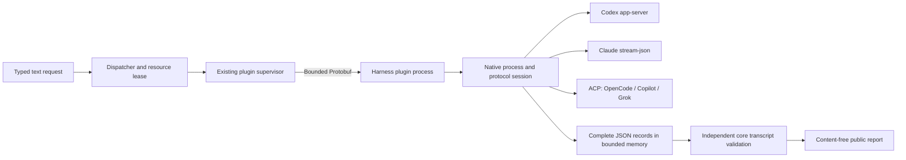

# ADR 023: Bounded Native Harness Request Dispatch

## Context

ADR 013 already selects a Rust 2024 core. The integrated baseline `6498e6a`
contains a canonical domain, a single SQLite writer, local control IPC, an A2A
information-sharing experiment, and the M4.1 plugin supervisor. None of those
components understands complete native harness streams or routes a typed text
request through a real vendor protocol.

The first target is Windows without WSL. The five priority harnesses are Codex,
Claude Code, OpenCode, GitHub Copilot CLI, and Grok Build. Their terminal UIs are
not protocol interfaces. An agent output, an OS process exit, and completion of
a canonical VibeMux task are different facts.

## Decision

Add `vibemux_harness` as a bounded, standalone integration slice. Keep the
existing Rust core, Protobuf plugin protocol, supervisor, and Python reference.
Do not create a second database writer or replace the daemon control protocol.

Responsibilities are separated into `contract`, `config`, `json_lines`,
`normalize`, `session`, `process`, `native`, `plugin`, and `dispatch` modules.
The session state machine has no process or filesystem side effects. Native
process ownership and protocol framing are separate from observations.

### Request and observation contracts

`Request` v1 contains a UUID, a harness selector, and a text prompt. It cannot
select an executable, inject an environment, provide a shell command, or choose
an arbitrary RPC method. Configuration belongs to the trusted local operator.

`Record` preserves each complete stdout JSON payload exactly, including unknown
fields, whitespace inside the payload, and escaped Unicode. Line delimiters
are framing and are not retained. Unknown vendor messages remain `opaque`.
Invalid UTF-8, invalid JSON, unsupported correlation, and limit violations are
explicit failures; no invalid record is silently treated as a successful run.

Public output contains record kind, sequence, byte counts, fixed error codes,
and terminal evidence. It does not contain prompts, vendor text, tool arguments,
paths, environment values, or stderr text. Raw records are available to trusted
library callers and cross the private local plugin pipe, never a public report.
Stderr is continuously drained and counted without retaining its content.

### Protocol ownership

- Codex uses `initialize`, `initialized`, `thread/start`, and `turn/start` over
  app-server stdio. Replies and turn IDs must match; completion comes from the
  matching `turn/completed` notification. `codex exec --json` is also supported
  as a one-shot text-input adapter.
- Claude uses the SDK control initialization and a structured user message over
  stream-json. The current execution profile is bare mode, with no tools and
  `dontAsk`; root results and nested agent results are kept distinct.
- OpenCode, Copilot, and Grok use ACP initialization and session/prompt control.
  Filesystem and terminal client capabilities are false. Permission requests
  are denied, not converted into local execution.
- Direct OpenCode, Copilot, and Grok JSON output can be replayed. Unsupported
  semantic variants remain opaque. OpenCode step completion is not whole-task
  completion. Direct Copilot/Grok event semantics are not invented.

`completed` requires correlated terminal protocol evidence and successful native
process termination. The core independently replays the transcript rather than
trusting a plugin's completion claim. Missing terminal evidence is `unverified`.
An ACP token limit or refusal is not a successful requested outcome.

### Limits, cancellation, and ownership

Defaults are 128 KiB per native JSON frame, 16 MiB of captured JSON per request,
16,384 records, queue capacity 16, four global requests, a 60-second request
deadline, and a two-second shutdown grace. Hard ceilings are validated before
launch. The trace cap is not a claim about total process RSS.

Only one executing request may lease a canonical working directory within one
dispatcher. UUID history is bounded and refuses additional requests when full.
This is local duplicate suppression, not durable or distributed exactly-once
execution. Another process does not share these leases.

Cancellation interrupts blocked reads, stdin writes, and full event queues.
Protocol cancellation drains trailing records within a grace deadline. A
Windows Job Object owns native descendants before the user prompt is sent;
POSIX uses a process group. A pending stdin read cannot hold plugin exit open
indefinitely. Native Windows launchers must resolve to `.exe`; npm `.cmd` and
PowerShell shims are not executed.

The configuration's SHA-256 is computed from the same bytes that are validated.
The plugin checks that digest before activation. Changing the file requires a
new dispatcher, preventing stale resource leases from launching a changed route.

## Consequences

This provides an inspectable local request-to-stream-to-report core and real
native initialization checks. It is not daemon registry integration, canonical
Task/Run mutation, durable stream replay, a general RPC proxy, multimodal input,
multi-turn resume, approval execution, a terminal host, or remote A2A task routing.

Executable configuration is trusted code. A Job Object controls lifetime, not
filesystem or network authority. Assignment occurs after process creation and
before prompt delivery; it is not atomic startup containment. Agent-internal
permissions and hooks are not replaced by client capability flags. Untrusted
workloads still require a separately approved sandbox backend.

As observed on 2026-08-27, four installed native harnesses initialized and exited
cleanly. Grok's observed shutdown did not satisfy the deadline and remains a
failed live check. Real model generation was not authorized or executed by this
slice's validation. Synthetic process tests are not vendor inference evidence.

## Alternatives

- Rewrite the core in Go: rejected because it discards the existing Rust
  ownership and protocol investment without measured benefit for this slice.
- Parse PTY text: rejected because terminal presentation cannot prove protocol
  correlation, permissions, or task completion.
- Share vendor or Python databases: rejected because writable state must retain
  one owner and explicit interfaces.
- Implement every native event as a closed schema: rejected because additive
  vendor events would cause information loss or unnecessary incompatibility.
- Start with network A2A and automatic retries: deferred until durable attempt
  ownership, cancellation, and canonical-state transitions are defined.

Rust remains the selected foundation for ownership and portability. No claim
that it outperforms Go or Python on this workload is made without a benchmark.

## Compatibility and Rollback

The new crate is additive; existing daemon IPC, database formats, and Python
contracts are unchanged. Plugin wire version remains v1 with `harness:probe`,
`harness:execute`, and `harness:record` method/event names. Disable the local
routes or stop using the new CLI to roll back; there is no database migration.

## Sources

Native protocol details were checked against the installed CLI help and primary
sources: [Codex app-server](https://learn.chatgpt.com/docs/app-server),
[Claude programmatic use](https://code.claude.com/docs/en/headless),
[Claude SDK control source](https://github.com/anthropics/claude-agent-sdk-python/blob/main/src/claude_agent_sdk/_internal/query.py),
[ACP schema](https://github.com/agentclientprotocol/agent-client-protocol/blob/main/schema/v1/schema.json),
[OpenCode CLI](https://opencode.ai/docs/cli/),
[Copilot CLI reference](https://docs.github.com/en/copilot/reference/copilot-cli-reference/cli-command-reference),
and [Grok scripting](https://docs.x.ai/build/cli/headless-scripting).
