# Native harness conversation M1: acceptance record

Status: **M1 implementation fixture-verified; acceptance PARTIAL**. Native
Windows process/window creation passed. Native interaction and real vendor
inference remain unverified, and the dependency gates below are not all green.
This record distinguishes
source inspection, automated fixture/local-daemon checks, native Windows UI
interaction, and real vendor inference. An unexecuted gate is `UNVERIFIED`;
source code or a passing fixture is not live qualification.

## Source identity

- Requested repository: `YueDongSun/vibemux`.
- Inspected main baseline: `617bb1feb0617fe771e3b0226a22534be29c884a`.
- Conversational UI baseline: `617bb1f`; PR #48 merge: `5c11231`.
- The coordinating checkout initially had a clean but divergent older branch
  at `ef1cb0a`, including separate runtime-owner planning work and lacking the
  desktop/client integration. The observed GitHub main ref still matched
  `617bb1f`. This task uses isolated worktrees from that main baseline and
  preserves the original checkout.
- Current baseline Control version: 10; Ask operation minimum: 5. Current
  store schema: 9. M1 requires no Control or persistence version change.

## Implemented, planned and missing at intake

The following table records the inspected baseline; it does not rewrite older
implementation evidence as evidence for the M1 changes.

| Area | Existing symbols and behavior | Missing at the baseline / M1 responsibility |
|---|---|---|
| Browser conversations | `vibemux_chat/web/src/app.svelte`, `services/provider.js`, `services/chat_store.js`; both presentations share browser state and the fixed direct Anthropic API. | Native execution, canonical identities and consent are absent; appearance does not select a backend. |
| Shared Ask | `vibemux_client::ask::worker::spawn_ask`, `session::drive`, `ReplyText`, `DaemonSession`; real authenticated one-shot client. | Caller-reserved request ID, retained admission/status metadata and separate observer/output/canonical facts. |
| Desktop commands | `commands::{settings_get,settings_set,about_info}` work; project/lifecycle/Ask wrappers return `not_implemented`. | Complete only the project-to-Ask journey; keep unrelated unfinished actions disabled. |
| Desktop ownership | `app_state::AppState` holds settings and `EventSink`. | Project identity registry, consent enforcement, atomic submission bindings, continuous collectors, bounded snapshots and shutdown. |
| TypeScript bridge | `Backend.invoke<T>(CommandName, Record<string, unknown>)` restricts names. | Per-command argument/result contracts and matching Rust invoke serialization. |
| Daemon dispatch | `control_harness_dispatch`, `HarnessDispatchReceipt`, authenticated `ControlClient` methods, `HarnessDispatchService` and writer admission. | Preserve existing request/Task/Run correlation, admission, paging, cancellation and version minimum. No new listener or generic proxy. |
| Metadata loss | Baseline `DispatchPort::submit` returns only `NativeProtocol`; `AttemptStatus` keeps only phase/error. | Preserve allowlisted receipt/status instead of synthesizing canonical IDs. |
| Profiles | `ProtocolSession::receive_initialize_result` starts ephemeral Codex read-only threads; `structured_arguments` supplies Claude's tool-free/restricted/no-session-persistence argv without `--bare`. | Keep one-turn profiles intact; persistent or writable behavior remains separate. |
| Output lifetime | `TranscriptStore`, `MAX_RETAINED_TRANSCRIPTS = 4`, `MAX_RETAINED_TRANSCRIPT_BYTES = 64 MiB`; `ReplyText` caps displayed assistant text at 256 KiB. | Desktop bounded display retention is separate from daemon raw-output retention and canonical persistence. |
| DSH | `DshSessionService`, `DshDriver`, `vibemux_harness::dsh` implement an owned long-lived session loop with memory-only records. | No persistent Claude/Codex mapping; no substitute for Ask consent/profile. |
| Standalone harness | `vibemux_harness_native` shares `ProtocolSession` but executes in its own CLI process. | Its output is not canonical daemon Task/Run evidence. |

## Implemented M1 source map

| Source | Changed responsibility / symbols |
|---|---|
| `crates/vibemux_client/src/ask/worker.rs`, `observation.rs` | `spawn_ask_with_id`, `spawn_observer`, `ObservedAskHandle`, `AskAdmission`, `AskCanonicalStatus`, `AskObservation`: stable identity, observation-only attach and separate canonical/observer/output facts; legacy `spawn_ask` remains available. |
| `crates/vibemux_desktop/src/project_registry.rs`, `project_status.rs` | `RegisteredProject::resolve`, `ProjectRegistry`, `SharedProjectServices`: opaque held-identity handles, serialized jobs, safe availability, explicit stopped-state setup. |
| `crates/vibemux_desktop/src/ask_registry.rs` | `AskRegistry::{submit,replay,reconcile,status,reply,cancel,shutdown}`: atomic bindings, continuous collectors, display/replay budgets, ownership-preserving cancellation and shutdown. |
| `crates/vibemux_desktop/src/app_state.rs`, `desktop_settings.rs` | `AppState::{ask_confirm,ask_submit,public_settings}`, `PublicSettings`, `SettingsPatch`: Rust consent/admission orchestration and private/public settings separation. |
| `crates/vibemux_desktop/src/commands.rs`, `command_arguments.rs`, `ui_contract.rs` | Thin fixed handlers, whole-invoke `parse_body`, closed DTOs and content-free revisioned events; `ask_status` optionally reconciles without submitting. |
| `crates/vibemux_desktop/ui/src/lib/{backend,api_client,ui_contract,native_state}.ts` and native Svelte components | `CommandMap`, `EventMap`, `NativeState::{send,refresh,retry_submission,set_presentation}`: typed native calls, safe receipts/drafts, two presentations and reload discovery. |
| `crates/vibemux_chat/web/src/{components/markdown_view.svelte,markdown_presentation.ts}` | Presentation-only sharing with native-safe Markdown/code rendering; browser provider/store/lifecycle remain separate. |
| `crates/vibemux_desktop/build.rs`, `tests/{native_invoke,native_projects,native_asks,native_daemon}.rs` | Common Controls v6 test manifest and command/ownership/native-daemon failure-path evidence. Existing lockdown protections remain tested. |
## Environment and installed protocol observations

Observed on 2026-10-31:

| Item | Observation | Evidence class |
|---|---|---|
| OS | Microsoft Windows 11 Pro Education (localized system caption), version `10.0.26300`, build `26300`, x64 | Read-only host query; no Windows 10 coverage |
| UI toolchain | Frontend verification observed Node `24.19.0` / npm `11.16.0`; package engine remains `22.22.0` | `npm ci` emitted an engine warning; the recorded successful builds/tests do not separately qualify Node 22.22.0 |
| Claude Code | Native executable `2.1.304` | `--version` and `--help`; no inference |
| Codex CLI | Native executable `0.166.0`, resolved through the installed `@openai/codex` package | Version/help and generated app-server schema; no inference |
| Codex schema | `thread/resume` requires `threadId`; turn start requires `threadId` and `input`; completion carries `threadId`/`turn`; interrupt requires `threadId`/`turnId`; approval carries item/thread/turn correlation | Installed-version schema inspection, not live session behavior |
| Desktop/native interaction | No interaction result is inferred from OS/version checks | See matrix |

The schema generator wrote only a task-owned temporary directory; the exact
directory was removed after reading the relevant definitions. No credentials,
user session history or provider configuration were inspected.

Commands executed for these observations (`$codex_exe` denotes the resolved
native image in the installed `@openai/codex-win32-x64` package;
`$claude_exe` denotes the resolved native Claude image):

```powershell
& $codex_exe --version
& $codex_exe app-server --help
& $codex_exe app-server generate-json-schema --help
& $codex_exe app-server generate-json-schema --out $schema_dir
& $claude_exe --version
& $claude_exe --help
Get-CimInstance Win32_OperatingSystem |
  Select-Object Caption,Version,BuildNumber,OSArchitecture
```

All listed CLI invocations exited 0. Schema generation does not start an
app-server session or make a model request. Official current documentation and
installed-version differences are recorded in
[ADR 057](../adr/057_persistent_harness_sessions.md).

## Boundary and failure cases

| Threat or failure | M1 control and required evidence |
|---|---|
| Forged path/handle or replaced directory | Rust resolves a registered handle through canonical project rules and held identity; unknown/missing/changed identity refuses before lifecycle or submit. |
| Forged settings consent | Public settings projection excludes paths/receipts; unknown patch fields refuse; consent is recorded only by the explicit Rust command. |
| Duplicate/lost renderer acknowledgement | Atomic fixed submission binding and a separate finite tombstone budget; uncertain delivery reconciles the original dispatch ID. |
| External active work during setup | Existing config is checked before the helper; setup requires the daemon stopped. Explicit operator lifecycle decisions and daemon reservations remain authoritative. This is not a new global cross-client lock. |
| Frozen/hidden renderer or saturated channel | Rust-owned collector drains continuously; snapshots/events are bounded and revisioned; shutdown closes receivers outside registry locks. |
| Malicious Markdown/model output | No executable HTML/SVG preview or renderer filesystem/shell/HTTP authority; escaping/sanitization, navigation/CSP and exact command permissions stay in force. |
| Lost output, IPC or process evidence | Canonical outcome, observer state and output completeness remain separate; no fabricated terminal success or cancel. |

The acceptance matrix below must include the corresponding failure paths.
## Acceptance matrix

`PASS` means the named evidence covers the stated check. `FAIL` means the check
ran and did not meet its assertion. `UNVERIFIED` means evidence is missing,
incomplete, or from a different environment. The Windows 10 and 11 columns
refer to native interaction/live checks, not merely OS-neutral unit tests.

| ID | Requirement | Automated/local-daemon evidence on Windows 11 build 26300 | Windows 11 interaction/vendor | Windows 10 interaction/vendor |
|---|---|---|---|---|
| M1-01 | Project identity, aliases, missing folders, Unicode, forged paths | PASS for `native_projects` identity/alias/replacement/forged-handle tests and Unicode/spaced `native_daemon` paths. Cross-drive/junction and native picker interaction remain UNVERIFIED. | UNVERIFIED | UNVERIFIED |
| M1-02 | Same route/Ask in both styles; no native direct-API fallback | PASS: native state side-effect tests and production asset guard; both layouts consume one native state model. | UNVERIFIED | UNVERIFIED |
| M1-03 | Explicit setup only; preserve configuration and active ownership | PASS: no-implicit-setup/selection checks, existing-config refusal before probe/restart and per-project ownership tests. Actual native setup UI remains UNVERIFIED. | UNVERIFIED | UNVERIFIED |
| M1-04 | Consent, registration and route gates enforced in Rust | PASS: project/registry tests, real Tauri invoke and local-daemon pre-consent refusal. | UNVERIFIED | UNVERIFIED |
| M1-05 | Prompt/ID/unknown-field and escaped-frame boundaries | PASS: real invoke/input tests, Rust UTF-8/double-escaped frame limits and Control integration. | UNVERIFIED | UNVERIFIED |
| M1-06 | One canonical attempt with matching request/Task/Run | PASS: `native_daemon` confirms canonical IDs/outcomes and one attempt per accepted send under duplicate invokes. Synthetic vendors only. | UNVERIFIED | UNVERIFIED |
| M1-07 | Duplicate invokes, lost acknowledgements, changed reuse and display eviction | PASS: 20 registry tests include concurrent preflight duplicates, changed binding, lost acknowledgement, dedup capacity, eviction and uncertainty; real daemon duplicate test also passes. | UNVERIFIED | UNVERIFIED |
| M1-08 | Async draft safety, unsupported files and IME | PASS: native state/composer tests plus browser regression suite. Actual Chinese IME interaction remains UNVERIFIED. | UNVERIFIED | UNVERIFIED |
| M1-09 | Fragmented JSON/UTF-8/CRLF, missed events and stale snapshots | PASS: shared client reducer/session tests, Control output-page integration and stale/replacement snapshot tests. | UNVERIFIED | UNVERIFIED |
| M1-10 | Collector independence across hide/minimize/switch/reload | PASS: capacity-one burst without renderer polling, bounded terminal-channel shutdown and reload read/reconcile tests. Actual minimize/hide/WebView2 reload interaction remains UNVERIFIED. | UNVERIFIED | UNVERIFIED |
| M1-11 | Cancel before admission, during streaming and at completion | PASS: registry pre-admission/completion-race tests, authenticated native cancel and daemon protocol cancellation tests. | UNVERIFIED | UNVERIFIED |
| M1-12 | Restart/generation/recovery/output-unavailable and no replay | PASS: observer-only reconciliation, preserved unavailable output/identity, recovery ownership and daemon restart tests. | UNVERIFIED | UNVERIFIED |
| M1-13 | Protocol terminal evidence; partial text/EOF/kill/nonzero never imply success | PASS: shared client/daemon protocol failures, deadlines, forced cleanup and synthetic failed-outcome tests. | UNVERIFIED | UNVERIFIED |
| M1-14 | Native executable trust; prompt metacharacters stay data | PASS: canonical executable/linked-target refusal tests and native Unicode/spaced fixture execution with metacharacter prompt. Real vendor profile qualification remains UNVERIFIED. | UNVERIFIED | UNVERIFIED |
| M1-15 | IPC ACL/token/descriptor, process descendants/deadlines/shutdown ownership | PASS: 22 Control unit tests, 26 dispatch/Control integration tests and 7 native process-tree tests, including descendant/owner-death/no-breakaway cases. An injected Windows ACL-failure scenario remains UNVERIFIED. | UNVERIFIED | UNVERIFIED |
| M1-16 | Hostile rendering/navigation/postMessage; status/event/log privacy | PASS for parser/presentation, invoke, content-free metadata and 9 lockdown tests. Mounted WebView2 sanitizer/navigation/postMessage exercise remains UNVERIFIED. | UNVERIFIED | UNVERIFIED |
| M1-17 | Browser, egui/TUI/shared-client compatibility; monitor read-only | PASS: browser 67 tests/build, client GUI-independence test and existing frontend dependency compilation. Frontend all-target/all-feature check also passes; no monitor mutation added. | UNVERIFIED | UNVERIFIED |
| M1-18 | WebView2 keyboard/focus/Chinese IME/copy/DPI/theme/layout | UNVERIFIED for interaction. Process/window creation PASS (`VibeMux` window), which does not establish these interactions. | UNVERIFIED | UNVERIFIED |
| M1-19 | Production bundle excludes fixtures/fake completions/fallbacks | PASS: final desktop production build and asset guard, within the 16-test UI suite. | UNVERIFIED | UNVERIFIED |
| M1-20 | Authorized real Claude and Codex smokes with correlated outcomes | UNVERIFIED: no real inference. Synthetic fixtures cannot satisfy this row. | UNVERIFIED | UNVERIFIED |

The automated column states bounded coverage, not completion of every native
interaction. The two right columns track actual interactive/vendor checks;
all tests above ran on Windows 11, and no Windows 10 execution is claimed.
A `PASS` for controlled synthetic processes never becomes real inference proof.
## Verification commands and results

The following parent-executed results are available for the integrated candidate.
The final UI run includes the optional observation-only reconciliation argument.
Cargo runs use the checked-in toolchain with a process-local C: target directory
after the initial I: compiler-output failure described below.

| Command | Observed result | Scope |
|---|---|---|
| `cargo build -p vibemuxd --features test_helpers --bin vibemux_native_fixture --bin vibemux_launch_trampoline` | PASS, 73 s | Builds the contained synthetic vendor and launch trampoline; no model inference. |
| `cargo test -p vibemux_desktop --test native_daemon -- --ignored --nocapture` | PASS, 1 test, 3.29 s | Actual authenticated temporary Control daemon, writer and contained synthetic Claude/Codex profiles; canonical correlation, concurrent duplicate invoke, consent refusal, no implicit setup, unchanged config, explicit cancellation, failed vendor outcome and owned shutdown. |
| `cargo test -p vibemux_desktop --test native_projects --test native_invoke` | Initial narrow targets: PASS, 2 project tests and 1 invoke test after the loader repair; the invoke target was also rerun with `-- --nocapture`. | Real Tauri invoke deserialization and project-handle/settings tests. Not rendered WebView2 interaction. Final expanded counts are in the combined suite below. |
| Desktop UI: `npm ci`, `npm run typecheck`, `npm run build`, `npm test` | PASS; final typecheck 0 errors/0 warnings; 16 tests | Final UI code includes observation-only reload/Refresh reconciliation. The earlier pre-reconciliation run passed 15 tests. |
| `cargo fmt --all -- --check` | PASS | Workspace formatting. |
| `cargo test -p vibemux_desktop -p vibemux_client --all-features --locked --offline` | PASS, 147 tests; 1 explicit native-daemon test ignored in this general run and executed separately above | Client: 87 unit, 4 daemon-feed, 1 GUI-independence. Desktop: 15 unit, 9 lockdown, 20 registry, 2 invoke/input, 9 project. |
| `cargo test -p vibemuxd --features test_helpers --test harness_dispatch --test control_harness_dispatch --locked --offline` | PASS, 26 tests (23 dispatch + 3 Control integration) | Real contained fixtures: admission/idempotency, output paging, cancellation, restart, protocol evidence, executable trust and process teardown. |
| `cargo test -p vibemux_store --test harness_dispatch --all-features --locked --offline` | PASS, 18 tests | Actual store dispatch integration, including admission/idempotency and canonical state integrity. |
| `cargo test -p vibemux_platform --test process_tree --all-features --locked --offline` | PASS, 7 tests | Native Windows Job Object children, termination/drop, owner death and no-breakaway cases. |
| `cargo test -p vibemuxd --lib control::tests --all-features --locked --offline` | PASS, 22 tests | Control library tests; separate from the 3 Control dispatch integration tests above. |
| `cargo clippy -p vibemux_desktop -p vibemux_client --all-targets --all-features --locked --offline -- -D warnings` | PASS, final run 18.31 s | All targets/features of the affected desktop and shared-client packages. |
| `cargo build -p vibemux_desktop -p vibemux_cli -p vibemuxd --bin vibemux_desktop --bin vibemuxctl --bin vibemuxd --bin vibemux_launch_trampoline --locked --offline` | PASS, 1 m 57 s | Normal production binary profile, including compilation of existing egui/TUI dependencies. Final rebuild after current UI assets also PASS, 14.22 s. |
| `cargo check -p vibemux_frontend --all-targets --all-features --locked --offline` | PASS, 40.48 s | Existing egui/TUI consumers compile with all their targets/features. |
| `cargo test -p vibemux_desktop --test native_daemon --locked --offline -- --ignored --nocapture` | Final PASS, 1 test, 3.13 s | Final integrated native authenticated-daemon check after the last repairs. |
| `Start-Process -FilePath <built target>/debug/vibemux_desktop.exe` | PASS: process alive with `MainWindowTitle = VibeMux` and a nonzero main window handle | Native Windows process/window creation only. No screenshot, DOM, keyboard, IME or DPI check. |
| Browser UI: `npm ci`, `npm test`, `npm run build` | PASS, 67 tests | Existing browser-local history/provider/attachment behavior and shared presentation compatibility. |
| `cargo deny --version`; `cargo audit --version` | UNAVAILABLE: each reports no such Cargo command | Neither tool was installed or its policy check executed by this task; no passing dependency-gate claim. |
| Desktop UI: `npm audit --audit-level=low` | FAIL: 2 low-severity findings | Existing `deepmerge` 4.3.1 in the Vite plugin chain; the baseline and candidate lockfiles retain that version. The severity threshold was not weakened. |
| Independent source review | PASS after 8 actionable findings/races were repaired | Native Sol/max source review of the candidate; separate from Pro/browser review, tests and native interaction. |

The npm failure maps to
[GHSA-gcqx-w48m-w2h4](https://github.com/advisories/GHSA-gcqx-w48m-w2h4),
which lists `deepmerge` 4.2.0–4.3.1 as affected and no patched version when
checked on 2026-10-31. This is retained as an unresolved baseline dependency
gate, not relabeled as a pass or an accepted exception.

The native daemon test uses a task-owned temporary runtime location, spaced/CJK
project and vendor paths, the original one-shot launch profiles and ordinary
`ControlClient` reads. It observes two canonical tasks for two accepted sends,
not two per duplicate invocation. It never substitutes fixture outcomes for
real vendor qualification. The existing `#[ignore]` on that explicit native
test was overridden by `--ignored`; the listed run actually executed it.

### Recorded failures and repairs

1. The initial Rust build targeting the I: output directory failed with MSVC
   `D8050`. A Developer PowerShell/DevShell attempt did not resolve it. Building
   the same source with unchanged compiler flags in a C: target directory
   succeeded. No global compiler, permission or storage setting was changed.
2. The initial real Tauri invoke test exited with loader status `0xc0000139`.
   The missing entry point was reproduced as `TaskDialogIndirect` with
   `comctl32` v5. The desktop build script now embeds the Common Controls v6
   manifest for test executables, and the same invoke check passes. The failure
   remains part of this evidence; it was not a passing test before repair.
3. An attempted extra trampoline `Copy-Item` refused because the source and
   target were already the same file. The required trampoline was already
   available beside the test executable; the acceptance run needed no copy.
4. The shared client's legacy reset regression first observed zero daemon
   cancellations after `cancel()` followed by dropping the handle. Separating
   the legacy and native drop policies made the same test observe one submit
   and one cancellation. Native observer stop/join remains independently tested.
5. The desktop registry suite first lost a previously confirmed admission
   sequence on observation-only reconnect (`None` instead of `Some(17)`).
   Retaining the prior receipt metadata repaired that assertion.
6. A shutdown regression first retained one unresolved Ask with zero observer
   attachments and zero cancellation requests when the old collector was still
   finishing. Bounded reconciliation now attaches at most once after ownership
   is released. The unchanged assertion passes in the final 20-case suite.

Independent review also identified the initial-submitter ownership gap,
recovery after webview reload, shorter replacement snapshots, finished-handle
retention and stale project handles after Forget. The final source review
closed these findings, and focused tests cover the resulting boundaries.

The final desktop process was created at `2026-10-31T07:52:03.9864434Z`
(15:52:03 on 2026-10-31 in Asia/Shanghai). Its launch PID was 117720; that
is historical launch evidence, not permission to signal a later process with
the same PID. The task-owned preview was left running for the operator.
A later read-only check confirmed that same process and `VibeMux` window were
still alive. Startup stderr contained a nonfatal default-window-icon resource
warning; icon rendering was not visually verified.
No workspace-wide test/Clippy/nextest or Linux/WSL result is claimed beyond
the exact affected-package commands above.

The native Chrome backend could not initialize because its launcher returned
host I/O error 1117. No Pro prompt or material was submitted (0 of 10 rounds),
and no desktop-input or WebView2 interaction check ran. No real vendor inference
was executed. Native source review does not substitute for those checks.

## Remaining gates and smallest next steps

- Native Windows interaction: exercise project picker, both layouts, focus,
  keyboard/Chinese IME, Enter/newline, copy, cancellation, minimize/reload,
  DPI and themes against the running local build. Record actual WebView2 and
  OS versions. Windows 10 needs its own host; Windows 11 evidence does not
  establish it. Cross-drive/junction project cases and an injected Windows
  ACL-failure scenario remain explicitly unverified.
- Real inference: obtain explicit authority for one bounded Claude and one
  bounded Codex smoke, then record the exact configured CLI versions and
  canonical correlation. Missing credentials or authority stays `UNVERIFIED`.
- Dependency checks: run Cargo deny/audit in an environment with those tools
  available. Resolve the existing deepmerge advisory through a supported
  upstream fix or a separately reviewed dependency change; do not lower the
  npm audit threshold or turn the failure into an unreviewed exception.
- Pro/browser review: retry only when the native browser backend is available.
  No review round was submitted; the independent native Sol source review is
  recorded separately and does not claim that Pro ran.
- Broader release coverage: use repository CI for the remaining workspace and
  Linux gates. No push, CI publication or release occurred in this task.
- Persistent sessions: ADR 057 is a completed proposal, not implemented runtime
  support. Its staged acceptance and unresolved writable Run/worktree mapping
  require a separate accepted implementation scope.

## 2026-11-01 continuation evidence

The broader desktop goal continued from the M1 candidate on `617bb1f`.
The entries above retain the original observations. This section records
subsequent implementation and qualification separately.

The two authorized one-turn model calls were consumed on 2026-10-31, each
with a 60-second deadline and the fixed prompt `Reply exactly VIBEMUX_SMOKE_OK`.
Codex CLI 0.166.0 returned that token, with a matching completed canonical
Task/Run. Claude Code 2.1.304 was admitted and ended with
`harness_process_failed`. Its output was complete but did not match the token.
The temporary daemon stopped and its project was removed. These calls did
not exercise the persistent profile. Additional persistent-vendor inference
has not run.

The candidate now contains a separate persistent protocol/runtime, store
schema 10, protected private bodies, Control v11, typed desktop commands and
identity-bound persistence consent. The native Tasks and Console surfaces
are mounted. The persistent chat UI is undergoing integration and verification.

Executed on native Windows with Rust 1.92.0 and locked offline dependencies:

| Command | Observed result |
|---|---|
| `cargo test -p vibemux_store --test chat --locked --offline` | 33 passed, including close-ID reservation and cross-Ask collisions |
| `cargo test -p vibemuxd --lib chat_writer --all-features --locked --offline` | 4 passed, including reopen, purged replay and private cleanup recovery |
| `cargo test -p vibemuxd --lib chat_session --all-features --locked --offline -- --test-threads=2` | 44 passed, 2 explicit native fixture tests ignored in this invocation |
| `cargo test -p vibemuxd --test persistent_chat_service --features test_helpers --locked --offline` | 3 passed, including repeated turns, exact resume, reopened history, Control paging/purge replay and cancelled shutdown observers |
| `cargo test -p vibemux_desktop --lib chat_bridge --locked --offline -- --ignored` | 1 passed through an authenticated temporary daemon and contained synthetic Codex process |
| `cargo test -p vibemux_desktop --all-features --locked --offline` | 64 passed, 2 explicit native acceptance tests ignored in this invocation |
| `cargo test -p vibemuxd --lib control::chat_ops --all-features --locked --offline` | 1 passed for authentication, v11 gating, strict arguments and read-only listing |
| `cargo test -p vibemuxd --lib --all-features --locked --offline -- --test-threads=2` | 189 passed, 1 failed, 2 ignored. The failure identified stale v10 prose in `docs/protocol_boundaries.md` |
| `cargo test -p vibemuxd --lib control::tests::protocol_boundaries_ipc_bullet_states_every_accepted_version --all-features --locked --offline` | Passed after the documentation was updated to v11 |
| `cargo clippy -p vibemuxd -p vibemux_store -p vibemux_types -p vibemux_harness -p vibemux_desktop --all-targets --all-features --locked --offline -- -D warnings` | Passed after the close-reservation and bridge-size additions |
| `cargo test -p vibemux_store --test harness_dispatch --locked --offline` | 18 existing one-turn Ask store tests passed after reciprocal chat-operation ID checks |
| `cargo build -p vibemux_desktop -p vibemuxd -p vibemux_cli --locked --offline` | Passed for the integrated persistent UI candidate before its review repairs |
| `python scripts/check_public_artifacts.py` | 769 publishable text files checked, zero findings and 18 existing reviewed negative fixtures |

The mounted read-view UI passed `npm run typecheck`, `npm run build`, and
`npm test` with 38 tests. The first integrated persistent-chat UI candidate
then passed all three checks with 44 tests. Source review found asynchronous
readiness, selection, recovery and chat-discovery gaps that those fixtures
did not cover. Their repairs and regression checks were completed in the
final 53-test candidate described below. The first green UI result alone
did not establish persistent UI acceptance.

Independent Sol review identified a rejected Close that could stop an owner
before detecting reuse of a turn UUID. The service regression reproduced
`Closed` where `Ready` was required. The repair reserves the operation through
the single writer before teardown, and the regression now passes. The scoped
source re-review returned PASS. The test checks retained Ready state after
rejection and later explicit close/resume, rather than an additional send
on the original owner immediately after rejection.

The final UI repair passed typechecking with zero errors/warnings, a fresh
production build, and 53 tests in the integration checkout. Independent Sol
source re-review passed for the backend and repaired UI. The Windows executable
was rebuilt with these assets on 2026-11-01.

### Approved native interaction check

On Windows 11 build 26300, the rebuilt WebView2 app rendered its native shell.
The operator authorized the bounded mouse/keyboard check. Navigation through
Settings, Tasks, Console, Chats and Independent Ask worked. The theme changed
from Light to Dark and was restored to Light. Escape dismissed Settings and
visually restored focus to its opener.

The native folder picker registered this task's integration worktree. Its
daemon was stopped, which the UI reported as `daemon_not_running`.
The persistent composer accepted `Native draft check 中文输入测试`, displayed
37 UTF-8 bytes, and retained the text across a switch to Independent Ask and
back. The Independent Ask draft was empty. The test draft was then cleared
and the composer returned to zero bytes. Send remained disabled. No inference
consent, daemon start, route setup, or Send action occurred during this check.
The task-built window remains open with the integration worktree selected.

This check establishes the observed navigation, theme, focus and bilingual
text-entry behavior. Chinese IME composition, DPI variants, saved-history
interaction against a running vendor, Windows 10, Linux/WSL, hosted CI and
complete dependency audits remain open. Startup stderr still reports a
nonfatal default-window-icon resource warning.

## Text attachments and persistent vendor qualification

The 2026-11-01 attachment continuation added the native file-picker command,
bounded UTF-8 snapshots, per-chat attachment drafts, literal previews/removal,
the versioned prompt envelope and exact-payload uncertain retry handling.
OpenCode supplied the attachment documentation draft, and the parent integrated
it against the final behavior. A proposed writable-owner contract is recorded
in ADR 058.

Executed on this native Windows 11 build 26300 host with the locked repository
Rust toolchain and existing Node runtime.

| Command | Result |
|---|---|
| `node --experimental-strip-types --test --test-name-pattern='file snapshots stay' tests/chat_state_test.ts` | Failed before controller integration because `pick_files` was absent |
| `npm run typecheck`, `npm run build`, `npm test` in desktop UI | Zero typecheck errors/warnings, successful production build, 64 tests passed |
| `cargo test -p vibemux_client --lib text_attachment --all-features --locked --offline` | Four passed, including immutable capture, size/UTF-8 validation and junction-ancestor refusal |
| Junction regression before repair, outside sandbox | Reproduced an accepted file under a junction where `InvalidFile` was required |
| `cargo test -p vibemux_desktop --test native_invoke --locked --offline` | Two passed, including refusal of renderer-supplied file paths and fixed command/ACL agreement |
| `cargo test -p vibemux_harness chat_session --locked --offline` | 38 passed after the Codex resume-order regression was repaired |
| `cargo fmt --all -- --check` | Passed |
| `cargo clippy -p vibemux_client -p vibemux_desktop -p vibemux_harness -p vibemuxd --all-targets --all-features --locked --offline -- -D warnings` | Passed |

The junction fixture was blocked in the sandbox, then ran outside it. An open
task-owned preview locked the desktop executable during the first native invoke
build. The parent verified its exact executable/start identity, stopped it and
reran the check successfully. A scratch probe build hit a sandbox `protoc` DLL
relocation failure and built successfully outside the sandbox.

### Six-turn live allowance

The operator approved at most three synthetic turns for each pinned vendor,
with a 60-second per-turn deadline in an isolated temporary Git repository.
Six turns were attempted, and the temporary daemon was stopped after each
diagnostic phase. The earlier two one-turn smoke calls remain separate.

Codex 0.166.0 completed its first two turns and recalled the synthetic code.
Resume after restart first reached `Suspended`. A handshake-only diagnostic
sent zero turns and identified `UncorrelatedSession` on
`thread/status/changed` before the `thread/resume` response. The pure-machine
regression reproduced this failure. The repair validates an early notification's
expected thread and leaves readiness to the response's existing policy and
identity checks. Independent source review passed. The third authorized turn
then completed after restart and recalled the same code, with matching
canonical IDs, a correlated terminal and complete output.

Claude Code 2.1.304 used three attempts. The first temporary route omitted the
host's authentication/provider environment references. A non-inference auth
status check reported authenticated under the normal environment and
unauthenticated under the probe's restricted environment. The corrected
temporary route passed only the existing configured variable names through the
native launch owner. No credential value was printed or stored in the evidence.
The next two attempts failed `UnsafeProfile` at the root initialization frame.
Content-free diagnostics showed matching cwd, empty tools, empty MCP servers,
and `dontAsk`; the plugin field failed the absent-or-empty check. The strict
profile guard remains enforced. Claude follow-up and restart-resume are open.

Temporary diagnostic statements were removed after capturing these categories.
The live Codex result covers this version/profile, synthetic context retention,
and restart-resume. Live cancellation, parallel-vendor operation, Claude
persistence, Windows 10 and full S5 remain unverified.

### Attachment review boundary

Independent source review passed the UI snapshot, selection, retry and literal
display paths. The native reader rejects observed reparse points and holds
directory handles against ancestor rename/replacement during the read. A
hostile in-place reparse mutation through a separately writable directory
handle was identified as an unverified race case. The implementation and guide
describe the narrower verified behavior. File capture is bounded but does not
establish an atomic filesystem snapshot during concurrent writes.

### Native attachment interaction

The operator approved the bounded picker/preview/navigation/removal sequence.
The rebuilt Windows app opened its native file dialog and selected the
task-created `attachment_ui_sample.txt`. It displayed 64 UTF-8 bytes, showed
Chinese characters and `<script>literal text</script>` literally in the preview,
and retained the file across Independent Ask and back. Removing it returned
the composer to zero files and zero bytes. Send remained disabled. No consent,
daemon start or inference action occurred in this UI check.

The native launcher failed to initialize its window observer twice. A supervised
launch of the same rebuilt executable succeeded. Accessibility text was
unavailable, so the approved actions used fresh window screenshots and verified
their visible results. The task-built preview remains open after clearing the
fixture from its draft.

### Claude v2 resolution

The operator then approved four additional Claude-only turns, each with the
same 60-second bound. The first established that safe mode still reports
`cc-plugin-agents-md`, `cc-plugin-telemetry` and
`cc-plugin-plugin-authoring` as builtins. Installed CLI help, supported plugin
details, and a scoped inspection of its initialization serializer supported
the builtin-source distinction. The v2 validator admits only those exact names
with matching `name@builtin` sources on CLI 2.1.304, with a three-entry bound
and duplicate refusal. Empty tools/MCP, `dontAsk`, cwd, model and correlation
checks remain enforced. Independent source review passed.

The next three turns all completed. Claude remembered the synthetic code on
the follow-up and again after closing the process, restarting the daemon and
resuming the same chat in a new generation. Every result had matching canonical
Task/Run/turn/request identities, a correlated terminal and complete retained
output. Ten persistent attempts were consumed across the six-turn and four-turn
allowances. The temporary daemon stopped successfully. Prior failures remain
recorded above.

The final pure protocol suite passed 39 tests, including the builtin-source,
version, duplicate and effective-tool negative cases. The persistent launch
profile suite passed two tests after its missing-safe-mode regression first
failed. Claude v2 uses a distinct profile fingerprint; retained v1 records stay
readable and cannot silently resume with the changed profile. Default setup's
authentication/provider reference repair has its own regression. Temporary
plugin diagnostics were removed after qualification.

Final cleanup/verification reran the three persistent-service integration
fixtures successfully. The six route-setup tests passed outside the sandbox
after its temporary config write was denied in the first invocation. The final
UI typecheck/build and 64 tests passed after the setup disclosure update.
Formatting, focused Clippy and the desktop/daemon rebuild passed with diagnostic
statements removed. The public-artifact checker inspected 772 publishable text
files with zero findings and 18 existing reviewed negative fixtures. Its initial
Git ownership failure was resolved through a process-local exact-worktree
`safe.directory` setting.

Native Chrome page reading timed out again before any Pro submission. Independent
scoped source reviews covered the attachment paths, Codex ordering repair,
Claude v2 policy, route setup and ADR 058. The Pro round count remains zero.

## Lifetime owner workspace foundation

The 2026-11-01 continuation implements the ownership/provisioning stage of
ADR 058 on the `codex/native_harness_conversations` working candidate based on
`617bb1f`. Control v12 and store schema 11 are allocated. An owner has one
lifetime canonical Task/Run, a persisted workspace plan, a durable creation
claim and a verified Git ownership receipt. Its admitted tool set is empty.
Desktop owner controls and writable attempts remain open.

Validation ran on native Windows with Rust 1.92.0 and Git
2.51.1.windows.1, using locked offline dependencies and temporary fixture
repositories. The owner-service tests record a vendor-launch sentinel and
verify that provisioning leaves it absent.

| Command | Result |
| --- | --- |
| `cargo test -p vibemux_store --test chat_owner --test chat --locked --offline` | 8 owner tests and 33 historical chat tests passed |
| `cargo test -p vibemux_workspace --locked --offline` | 4 unit and 9 integration tests passed, 1 child fixture ignored by design |
| `cargo test -p vibemuxd --test chat_owner_service --test persistent_chat_service --all-features --locked --offline` | 4 owner and 3 existing persistent-service integration tests passed |
| `cargo test -p vibemuxd --lib --all-features --locked --offline` | Final rerun passed 192 tests, with 2 child fixtures ignored by design |
| `cargo test -p vibemux_workflow -p vibemux_types --lib --all-features --locked --offline` | 154 workflow and 23 domain tests passed |
| `cargo clippy -p vibemuxd -p vibemux_store -p vibemux_types -p vibemux_workspace -p vibemux_workflow --all-targets --all-features --locked --offline -- -D warnings` | Passed |
| `cargo clippy -p vibemuxd --all-targets --all-features --locked --offline -- -D warnings` | Final daemon/test-fixture correction passed |
| `cargo fmt --all -- --check` and `git diff --check` | Passed |
| `python scripts/check_public_artifacts.py` | 780 publishable text files, 0 findings, 18 existing reviewed negative fixtures |

The authenticated tests cover wrong credentials, v11 owner-request refusal,
unknown fields, private status, duplicate Open, receipt reconciliation after
restart, unknown creation claims, foreign-directory retention and candidate
retention after Stop. The store suite covers transactional migration/rollback,
concurrent duplicate admission, idle workspace reservations, generic projection
and A2A guards, and historical read-only isolation.

The first real-Git service run exposed error-code loss at the Control client.
The client collapsed `chat_owner_control_required` into `control_remote_error`.
The correction preserves bounded lowercase `chat_` and `workspace_` codes and
rejects arbitrary text, paths and oversized values. The service rerun passed.

Independent source review found that a Reconcile replay could hit busy or
cleanup prechecks before its durable receipt. The correction checks exact
operation binding first and returns duplicate receipts without spawning another
effect. Replays with changed expected versions conflict. A persisted cleanup
failure keeps fresh reconciliation fenced. The targeted review and integration
regressions passed after the correction.

The first full daemon library run produced 187 passes, 5 failures and 2 ignored
fixtures. One failure was a stale v11 assertion, updated for v12 while preserving
the historical accepted-version checks. Four private-writer tests timed out at
Open using a five-second response budget. Those same compiled tests passed in
isolation in 2.00 seconds. Source inspection found that ACL initialization waits
for the process-wide Windows helper slot before its separate 15-second helper
deadline starts. The four persistence/cleanup fixtures now use the existing
configurable writer constructor with a finite 30-second budget. Their behavior
assertions are retained. Independent review accepted this fixture scope, and
the original full parallel command then passed 192 tests with 2 ignored fixtures.
Exact per-request helper contention timings were not instrumented.

The workspace-manager change came from the supervised Claude CLI worker and
passed parent-run checks after integration. The existing OpenCode MiniMax
session supplied the documentation draft, which the parent checked and shortened
to match the delivered API and verification. Independent source reviews cover
the store/workspace foundation and the daemon/Control integration.

This stage used fixture processes and real temporary Git worktrees. Linux/WSL,
live writable vendor execution, affirmative approvals, success finalization,
full workspace CI, nextest and dependency audits remain unverified for it.
The existing desktop preview still represents the preceding read-only stage.

## Native workspace controls

The subsequent desktop integration adds the Workspaces tab and the 27th fixed
command, `chat_owner_request`. Its strict body contains a registered project
key and the closed owner request. The Rust bridge resolves identity before and
after dispatch, holds the foreground project guard for mutations and performs
authenticated Control calls off the webview thread. The view provides explicit
creation consent, saved-owner/title inspection, receipt reconciliation and Stop
confirmation while the owner tool grant set remains empty.

The supervised Claude CLI worker supplied four isolated UI files. The parent
mounted them in the actual app, integrated the typed command and retained project
selection, refresh, disposal and Forget guards. Independent source review found
and resolved retry-uncertainty, exposed request mutation, removed-project cache,
receipt-correlation and pagination defects. Parent repairs cover both sequential
and overlapping timer/Load More continuation. Refresh and Load More coalesce
their entire list window, and a bounded refresh rereads the loaded pages. The
last targeted source recheck passed.

| Command/check | Result |
| --- | --- |
| `cargo test -p vibemux_desktop --lib --tests --locked --offline` | 64 passed, 3 native acceptance tests ignored in this default invocation |
| `cargo test -p vibemux_desktop --test native_owners --locked --offline -- --ignored` | 1 explicit real-Git desktop bridge acceptance passed |
| `cargo test -p vibemux_desktop --lib desktop_chat_bridge_reaches_authenticated_saved_conversation --locked --offline -- --ignored` | Existing saved-chat bridge acceptance passed after helper extraction |
| `cargo test -p vibemux_cli --test bootstrap_process --features test_helpers --locked --offline` | 5 native process lifecycle tests passed |
| `cargo clippy -p vibemux_desktop -p vibemux_client -p vibemux_cli -p vibemuxd --all-targets --all-features --locked --offline -- -D warnings` | Passed |
| Desktop UI typecheck and production build with explicit Node 22.22.2 | Passed, 0 errors and 0 warnings |
| Full UI suite with explicit Node 22.22.2 | 85 tests passed, including 21 workspace-controller regressions |
| `cargo fmt --all -- --check` and `git diff --check` | Passed |
| `python scripts/check_public_artifacts.py` | 782 publishable text files, 0 findings, 18 reviewed negative fixtures |

The native owner test used a temporary real Git repository and synthetic vendor
image. It verified workspace creation through the registered desktop bridge,
duplicate Open, saved-project reopening, explicit private title reads, retained
candidate files after Stop and an absent vendor-launch sentinel. The main HEAD
and working tree remained intact. It invoked the Rust service path. The separate
mock invoke test exercised actual Tauri request deserialization and rejected
forged paths, tool grants, unsupported owner Send and missing workspace consent.

Lifecycle inspection found that the CLI's five-second post-acknowledgement Stop
wait could expire during the daemon's permitted 600-second provisioning drain.
The shared daemon observation window is now 900 seconds. The CLI uses that
window and the desktop Stop wrapper allows 960 seconds. Start retains its
60-second wrapper. The new test gates the exact fixture process after server
cleanup, advances virtual time by 601 seconds, then releases and verifies actual
process exit. It passed with the corrected budget, reproduced `ShutdownTimeout`
with the original five-second budget, and passed in the final five-test suite
after restoring the correction. The timeout is an observation limit. Untimed
writer joins and DSH input writes remain outside a proven universal drain bound.

The CLI worker's first controller check exposed an unterminated string literal.
The parent located it, the worker corrected it and reran its checks. The parent
then found the remaining pagination continuation and timer-overlap cases,
extended the regressions and reran the integrated typecheck/build/full UI suite.
The earlier green count was 84. The final race regression brings it to 85.

The desktop, daemon and CLI build with locked offline dependencies. The final
desktop build embeds the repaired UI bundle. Native mouse/keyboard interaction
with the new view remains pending explicit bounded desktop-control consent.
Linux/WSL, hosted CI, live writable vendor execution, approvals and success
finalization remain open. This continuation consumed no vendor inference calls.

### Approved native workspace dialog check

The user approved a bounded desktop-input sequence on 2026-11-01. The verified
desktop build was launched as PID 174300 at 06:08:14 local time. The selected
VibeMux project was already registered and its daemon was stopped.

Native screenshots and accessibility observations verified the Workspaces tab,
the creation dialog's initial harness focus, literal `Workspace UI check 中文`
title entry and the two independent consent checkboxes. Create remained disabled
with one consent and became enabled with both. Escape cancelled the dialog and
restored focus to Create. Switching to Independent Ask and back succeeded.
Reopening the dialog showed an empty title and unchecked consents, and the
Cancel button closed it. The sequence ended on Workspaces with the daemon still
stopped. Creation/submission was outside this check. The earlier real-Git fixture
remains the evidence for actual workspace creation and file retention.

The preview remains open for the user. Its binary predates the subsequent
owner-attempt schema work in the source checkout. Further desktop-input
sequences retain the host's explicit-consent requirement.

## Owner-backed attempt persistence

The next increment adds store schema 12 and the daemon's owner-specific private
writer facade. It preserves one canonical owner Task/Run while recording each
submission as a distinct `ChatExecutionAttempt`. The first admission transitions
the owner Run to Running. Attempt completion, interruption and cancellation leave
that lifetime Run nonterminal. Read-only `chat_turns` keep their unique canonical
Task/Run mapping and record foreign keys.

This is persistence and writer evidence. The owner-backed runtime sink, public
submission Control operation and desktop transcript are still open. Control
remains v12, and owner tools remain empty. The current native preview predates
this source increment and has not been replaced.

| Command | Result |
| --- | --- |
| `cargo test -p vibemux_store --test chat_execution --locked --offline` | Initial red run reported the eight missing transaction/read APIs |
| `cargo test -p vibemux_store --all-features --locked --offline` | Final complete run passed 190 tests, including 10 attempt regressions |
| `cargo test -p vibemuxd --lib chat_writer::tests --all-features --locked --offline` | 6 passed, including 2 new owner private-body tests |
| `cargo test -p vibemuxd --lib --all-features --locked --offline` | Final rerun passed 194, with 2 ignored |
| `cargo check -p vibemuxd --all-features --locked --offline` | Passed |
| `cargo clippy -p vibemuxd -p vibemux_store -p vibemux_types --all-targets --all-features --locked --offline -- -D warnings` | Passed on the final loader/concurrency candidate |

The database regressions verify two submissions sharing the same lifetime Run,
one fresh admission across four concurrent exact requests, and one successful
input claim across two contenders. They also cover unsent versus claimed
cancellation, unknown cleanup retaining the process fence and active attempt,
verified cleanup followed by exact resume, old-operation replay returning no new
launch authority, immutable record bindings, contradictory phase/claim rejection,
publication rollback and transactional schema-11 migration failure/recovery.

The private-writer tests use the actual protected body directory. They verify
literal bilingual prompt/output storage, reopening history, sanitized Debug and
event output, exact replay after a body is missing and removal of only the
matching body when metadata admission rejects it. They exercise the writer queue
and filesystem. They do not execute a vendor process or certify a worktree.

Source review found and resolved two cross-layer issues. Claude control readiness
can precede root session/profile proof, so the store now allows the initial input
only for a valid unused pinned Claude UUID with no previous send claim. Binding
and completion still require confirmed identity. Codex and unconfirmed replay
negative cases are included. Claim/bind and cleanup event times now include the
operation/attempt's monotone timestamp. The recheck passed. The final claim-loader
rules and concurrent test received a separate read-only review in an isolated
snapshot at branch `codex/chat_attempt_review`, based on `617bb1f` and copied
current inputs. That review passed without executing tests or changing source.

The first full daemon run produced 189 passes, 5 sink-fixture Open timeouts and
2 ignored tests. The sink helper allowed 10 seconds for a request that can wait
behind the process-wide Windows ACL helper and its separate 15-second deadline.
The unchanged compiled unsent-teardown test passed in isolation in 2.45 seconds.
Only the correlation fixtures' setup budget was set to 30 seconds. Their timing
and cleanup assertions remained in place, and the original full command then
passed 194 with 2 ignored. The original failure remains in the local test log.

The CLI worker prepared `PreparedChat::for_workspace` in its separate checkout.
After the parent repaired the staged desktop manifest to match the lockfile,
the exact required locked/offline launch unit command passed 5 tests there.
The helper is a retained candidate for the runtime caller. It has not been copied
into the parent, and its unintegrated library check reports the expected unused
method. Its unit checks establish plan normalization and field preservation.
Actual receipt/Git ownership checks remain the runtime caller's responsibility.

Final formatting and diff checks passed. The public-artifact scan inspected
789 publishable text files with zero findings and 18 reviewed negative fixtures.
After the isolated source review completed, its task-created worktree was removed
through Git. Cleanup verified its exact path, branch, HEAD and all 70 copied
source inputs against the preserved parent, with no extra edits. The review
branch was retained. The launch worker's separate candidate remains available
for runtime integration.

## Owner runtime service

The owner-specific service and sink now drive the existing process actor through
internal Rust entry points. Start and Send resolve immutable receipts before
fresh-work prechecks. Fresh launch/input verify the retained workspace receipt,
inventory, branch, resource and HEAD; Start checks the pinned profile. A process
claim precedes spawn, and an exact attempt/prompt claim precedes stdin delivery.
The lifetime Task/Run remains distinct from each submission and process generation.

`ChatExecutionSink` uses only execution transactions. Its protocol turn ID equals
the durable attempt ID. Both sinks reuse pure bounded output bookkeeping. Unknown
cleanup retains the fence; verified release settles interruption without ending
the lifetime Run. Exact pending identity covers teardown after a lost claim result
without supplying completion evidence. The separate runtime timeout and lost-capture
sink checks do not execute the composed real-writer response-timeout interleaving.

| Command/check | Result |
| --- | --- |
| `cargo test -p vibemux_store --test chat_execution --locked --offline` | 11 passed on the final Start replay and Claude resume candidate |
| `cargo test -p vibemuxd --test execution_chat_service --features test_helpers --locked --offline` | Final fresh run: 3 passed, with both vendors covered by repeated turns/resume, cancellation, crash and active-input shutdown scenarios |
| `cargo test -p vibemuxd --all-features --locked --offline` | 203 library tests passed, 2 ignored; subsequent integration targets passed through the chat services, but the package run stopped on 2 workflow compare snapshot failures |
| `cargo test -p vibemuxd --test workflow_compare --features test_helpers --locked --offline` | Unchanged targeted probe passed 2 tests in 156.21 s; the earlier full-run failure remains unresolved |
| `cargo clippy -p vibemuxd -p vibemux_store -p vibemux_types --all-targets --all-features --locked --offline -- -D warnings` | Passed |
| Independent GPT-6.1 Sol source review and focused test follow-up | Scoped PASS against the frozen 75-input backend snapshot |
| `cargo fmt --all -- --check` and `git diff --check` | Passed |
| `python scripts/check_public_artifacts.py` | 794 publishable text files, 0 findings, 18 reviewed negative fixtures |

The native service tests used real temporary Git repositories and contained
synthetic Claude/Codex executables. They observed owned cwd, two inputs in one
process, unchanged lifetime identity after explicit restart, exact vendor resume,
changed-branch refusal with historical replay, final Stop/file retention and
shutdown admission refusal. Claude failure cases also reject relaunch of a claimed
unconfirmed root. They remove only their own fixture worktrees through Git.

The first managed-sandbox invocation failed before assertions because Git could
not create the temporary `.git/config`. The same command ran through native host
approval. That run exposed Claude exact-resume readiness rejection: control Ready
precedes root proof, including resume. A store regression reproduced
`chat_unconfirmed_session` at Ready. The correction permits one first input per
new generation only for the exact retained UUID, while a new root still requires
an unused UUID and no prior claimed input. Acknowledgement and completion still
require current-generation root/profile confirmation. The original shutdown
expectation was also corrected after tracing the existing close path: the fixture
confirms cancellation before exit, so the test requires correlated cancellation.

The CLI worker supplied five frozen sink/shared-helper files. Its sink checks
passed 6 and the legacy sink checks passed 15 in its isolated checkout. A fixture
workspace initially violated the existing Run-bound branch/path validator and
was corrected without changing that validator. Older staged legacy fixtures had
a 10-second setup timeout; the authoritative parent's existing 30-second fixture
budget was preserved, and its 203-pass library run includes those sink tests.

Compilation also hit an exhausted build volume. The worker attempted a scratch
build outside its assigned checkout; the parent stopped the owned turn and
removed only that verified task-created scratch directory. The parent measured
and removed its inactive incremental compilation cache, recovering about 66.8 GiB
while preserving source, binaries and test logs. Final tests used the assigned
checkout. This was task-artifact cleanup, not a general storage cleanup.

The native Chrome Pro checkpoint timed out before account/mode proof, upload or
submission. No Pro review was obtained and no submitted round was consumed.
OpenCode supplied two documentation additions; the parent shortened them and
synchronized current facts across the canonical guide, progress, architecture,
protocol boundary, README, changelog and ADR.

Schema 12 and Control v12 are unchanged. The runtime uses empty grants and pinned
read-only profiles. Public owner submission Control/Tauri and desktop transcript
wiring, writable profiles, affirmative approvals and success finalization remain
open. No live vendor qualification or native desktop input ran in this stage.
Linux/WSL, Windows 10 and a green complete repository/daemon suite remain unverified.

After review, cleanup verified the exact review path, branch and HEAD, all 75
copied source inputs against the preserved parent, and the absence of extra
edits. The temporary worktree was returned to its baseline and removed through
Git. Its branch was retained. CLI source candidates and the parent remain
available; all changes are local and uncommitted.

## Public owner execution

The source-matched Control v13 and native Workspaces conversation are implemented
under ADR 058. The closed execution operation is separate from legacy chat and
owner lifecycle operations. Store schema 12 is unchanged. The 28th fixed native
command resolves a registered project and checks Start/Send consent and escaped
frame bounds before connecting. Runtime metadata excludes private paths, storage
references and message bodies. Only explicit Content/Live reads return text.

The mounted conversation requires manual Start/Resume, then a separate Send.
It includes text attachments, bounded private transcript/live output, cancellation,
process Close and exact uncertain-action recovery. Three navigation regressions
were reproduced before their fixes: private history across project changes with
the same chat ID, a late read error assigned to a new owner, and a delayed Send
receipt assigned to another project's active detail.

Independent read-only Sol/max source review passed the backend/native bridge,
then found a UI receipt-recovery defect. The UI required a current process claim
when consuming a positive Start receipt, even after the process had exited.
The fresh/lost-response regression failed before removing those two requirements
and passed afterward. New Start/Send actions retain their readiness/claim checks.
The exact follow-up source review passed. This is source evidence rather than
execution of the native acceptance fixtures.

Checks executed on native Windows with Node 22.22.2:

| Command, from the desktop UI directory | Outcome |
| --- | --- |
| `node.exe --experimental-strip-types --test tests/workspace_execution_state_test.ts` | 14 passed after the four reproduced regressions were corrected |
| `node.exe node_modules/svelte-check/bin/svelte-check --tsconfig ./tsconfig.json` | 0 errors, 0 warnings |
| `node.exe node_modules/vite/bin/vite.js build --config vite_config.ts` | Production bundle built |
| `node.exe --experimental-strip-types --test tests/*_test.ts` | 99 passed, 0 failed, 0 skipped |

The preceding scoped API checks passed four execution-API unit tests, one
Control version test, one authentication/closed-arguments test, and the desktop
lockdown/invoke boundary targets (9 + 2). The required operation minimums remain
v11 for chat, v12 for owner and v13 for execution. These results do not establish
a new complete daemon or repository pass.

Native acceptance attempts and corrections:

- The first current command omitted `--features test_helpers` and ran zero
  tests. Its successful exit supplies no execution coverage.
- The feature-enabled public Control fixture reached a verified Open owner, then
  returned `chat_acknowledgement_uncertain` for Start. The original failure is
  retained. The test now observes LookupStart with the original operation/chat/
  generation/owner-version binding instead of sending another Start.
- The extended desktop bridge test first had a test-only cursor import error,
  corrected to `chat_session::api::ChatContentCursor`. Its next invocation
  returned `writer_response_timeout` during owner Open. Its recovery now reads
  the original LookupOpen receipt and performs one explicit Reconcile when
  provisioning remains unclaimed. Start uncertainty uses exact read-only lookup.
- Receipt observation is bounded at 60 seconds. Provisioning observation uses
  the service's existing 600-second drain bound. Production RPC and execution
  deadlines, ownership guards and success/correlation assertions are unchanged.

The corrected native Control and desktop bridge acceptance jobs remain in
progress at this checkpoint. They use temporary real Git repositories and
contained synthetic vendors, with no live inference. The earlier broader daemon
run's two workflow snapshot failures remain open despite the later passing
targeted probe. Linux/WSL, Windows 10, live owner execution and native desktop
interaction with these new controls remain unqualified.

OpenCode's configured documentation probe timed out before launch, so Codex
completed the canonical documentation updates. No provider was changed. The
previous native Chrome Pro checkpoint remains blocked before a source upload or
submitted prompt; no Pro source review is claimed. All changes remain local and
uncommitted, with no push, merge or deployment.

### Completion ownership repair and final native checks

Investigation of acknowledgement timeouts exposed an independent P1 ownership gap.
The synchronous writer could return after its five-second response deadline while
its queued callback still committed. The chat actor then exited before spawning
the claimed process or queuing the admitted turn. Exact replay returned the receipt
and did not re-dispatch that effect. The earlier acknowledgement errors alone did
not establish which operation reached this gap.

A deterministic typed admission test held the real writer for 100 ms with a 5 ms
handle deadline and reproduced `Writer(ResponseTimeout)`. Earlier managed and
native attempts failed during temporary private-root protection before reaching
this assertion; those remain setup failures. On resume the correctly selected
existing platform protection test passed, and the typed regression reached its
intended assertion. No ACL check or production deadline was weakened.

The repair adds a crate-private owned completion channel to the existing bounded
writer queue. ChatWriter awaits the accepted operation's actual result, leaving
its supervising actor responsible for the dependent launch/input. Post-commit
shutdown checks retain release/cancellation before vendor effects. Independent
Sol/max source review passed the repair and its two typed regressions.

Final native Windows results after the repair:

| Command | Outcome |
| --- | --- |
| `cargo test -p vibemuxd --lib chat_writer::tests::accepted_execution_ -- --nocapture` | 2 passed: delayed admission result and fresh Start grant |
| `cargo test -p vibemuxd --lib --all-features --locked --offline` | 211 passed, 2 ignored |
| `cargo test -p vibemuxd --test execution_chat_service --features test_helpers --locked --offline -- --nocapture` | 4 passed, including authenticated Control for both synthetic vendors |
| `cargo test -p vibemux_desktop --test native_owners registered_desktop_workspace_creates_reopens_and_stops_without_losing_files --locked --offline -- --exact --ignored --nocapture` | 1 passed |
| `cargo clippy -p vibemuxd -p vibemux_store -p vibemux_desktop --all-targets --all-features --locked --offline -- -D warnings` | Passed |
| `cargo fmt --all -- --check` and `git diff --check` | Passed |

The public Control case covers multiple turns, chunked private history, pagination,
exact replay, explicit process Close, daemon restart/resume, stale-generation refusal,
final owner Stop and main-repository integrity for both synthetic vendors. The native
desktop bridge case verifies project consent denial/acceptance, Start, Send, correlated
completion, private content, replay, Close and retained files after final Stop.

The first post-repair matrix reached the final legacy-access refusal but asserted
the server's internal `Plugin` error variant. The existing client maps the refusal
to `Remote` while preserving `chat_owner_control_required`. The test now checks
that exact public code; its original failure is retained, the corrected matrix
passed, and the independent assertion-delta review passed. An earlier test-only
Clippy conditional was corrected without suppressing the lint.

The unchanged UI evidence remains 99 tests, zero typecheck errors/warnings and a
production build. No live vendor inference or direct desktop input ran in this
repair. A subsequent complete `cargo test -p vibemuxd --all-features --locked --offline`
finished with exit code 0: 363 passed and three ignored across the emitted target
summaries. Both earlier workflow compare failures passed within this run. Their
original cause is not established. The three default skips are two explicit
native-process acceptance entry points and the native browser CDP lifecycle case,
whose renderer access is denied inside the contained Job on this host. This is a
green daemon-package result, not a whole-workspace or release qualification.

The source-matched native bundle build also passed:

`cargo build -p vibemux_desktop -p vibemux_cli -p vibemuxd --locked --offline`.

It produced the desktop, CLI, daemon and launch trampoline from the same source.
No native GUI interaction or new live-provider qualification is claimed by that
build. A measured inactive incremental cache in this checkout was removed under
an exclusive Cargo lock after compiler, path and reparse checks to make build
space; source, binaries, logs and worktrees were preserved. The finished review
worktree's 199 known input files were checked against the parent, including three
inspected expected stale differences, before Git removed the copy. Its branch
was retained. All source changes remain local and uncommitted.

## Interactive approval foundation

This increment implements private I/O receipts and a test peer, with no production
approval or writable profile. At this foundation artifact, schema 12 and Control v13 were unchanged;
[ADR 059](../adr/059_interactive_chat_approvals.md) proposes the later contract.
The installed Claude 2.1.304 help and primary SDK sources were inspected. Claude
manual/host file tools are the first candidate; RunDevTests and Codex writable
execution remain refused under ADR 036. Native policy, correlation and ordering
are unqualified. Chrome was absent from enabled browser inventory, so no Pro
consultation or submitted round is claimed.

The private receipt reports Written after write_all plus flush, and Unknown after
I/O failure, lost completion or abort. Observer loss does not cancel accepted
bytes. Legacy send still proves only queue acceptance. The synthetic Claude peer
waits for an exact request ID, unchanged input, allow decision and no permission
amendment before consuming pending state and writing its fixed artifact. Sentinel
checks prove that duplicate/stale replies cannot repeat it or approve another
challenge. Denial, changed input, interruption and EOF do not release the effect.
Tests use a direct owned kill_on_drop subprocess, not production containment or
a live vendor. No invented assistant user UUID supplies correlation proof.

| Command | Result |
| --- | --- |
| `cargo test -p vibemuxd --lib chat_session::input_writer::tests --locked --offline -- --nocapture` | Missing-API red, then 4 passed |
| `cargo test -p vibemuxd --test approval_vendor_fixture --features test_helpers --locked --offline -- --nocapture` | Missing-mode red, then 3 passed |
| `cargo test -p vibemuxd --lib --all-features --locked --offline` | 215 passed, 2 ignored |
| `cargo test -p vibemuxd --test execution_chat_service --features test_helpers --locked --offline -- --nocapture` | 4 passed |
| `cargo test -p vibemuxd --test persistent_chat_service --features test_helpers --locked --offline` | 3 passed |
| `cargo clippy -p vibemuxd --all-targets --all-features --locked --offline -- -D warnings` | Passed |
| `cargo fmt --all -- --check` and `git diff --check` | Passed |

Independent scoped source review found no remaining actionable P1/P2 in the
four-file slice. The proposal now defines the irrevocable claim cutoff, effective
policy binding and approval expiry/retirement. These checks do not establish
native liveness, authority or actual approval delivery in the app.

An engineering CLI ran unrelated verification and was stopped; its checks were
not accepted. A bounded native worker supplied the single-file peer candidate,
which the parent reviewed, formatted and tested. The documentation worker updated
the two canonical status guides; the parent corrected permission terminology and
closed this evidence record. No global workflow repair or provider switch ran.

The preceding full daemon 363-pass/3-ignored result belongs to the previous
repair artifact. The fresh affected-scope checks above qualify this increment.
UI code remains unchanged and its 99-test/typecheck/build evidence is reused.
Live vendor and direct desktop-input allowances were not expanded. Durable
decisions/outbox, interactive protocol/runtime/control/UI and installed-version
qualification remain part of the full desktop goal.

The source-matched default native bundle was rebuilt successfully with
`cargo build -p vibemux_desktop -p vibemux_cli -p vibemuxd --locked --offline`.
Compilation reported non-fatal incremental-cache hard-link fallback warnings.
No native UI interaction or live writable execution was performed. The151-input
review snapshot matched preserved parent bytes; the two-input worker copy matched
the accepted fixture after formatting and its readonly test baseline. Git removed
both finished worktrees and retained their branches. The earlier known external
fixture copy was restored to its task baseline and its staged test input removed
without touching other child edits.

## Durable chat approval ledger

The 2026-11-02 store increment adds schema 13 while retaining Control v13.
Checks used the pinned rustc 1.92.0 on the native Windows host.
The daemon has no approval consumer or public decision operation yet; both
production adapters retain their read-only denial behavior. ADR 059 remains
proposed with a partial store implementation. No live vendor call, native UI
interaction, commit, push, deployment or new writable profile was performed.

`ChatApproval` binds the canonical owner, attempt, generation, profile and tool
to a private evidence reference. Separate request/tool keys are unique across
the physical chat generation. A fresh atomic AllowOnce/Deny decision commits
the operation receipt, one-use outbox claim and sanitized event together. Only
that commit returns the privately constructed non-Clone, nonserializable
delivery capability. Exact replay returns its receipt without a capability;
changed reuse and namespace collisions refuse. Written records write/flush
observation, not peer acceptance or an observed file effect.

Cancellation committed before a claim invalidates Pending. Cancellation after
a claim retains the decision; process release/restart seals unobserved Claimed
as Unknown and never resends. Unresolved Pending/Claimed/Unknown obligations
prevent ordinary terminal completion. Expiry is at most 120 seconds with an
exclusive claim boundary and an event-ordered per-chat clock watermark. Runtime
monotonic deadlines, remaining-turn capping and interruption are still pending.
One unresolved challenge per attempt and at most 4096 per chat are enforced;
private references consume existing byte quotas. RunDevTests and non-Claude
requests are refused in this store slice. The store does not itself publish
private files or qualify vendor input, identity ordering or effective policy.

Eleven API tests cover exact replay, changed reuse, competing connection
decisions, cancellation order, expiry/backdating, restart outcomes, narrowed
grants and stale bindings, private limits, denied delivery, retired tool IDs,
terminal settlement, corruption and transactional migration rollback. The
schema-12 upgrade test preserves owner/session/attempt JSON bytes and event
history. Existing schema-6/9/10/11 fixtures now remove the new table before
reconstructing their historical schema; their original assertions remain.

| Command | Actual result |
| --- | --- |
| `cargo test -p vibemux_store -p vibemux_types --all-features --locked --offline` | 202 store tests and 23 types tests passed; zero failures/ignores (`approval_ledger_store_current.log`) |
| `cargo test -p vibemuxd --lib --all-features --locked --offline` | Native Windows run: 215 passed, 2 existing ignores (`approval_ledger_daemon_native.log`) |
| `cargo test -p vibemuxd --test execution_chat_service --features test_helpers --locked --offline` | 4 passed using contained synthetic vendors (`approval_ledger_execution_native.log`) |
| `cargo clippy -p vibemuxd -p vibemux_store -p vibemux_types --all-targets --all-features --locked --offline -- -D warnings` | Passed (`approval_ledger_clippy.log`) |
| `cargo fmt --all -- --check` | Passed (`approval_ledger_fmt.log`) |
| `cargo build -p vibemux_desktop -p vibemux_cli -p vibemuxd --locked --offline` | Passed; source-matched desktop, CLI, daemon and trampoline rebuilt (`approval_ledger_native_bundle.log`) |

The original red API compile evidence, cancelled-Pending failure, backdated
decision failure and cross-tool clock regression remain in the task logs. The
first broad migration runs failed because historical fixture setup left the new
table behind; the setup correction and passing rerun are recorded separately.
A restricted daemon-library run had 179 passes, 36 failures and 2 ignores from
Windows private-directory ACL checks and temporary Git ownership; the unchanged
tests passed in the native test context. No assertion or host policy was
weakened. Some builds reported incremental hard-link fallback-to-copy warnings.

Independent Sol/max source review found and reproduced the cross-tool/lifecycle
clock gap, then passed the repair and final bounded-loader delta with no
remaining actionable P1/P2. It executed no tests. OpenCode MiniMax handled the
two canonical guide/status documents; the parent integrated them behind exact
baseline checks, corrected expiry wording and supplied final check outcomes.
The completed isolated reviewer worktree had 27 known input files, all equal to
the parent, and was removed through Git after identity checks; its branch stays.

The UI and its 99-test/typecheck/build evidence are unchanged from the earlier
artifact. No new full-daemon-package, whole-workspace, Linux/WSL, Windows 10,
WezTerm or live approval qualification is claimed by this increment.

Final delivery checks found no broken targets among 201 local links in eight
canonical documents, including the new ledger anchor. The public-artifact scan
checked 805 text files with zero findings and 18 exact reviewed negative
fixtures; `git diff --check` passed. These checks supplement the affected tests
and do not establish a whole-repository release gate.

## Private approval writer and diagnostic observer

The 2026-11-02 increment connects schema-13 approval metadata to protected
private evidence through the authoritative writer. Store schema 13 and Control
v13 remain unchanged. The writer API has no runtime actor, public decision or
UI consumer yet; production adapters still deny all tool permissions.

The writer publishes immutable evidence before its reference commits and uses
an exact read-only replay lookup before filesystem I/O. A fresh decision verifies
the owned body's bytes, schema, canonical chat/attempt/generation, tool mapping,
vendor session and raw request/tool identity keys. It retains that snapshot and
refreshes UTC immediately before the atomic claim. Only the fresh commit returns
a private, non-Clone/nonserializable dispatch and sole claim; replay reads no
missing body, recreates nothing and grants no payload. Completion consumes the
claim. Upstream native correlation, path policy and physical-process ownership
remain independent requirements; stored IDs do not establish them by assertion.

Eight writer-boundary tests use real protected files and SQLite fixtures. They
cover reopen/replay, absent or changed evidence before decision, missing evidence
after a recorded decision, changed reuse, rejected-publication cleanup, competing
decisions, accepted completion beyond the synchronous writer deadline, queued
expiry at actual commit, and disagreement between private raw IDs and ledger
keys. Raw paths/content/vendor IDs are absent from canonical database bytes and
redacted Debug. The original missing-API compile failure is retained separately.

A test-only observer parses synthetic complete and streamed tool evidence. It
outputs fixed booleans, counters and errors, with bounded encoded record/input
and retained payload bytes. It distinguishes raw request/tool matches from
current-input proof tied to that exact tool's message. A user replay or unrelated
echo cannot supply proof. A streamed tool's final snapshot must repeat that tool
exactly once with unchanged input before upgrading its provenance; denial freezes
the proof snapshot. Fifteen pure tests cover these conditions, rejection paths,
quotas and privacy. The observer has no native runner or effect/approval API.
Its byte accounting is an encoded-payload bound, not an allocator heap measure.

Parent and independent Sol/max review reproduced and repaired nil/historical
origins, normal streamed-final snapshot confirmation, duplicate tool blocks and
the same-message omitted-tool false proof. The red evidence is retained. The
final source gate found no actionable P1/P2 in this slice; it executed no tests.

| Command | Actual result |
| --- | --- |
| `cargo test -p vibemuxd --lib chat_writer::tests::approval_tests --all-features --locked --offline` | 8 passed (`approval_private_writer_final_matrix.log`) |
| `cargo test -p vibemux_store --test chat_approval --locked --offline` | 11 passed, including the read-only replay assertion (`approval_private_store_lookup.log`) |
| `cargo test -p vibemuxd --lib --all-features --locked --offline` | 238 passed, 2 existing ignores on native Windows (`approval_private_delivery_lib.log`) |
| `cargo test -p vibemuxd --lib chat_session::approval_probe --all-features --locked --offline` | Final 15 passed after the test-only encoded-accounting adjustment (`approval_probe_delivery_green.log`) |
| `cargo clippy -p vibemuxd -p vibemux_store --all-targets --all-features --locked --offline -- -D warnings` | Passed (`approval_private_final_source_clippy.log`) |
| `cargo fmt --all -- --check` | Passed (`approval_private_fmt_delivery.log`) |
| `cargo build -p vibemux_desktop -p vibemux_cli -p vibemuxd --locked --offline` | Passed; source-matched native bundle rebuilt (`approval_private_native_bundle.log`) |

The full-library source precedes only the final test-only pending-byte accounting
adjustment, covered by the final 15-test observer rerun and lint check. Earlier
store-202/types-23, four native owner cases, three persistent cases, UI-99 and
complete-daemon-package-363 results retain their original artifact scopes. No
new whole-package, whole-workspace, Linux/WSL, Windows 10, UI, WezTerm or live
approval result is claimed. The first lint run found two collapsible-if issues;
they were corrected without suppressions. Incremental hard-link fallback warnings
were nonfatal.

The installed CLI rejected an invalid numeric --max-turns value with no user
input. This confirms option parsing, not execution limits or a model call. The
[official SDK subprocess implementation](https://github.com/anthropics/claude-agent-sdk-python/blob/main/src/claude_agent_sdk/_internal/transport/subprocess_cli.py)
also emits that option. No live allowance was consumed. Native ordering and all
surviving [managed policy sources](https://code.claude.com/docs/en/managed-settings)
remain unqualified. The new closed fresh single-input alternative in ADR 059 is
a proposal, with explicit incarnation/history mapping and closure still pending.

Native Chrome became discoverable during closure, but page inspection and the
documented screenshot API failed before account/workspace, model, Pro effort or
Project binding could be established. No source upload or submitted consultation
round occurred. Independent native source review is recorded separately.

OpenCode prepared the two guide/status edits in its isolated documentation
worktree; parent integrated behind exact baseline checks and supplied final
results. The completed reviewer snapshot had 24 known inputs equal to parent.
The observer worker had four known inputs/outputs; its exact frozen candidate
and staged contract were preserved for recovery, and the other two inputs matched
parent. Both finished worktrees were removed through Git after identity checks;
their branches remain. All source is local and uncommitted.

Final closure checked 808 publishable text files with zero findings and 18
reviewed negative fixtures, verified 203 local links across eight canonical
documents with no broken targets, and passed `git diff --check`. These checks
do not expand the runtime, platform or release scope above.

## Guarded fixture approval runtime

The 2026-11-02 increment connects the schema-13 private approval writer to the
runtime actor and an actual contained fixture process. Source remains local and
uncommitted on `codex/native_harness_conversations`, based on `617bb1fe`.
The test-only factory in `chat_session/fixture_runtime.rs` creates a fresh
single-input Claude fixture session with WriteFiles over a real managed owner
worktree. The default constructor and production services remain read-only.
Store schema 13, Control v13 and the native command list are unchanged.

The pure protocol requires qualified root initialization, the exact user input's
actual write/flush acknowledgement, and matching complete or streamed root
tool-use/request/input evidence before offering a challenge. Raw evidence stays
in a private nonserializable challenge. The response is prepared once before
the canonical claim, and physical delivery requires that one-use capability.
Actor-owned futures retain accepted work after the client stops observing.
Output reading and cancellation continue while callbacks wait; terminal evidence
waits for durable Written. The monotonic approval deadline is at most 120 seconds
and is capped by the original total-turn deadline. The human wait pauses idle
expiry. Unknown delivery is retained and never resent.

The launch guard binds the actual built fixture vendor and trampoline, exact
configuration and CWD, managed worktree receipt, branch and pinned HEAD. Its
shared consuming seam refuses a fixture protocol machine with an ordinary launch
check. The scope is rechecked after a parked claim callback and before enqueue.
The fixture creates `approved_runtime.txt` with `create_new` only after its exact
matching allow response; deny and the tested refusal paths create no artifact.
These source and ownership checks do not constitute a hostile same-user sandbox.

Native Windows checks used Rust 1.92.0 and offline, locked dependencies:

```text
cargo test -p vibemuxd --test approval_runtime_service --features test_helpers --locked --offline
cargo test -p vibemux_harness --all-features --locked --offline
cargo test -p vibemuxd --all-features --locked --offline
cargo test -p vibemuxd --lib --all-features --locked --offline
```

The approval runtime matrix passed ten cases. They cover explicit AllowOnce and
Deny with the contained file effect and retained lifetime Run; cancellation of a
human wait; continued output/cancellation while admission completion is parked;
a committed allow returned after cancellation; durable response receipt before
terminal release; same-branch HEAD movement after claim; fresh no-dispatch
Unknown cleanup; lost client decision observation; idle pause with expiry at
the original turn deadline; and mismatched vendor or trampoline refusal.
The full harness package passed 278 tests: 217 unit and 61 integration tests.
The initial logs are `target/approval_runtime_ten_case_matrix.log` and
`target/approval_harness_full_regression.log`. The full daemon package passed
404 tests with three existing explicit ignores in
`target/approval_daemon_full_regression.log`. That broad run preceded the final
lint-only condition/initializer and boxed-guard refinements. The current source
then passed harness 278, daemon library 239 with two existing ignores, and the
ten native approval cases again, recorded in `target/approval_harness_final.log`,
`target/approval_daemon_lib_final.log` and
`target/approval_runtime_native_final.log`.

The tests create their own Git repositories and managed worktrees. Teardown
joins/reaps the contained process, confirms the writer release, performs an
explicit file-retaining owner Stop, removes only the known test artifact and
cleans the owned worktree through Git. Main temporary repository identity and
cleanliness are checked. Event-order audit opens the database only after the
authoritative writer shuts down.

An initial cancellation regression is retained in
`target/approval_runtime_cancel_red.log`: a root cancelled terminal was rejected
before any permission response, leaving acknowledgement uncertain. The pure
fixture protocol now accepts that cancelled outcome without response authority,
and the fresh process closes after its sole input. Its green result and the
later matrix logs remain separate. Independent source review found and then
closed the missing HEAD comparison, stale no-dispatch offer, and launch-guard
coupling issues. The required GPT-6.1 Sol/max final source gate passed, including
the owner ADR and final lint-only deltas. Both source reviews are static review
evidence, separate from parent-executed tests.

No live vendor/model allowance was consumed. Installed-version ordering,
effective permission policy, closed native origin, native-incarnation/history
mapping, production writable profiles, Control v14 and desktop approval controls
remain unqualified or unimplemented. Linux/WSL and Windows 10 were not executed.
The earlier UI 99 tests, store/types results and bundle evidence retain their
original scopes. No commit, push, merge, deployment or release occurred.

Final affected-package lint and bundle checks also passed:

```text
cargo clippy -p vibemux_harness -p vibemuxd --all-targets --all-features --locked --offline -- -D warnings
cargo build -p vibemux_desktop -p vibemux_cli -p vibemuxd --locked --offline
```

Logs are `target/approval_runtime_clippy_final.log` and
`target/approval_runtime_native_bundle.log`. The build environment reported
incremental-cache hard-link fallback warnings and copied those files instead;
the commands exited successfully. OpenCode updated the two guide/status files
in its existing isolated MiniMax conversation, and the parent verified their
baselines, integrated the edits and added final outcomes. The three completed
protocol/review worktrees were removed through Git after exact source, inventory,
containment and recovery checks. Their branches and the differing original
snapshots remain available for audit. The full desktop objective stays active.

Closure checked 815 publishable text files with zero findings and 18 exact
reviewed negative fixtures, verified 210 local links across the eight affected
canonical docs with no broken targets, and passed formatting and
`git diff --check`. These checks do not claim whole-workspace release acceptance.

## Deny-only approval diagnostic

The 2026-11-02 increment implements `chat_session::approval_diagnostic` behind
`test_helpers`. `DiagnosticCandidate` prepares a fixed Claude 2.1.304 profile,
fresh empty diagnostic directory and pinned vendor/trampoline without launching
an executable or reading credentials. Explicit native execution first checks
bounded `--version` output in its own contained process. The separate driver
uses the normal machine for exact initialization and its generated sole input,
then passes raw records to the pure diagnostic observer. Its only permission
response is a fixed Deny without updated input or permissions.

The driver owns separate initialization, user and denial receipts. Output,
cancellation, root polling and absolute deadlines continue while a flush waits.
It inspects every record in an output batch before scheduling the initial input,
retains missing echo as missing proof, and waits for the relevant receipts before
returning a terminal observation. Every normal stop joins stdin before contained
process finish. Reports contain fixed enums, booleans, byte/record counts and
cleanup facts; private IDs, input, paths and provider values are excluded.
Policy-source and production-profile qualification flags always remain false.

The normal integration target uses only an exact built fixture copy registered
through the opaque guard. The fresh image, built trampoline, fixed configuration
and empty directory identity are revalidated before launch. The native test case
is explicitly ignored. It requires an exact executable, create-new recovery
root, selected existing provider environment names, a separate live allowance
and surviving-policy review. Failed runs or unknown files retain that root.

Native Windows execution used Rust 1.92.0 with locked/offline dependency
resolution. These commands ran:

```text
cargo test -p vibemuxd --lib chat_session::approval_diagnostic --all-features --locked --offline
cargo test -p vibemuxd --lib --all-features --locked --offline
cargo test -p vibemuxd --test approval_diagnostic --features test_helpers --locked --offline
cargo clippy -p vibemuxd --all-targets --all-features --locked --offline -- -D warnings
cargo build -p vibemux_desktop -p vibemux_cli -p vibemuxd --locked --offline
```

The eleven injected driver tests passed. They cover exact initialization and its
flush barrier, generated input and fixed denial, early/missing correlation,
pre-input work, foreign/nested/invalid profiles and evidence, held input/denial
flushes with output and cancellation, terminal-before-flush ordering, additional
challenges, malformed frames, distinct EOF/root/deadline/output-limit stops, and
input-owner join before finish. The daemon library passed 250 tests with two
existing explicit ignores. The process integration target passed five tests with
the installed-vendor case ignored. It proves contained denial without fabricated
current-input proof, image/workspace change refusal, fixed preparation without
execution, environment-name rejection and closed-owner refusal before fixture
startup. Clippy and the rebuilt default desktop/CLI/daemon bundle passed.

The full library run preceded one equivalent Clippy let-chain refinement; all
eleven driver cases passed again afterward. Logs are
`target/approval_diagnostic_driver_final.log`,
`target/approval_diagnostic_daemon_lib.log`,
`target/approval_diagnostic_native_final.log`,
`target/approval_diagnostic_clippy_final.log` and
`target/approval_diagnostic_bundle.log`. An initial version-reader borrow
compilation error and the Clippy diagnostic remain in separate initial logs.
No check was weakened to obtain the final result. The environment again reported
incremental-cache hard-link fallback warnings and copied files instead.

An independent worker supplied the two driver/test files in its isolated
worktree and ran no commands. Parent compiled, executed and integrated them.
The required GPT-6.1 Sol/max source gate traced launch, driver, cleanup and report
boundaries. It identified a closed-false cancellation channel admitted by the
launch checks. The guards now reject a closed owner before acquisition, and the
passing fixture-marker regression demonstrates the refusal. The final source
gate passed, including the equivalent driver lint change and ADR wording.
OpenCode updated the two canonical guide/status files through its existing
visible MiniMax conversation; parent checked their baselines and claims, then
added final lint/build outcomes and the explicit invocation instructions.

Read-only host inspection found native file metadata 2.1.304.0. The inspected
managed-settings files and HKLM/HKCU 32/64-bit Settings values were absent. Only
provider environment-name presence was recorded. This inventory does not prove
remote, helper, embedding-host or runtime policy closure. Official documentation
states that an earlier allow can bypass a permission callback and managed
settings survive customization exclusions; see
[approval evaluation](https://code.claude.com/docs/en/agent-sdk/user-input) and
[managed source precedence](https://code.claude.com/docs/en/managed-settings).
No installed-vendor process or model input was run for this increment, and the
remaining live allowance stays zero. An approved diagnostic can observe an
unexpected synthetic file effect; it cannot certify production by returning a
green test alone.

Store schema 13, Control v13 and production read-only services are unchanged.
There is no new Control/UI approval route or native-incarnation/history mapping.
The earlier harness 278, daemon package 404, ten-case approval runtime and UI 99
results retain their original scopes. Linux/WSL, Windows 10, installed-vendor
policy/ordering and desktop interaction were not executed here. Source remains
local and uncommitted; no push, merge, deployment or release occurred.

Closure checked 820 publishable text files with zero findings and 18 reviewed
negative fixtures, verified 214 local links across the eight affected canonical
docs with no broken targets, and passed formatting and `git diff --check`. The
two completed diagnostic worker/reviewer worktrees were removed through ordinary
Git after branch, revision, source inventory, containment and recovery checks.
Their branches and the four differing original inputs/outputs remain available
for audit. These checks do not establish whole-workspace or live acceptance.

## Control v14 and desktop tool approvals

The 2026-11-02 surface increment exposes the existing approval engine through
authenticated local Control and the mounted Workspace view. Control is v14;
the prior Chat/Owner/Execution operations retain their v11/v12/v13 minima and
shapes. The new `chat_approval` operation requires v14. Store schema 13 is
unchanged, with no migration in this increment. Daemon, CLI/client and desktop
must be upgraded together for the new descriptor.

The closed requests cover Pending, Metadata, explicit Content, Decide and
Receipt. Decisions supply canonical chat/approval/request IDs, generation,
expected version, one operation ID and AllowOnce/Deny. They accept no path,
vendor ID, grant, fence, profile or replacement input. Metadata maps the store
record and excludes blob references and profile fingerprints. Content reads
return JSON input only in at most 8192 UTF-8 bytes with exact offsets and total
input size. Missing/tampered data remains an explicit content error.

The store receipt query performs metadata SELECTs only. Tests enable SQLite
`query_only`, compare events and `total_changes()`, and assert no transaction or
delivery capability remains. Receipt recovery validates the original client
binding, returns the original decision operation sequence and current delivery
metadata, reads no private file and advances no clock. Exact historical Decide
replay works after the runtime closes without dispatching again; changed reuse
conflicts.

The service selects the live handle through its owner registry and awaits the
runtime outside that serialized queue. The native approval bridge also avoids
the project-exclusive daemon job while waiting and rechecks project identity
before/after I/O. The owned runtime/writer retain an accepted decision after
client observer loss. The guarded service fixture retains the same actual sink
used by its runtime and shares the daemon's sole writer. Its Rust-only helper is
under `test_helpers`; no Control/config/renderer field selects that producer.

The native command list now contains 29 commands, including
`chat_approval_request`, with matching argument parser, handler, capability and
TypeScript contract. The app mounts the card/dialog through
`app → workspace_chats → workspace_execution → WorkspaceApproval`. Review reads
private JSON explicitly into a read-only textarea. Allow once requires complete
current input and a live, decidable, unexpired offer; Deny is explicit and holds
initial focus. Selection, rendering, close, expiry and recovery make no choice.
Scope/detail epochs clear or suppress stale private content. Recovery retains
the immutable payload and performs read operations only. A newer final canonical
row can prove the original operation was not recorded; that is reported as
noncommit, never as a successful decision or a replacement send.

Two independent source reviews passed, including the required GPT-6.1 Sol/max
gate. They identified and closed:

- A delayed post-decision/post-receipt metadata read could overwrite newer
  Written/Unknown evidence. The controller now checks the current approval ID
  and version at application time and discards the older response.
- A local wall-clock rollback during a still-open review could freeze elapsed
  time and retain private input. Detected rollback now clears/closes the review,
  blocks choices and reports `time_unverified` until fresh calibration. It does
  not claim canonical expiry.
- The protocol contract test still pinned v13. Its explicit v14 assertion and
  approval minimum were added while legacy minima remain intact; the protocol
  documentation now states the same current version/range.

Separate red logs preserve the metadata/clock reproductions. A further red/green
regression covers missing-receipt recovery after Expired, Invalidated or another
operation's decision, preserving uncertainty for Pending or the same operation.
The final 14 controller cases passed; no test assertion was removed to obtain
the result. Initial test-helper accessor/visibility compilation errors and the
fixture closure's Clippy type-complexity diagnostic remain in separate logs.

Native Windows checks used Rust 1.92.0 and the explicit Node 22.22.2 executable.
The host's global Node/NVM selection was preserved. Executed commands include:

```text
cargo test -p vibemux_store --lib approval_receipts --locked --offline
cargo test -p vibemuxd --lib --all-features --locked --offline
cargo test -p vibemuxd --test approval_runtime_service --features test_helpers --locked --offline
cargo test -p vibemux_desktop --test native_invoke --locked --offline
cargo test -p vibemux_store -p vibemux_client -p vibemux_desktop -p vibemux_cli --all-features --locked --offline
cargo clippy -p vibemux_store -p vibemuxd -p vibemux_desktop --all-targets --all-features --locked --offline -- -D warnings
cargo build -p vibemux_desktop -p vibemux_cli -p vibemuxd --locked --offline
node --experimental-strip-types --test tests/*_test.ts
node node_modules/svelte-check/bin/svelte-check --tsconfig ./tsconfig.json
node node_modules/vite/bin/vite.js build --config vite_config.ts
```

Results: six new read-only store tests passed; daemon library 253 passed with two
existing explicit ignores; all twelve contained approval runtime cases passed;
actual Tauri invoke tests passed two; UI tests passed 113 with zero type errors
or warnings and a successful production build. The four-package regression
passed 454 with three explicit synthetic native ignores. Those three cases then
passed when selected explicitly: saved-conversation bridge, canonical send/cancel
service and workspace create/reopen/retaining Stop. The installed-Claude
diagnostic is a different test target and was not selected. Final three-package
Clippy and the default source-matched native bundle passed.

The two new real Control cases prove allow/deny fixed file-effect gating and
retained lifetime Run, explicit private input and invalid UTF-8 cursor refusal,
historical receipt/replay after actor closure, changed decision reuse refusal,
and cancellation within two seconds while the real committed decision callback
is parked. The latter records Unknown without sending the affirmative frame.
The standalone fixture cases still cover expiry, lost observers, delayed
receipts, changed HEAD, launch identity and main-repository integrity.

Logs are under `target/approval_surface_*`: `receipt_initial`,
`daemon_lib_green`, `control_e2e_green`, `runtime_full`, `native_invoke`,
`related_packages`, `native_saved_bridge`, `native_daemon`, `native_owners`,
`clippy_green`, `ui_tests_final`, `ui_typecheck_final`, `ui_build_final` and
`native_bundle_final`. The original and final logs remain separate. Rust builds
reported incremental-cache hard-link fallback warnings and copied files instead;
they exited successfully.

OpenCode updated the guide/status in the existing MiniMax native conversation
with a renewed finite two-file receipt. Parent checked the baseline/diff,
integrated the candidate and corrected clock/noncommit wording and final
outcomes. Default production services/grants remain read-only/empty. Writable
owner admission, narrowed Send, production profile/native-incarnation mapping
and installed-vendor qualification remain pending. No installed-Claude
qualification process/input, native GUI operation, Pro submission, commit,
push, merge, deployment or release occurred. The prior live allowance remains
zero and the additional-input question remains pending. Linux/WSL, Windows 10,
native policy closure and full-workspace release acceptance are unverified.

Final closure checked 826 publishable text files with zero findings and 18 exact
reviewed negative fixtures, verified 229 local links across nine affected
canonical documents with no broken targets, and passed formatting and
`git diff --check`. Four completed implementation/review worktrees were removed
through ordinary Git after exact branch/HEAD, file inventory, containment,
ignored/reparse and recovery checks. Their branches and thirteen differing
original inputs/outputs remain available for audit. Parent user/task changes
remain intact and uncommitted, and the full desktop objective remains active.

## Installed Claude diagnostic and redacted init checks

On 2026-11-02, after explicit confirmation of the previously presented one-input
allowance, the installed Claude 2.1.304 deny-only diagnostic ran once through
the existing configured provider. Native Windows file metadata matched the
reviewed executable, the recovery root did not exist before the invocation,
and the contained version check succeeded. The command was:

```text
cargo test -p vibemuxd --test approval_diagnostic --features test_helpers --locked --offline installed_claude_deny_only_diagnostic -- --ignored --exact --nocapture
```

The selected test passed because the diagnostic returned and verified owned
process cleanup. Its report v1 recorded `initialize_written=true`,
`input_written=true`, `denial_written=false`, `stop=protocol_rejected` and
`observations.error=init_mismatch`. Five records contained 6360 encoded JSON
bytes; 6365 transport bytes were read. Root initialization, current-input echo,
tool/request matching, denial and terminal observation flags were false. The
fixed synthetic artifact was absent. Root reaping, empty process tree, cleanup
and workspace identity were verified; forced termination was used with exit
code 1 and no stderr bytes. The empty owned workspace and recovery root were
removed. This proves neither denial delivery nor closure of surviving policy
sources. Both qualification flags remain false.

The input's complete write/flush receipt spends the one new input allowance.
No installed retry occurred. The original report remains in
`target/installed_claude_diagnostic_20261102.log`. Raw protocol values were not
logged, so this report cannot identify which initialization comparison failed.
The historical pending-allowance statements in the preceding sections describe
their earlier increments; this explicit confirmation and observation supersede
them for this one invocation only.

The observed ambiguity led to a diagnostic-only reporting repair. Report v2
adds `initialize_accepted`, `input_queued` and `denial_queued`, captured directly
from owned driver state before teardown. They remain separate from observed
write/flush completion. Queued bytes can reach the peer without a completed
receipt; false `input_written` alone cannot prove non-delivery or justify retry.
The optional `observations.init_checks` is `null` until root identity and
duplicate-initialization validation succeed. Its object contains three fixed
booleans: `permission_mode_matches`, `working_directory_matches` and
`tools_match`. All three comparisons are computed before the same strict
manual-mode, exact-directory and single-Write rejection. No observed values,
IDs, paths, prompts or provider values enter this object or Debug output.
Duplicate or foreign initialization cannot replace prior qualified checks.

The new regressions first compiled against v1 and produced a behavioral red
result: 6 passed and 8 failed on the absent version/evidence fields. After the
repair, all 14 driver tests passed. The original eleven tests and their
assertions were preserved; three new matrix tests cover individual/combined
initialization mismatches and malformed tools, foreign/nested identity, and
duplicate-init preservation. Existing handshake, held-flush and cancellation
cases now also assert queue/receipt separation and redaction.

Executed on native Windows with Rust 1.92.0:

```text
cargo test -p vibemuxd --lib --features test_helpers --locked --offline chat_session::approval_diagnostic::driver::tests
cargo test -p vibemuxd --lib --all-features --locked --offline
cargo test -p vibemuxd --test approval_diagnostic --features test_helpers --locked --offline
cargo clippy -p vibemuxd --all-targets --all-features --locked --offline -- -D warnings
cargo fmt --all -- --check
git diff --check
```

Results: focused driver 14 passed; full daemon library 256 passed with two
existing explicit ignores; synthetic process diagnostic 5 passed with the
installed-vendor case left ignored; Clippy, formatting and diff checks passed.
The original native observation and all red/green/final checks have separate
logs under `target/installed_claude_diagnostic_20261102.log` and
`target/installed_probe_*`. Incremental-cache hard-link warnings fell back to
copying; successful commands retained their actual exit status. An independent
GPT-6.1 Sol/max source review passed the frozen patch without executing it.

Control v14, store schema 13, the 29 fixed native commands and production
admission are unchanged. The observer/diagnostic modules remain behind
`test_helpers`; no production binary behavior changed. OpenCode updated the
canonical status and guide in the existing MiniMax conversation, and the parent
verified and integrated those edits. No further vendor input, GUI interaction,
Pro submission, commit, push, deployment or release occurred. Linux/WSL and
Windows 10 remain unverified. The installed initialization mismatch and
production-profile qualification remain open; report v2 cannot retroactively
supply missing evidence from the v1 run.

Documentation closure checked 228 local links across the eight affected
canonical documents with no broken files or anchors. The public-artifact scan
checked 826 publishable text files with zero findings and eighteen reviewed
negative fixtures. Its first attempt stopped at Git's ownership check before
scanning; the successful rerun used a command-local safe-directory setting,
without changing global Git configuration. The initial failure log was kept.
The two completed test/review worktrees were removed through Git after exact
branch/HEAD, containment, fifteen-file inventories each, zero ignored/reparse
resources and byte-for-byte recovery-copy checks. Both branches and all copied
inputs/outputs remain under the task's recovery plan. The unmounted export
draft is retained only as a prepared target artifact, outside compiled source.

## Native conversation export

The 2026-11-02 export increment implements the previously planned private-copy
function for saved chats and owner-backed Workspace history. The 30th fixed
native command, `chat_export_request`, accepts only a registered project key,
kind/format, ChatId, generation and expected version. The actual Tauri invoke
decoder rejects injected paths, destinations, titles, text, records and blob
IDs. Native Rust owns the Save selection and file; the renderer receives only
receipt metadata. Control v14 and store schema 13 remain unchanged.

The client reads retained history exclusively through authenticated Control
APIs. It requires an exact quiescent selection, bounded progressing turn and
UTF-8 record cursors, stable metadata/cutoff and the exact canonical record
count. The complete session projection is compared after collection and again
after formatting before file creation. All record metadata survives unavailable
content; a failed later chunk discards the copied prefix for that record.
Schema-1 JSON preserves exact text and canonical ownership/correlation facts;
readable text makes terminal and bidi controls visible. Both retain explicit
purge, truncation, missing-content and incomplete-output facts without inferring
success. No internal blob, fingerprint or vendor-session binding enters export.

Native Save selection happens before any history read. Cancel returns without
Control access or file creation. The export mutex is separate from daemon jobs,
so it does not block conversation Cancel. Ordinary absolute destinations with
the selected extension use checked ancestor handles and exclusive `create_new`
leaf creation, followed by `write_all` and `sync_all`. Existing files are never
overwritten; an I/O failure may leave a partial new file for the user to inspect.

Three initial defects or limits were preserved in separate evidence:

- A valid truncated record with an original size above 256 KiB failed the
  collector. Its regression went red, then green after applying the domain's
  32 MiB original-size limit while retaining the 256 KiB body limit.
- Independent review found that read/write ancestor sharing blocked rename but
  permitted a writable handle capable of in-place reparse mutation. A Windows
  regression first established a valid writable directory handle and reproduced
  the refusal gap. Read-only sharing now rejects an existing writer and blocks
  a new writer with sharing violation 32 while pins are held. The red test and
  final green run remain separate.
- The first UI typecheck caught missing startup null guards in the mounted
  selection effect. The guard was repaired; the final typecheck reports zero
  errors and warnings. The first junction test could not create its temporary
  fixture under the default sandbox; the authorized native rerun passed without
  weakening the assertion or path checks.

Executed on native Windows with Rust 1.92.0 and the explicit Node 22.22.2 runtime:

```text
cargo test -p vibemux_client --lib --all-features --locked --offline chat_export
cargo test -p vibemux_desktop --lib --all-features --locked --offline
cargo test -p vibemux_desktop --test native_invoke --locked --offline
cargo test -p vibemux_client -p vibemux_desktop --all-features --locked --offline
cargo clippy -p vibemux_client -p vibemux_desktop --all-targets --all-features --locked --offline -- -D warnings
cargo test -p vibemux_desktop --lib --locked --offline chat_bridge::tests::desktop_chat_bridge_reaches_authenticated_saved_conversation -- --ignored --exact
cargo test -p vibemux_desktop --test native_owners --locked --offline registered_desktop_workspace_creates_reopens_and_stops_without_losing_files -- --ignored --exact
cargo build -p vibemux_desktop -p vibemux_cli -p vibemuxd --locked --offline
node --experimental-strip-types --test tests/*_test.ts
node node_modules/svelte-check/bin/svelte-check --tsconfig ./tsconfig.json
node node_modules/vite/bin/vite.js build --config vite_config.ts
```

Results: all 25 export client tests passed, covering collection, formatting and
Windows file safety; desktop library 18 passed with one synthetic native ignore;
actual Tauri invokes passed two; the related client/desktop package run passed
188 with three explicit native fixture ignores. Two of those synthetic cases
then passed when selected explicitly. Saved-chat acceptance reads through the
real authenticated daemon, saves both formats to native-selected test paths,
verifies title/prompt/byte counts and excludes internal bindings, and confirms
unchanged canonical session metadata. Workspace acceptance exports the retained
title/prompt, complete record metadata and lifetime Run through the real owner
APIs into a new JSON file. No installed vendor participates in these cases.

UI tests passed 127, including fourteen new export-state cases. The final
typecheck reported zero errors and warnings, and production assets built. Vite
reported its 500 kB advisory for the 502.45 kB main chunk; no threshold was raised
to hide it. Clippy and the matching default desktop/CLI/daemon build passed.
Rust incremental-cache hard-link warnings fell back to file copying. Independent
source reviews passed for the Rust export path, including the Sol/max gate,
and for the mounted UI. They performed source reads only; the parent executed
acceptance checks. Logs are under `target/conversation_export_*`, with failures,
red reproductions and final outcomes retained separately.

OpenCode owns the canonical guide/status update in the existing MiniMax native
conversation with an exact finite two-document receipt. Parent integration and
documentation checks complete the delivery. The user workflow and artifact
contract are recorded in [ADR 060](../adr/060_native_conversation_export.md).
Live native Save-dialog operation, Linux/WSL, Windows 10 and full-workspace
release validation remain unverified. No installed-vendor input, Pro submission,
global provider/runtime change, commit, push, merge, deployment or release was
performed. The broader desktop goal and native-profile qualification remain
open.

Export documentation closure synchronized ten canonical documents, including
the new ADR 060, and verified 257 local links without broken files or anchors.
The public-artifact check found no privacy findings across 834 publishable text
files and eighteen reviewed negative fixtures. The three completed export
implementation/review worktrees had 22, 16 and 63 changed-file inventories with
zero ignored or reparse resources. After exact path/branch/HEAD and recovery-copy
checks, they were removed through Git; their branches and original snapshots
remain in the task's bounded recovery namespace. All existing parent edits stay
uncommitted, and this increment makes no full-desktop completion claim.

## Project conversation search

The 2026-11-02 search increment closes the gap between Find in loaded transcript
text and project-wide retained history. The native-only Search history dialog
searches Saved titles/messages and owner-backed Workspace history through the
31st fixed command, chat_search_request. Opening, typing and option changes make
no reads; Search and Load more are explicit. The query stays in the client and
is never SQL, a shell string or model input. No index, new daemon operation,
database reader or canonical mutation is added.

HistoryClient now owns authenticated normalization for the two actual consumers,
export and search. ExportKind and ExportTurn remain public aliases with unchanged
schema-1 serialization fields/order. The direct regex 1.13.1 dependency uses the
package already present in the lockfile. Its pinned MIT/Apache license and Rust
1.65 manifest were inspected; the only lockfile change from the task's captured
baseline is the direct client dependency edge. No package/version was added.
Literal escaping and Unicode simple folding follow the primary regex sources;
queries are not normalization or multi-code-point-fold searches.

The option-bound schema-1 cursor retains kind, canonical generation/version,
record cutoff/count, completed-record count, sequence and title progress. Pages
advance whole records with exact UTF-8 chunks and canonical coverage. A later
unavailable chunk discards its copied prefix; changed conversations discard new
previews from the current page. Purged conversations and unavailable titles or
records remain visible gap counts. Search observes each conversation/page and
does not freeze the entire project. Earlier hits can become stale. Each matching
title/record has one bounded first-match preview and an occurrence count.

Opening a hit performs Status and private read operations only. Saved results
outside the first listed page resolve through the registered project; Workspace
navigation obtains its real owner. Generation/version, exact record ID/sequence
and final status must agree. Deep navigation starts at sequence-1 because store
sequences are global, and explicitly leaves earlier history unloaded. Drafts,
attachments and exact uncertain mutation payloads remain retained. No Send,
Start, Resume, Cancel, consent or owner mutation is issued. Native search/export
use owned atomic guards independently of project jobs, without a mutex held
through async history reads.

The first integrated UI run passed 152 and failed one new navigation case:
final Status removed a selected archived search result from the sidebar. The
repair pins that selected result through status/polling and releases the pin on
ordinary navigation. Validation precedes removal of an earlier pin. The existing
regression gained a polling assertion; the final complete UI run passed 153.
The original failing log remains separate. An initial Clippy collapsible-if
finding was repaired with an equivalent predicate shape; all eighteen affected
search cases and final Clippy passed afterward, without lint suppression.

Executed on native Windows, Rust 1.92.0 and explicit Node 22.22.2:

~~~text
cargo test -p vibemux_client --lib --all-features --offline chat_
cargo test -p vibemux_client --lib --all-features --locked --offline chat_search
cargo test -p vibemux_desktop --test native_invoke --locked --offline
cargo test -p vibemux_client -p vibemux_desktop --all-features --locked --offline
cargo clippy -p vibemux_client -p vibemux_desktop --all-targets --all-features --locked --offline -- -D warnings
cargo test -p vibemux_desktop --lib --locked --offline chat_bridge::tests::desktop_chat_bridge_reaches_authenticated_saved_conversation -- --ignored --exact
cargo test -p vibemux_desktop --test native_owners --locked --offline registered_desktop_workspace_creates_reopens_and_stops_without_losing_files -- --ignored --exact
cargo build -p vibemux_desktop -p vibemux_cli -p vibemuxd --locked --offline
node --experimental-strip-types --test tests/*_test.ts
node node_modules/svelte-check/bin/svelte-check --tsconfig ./tsconfig.json
node node_modules/vite/bin/vite.js build --config vite_config.ts
~~~

The initial client subset passed 43 (25 preserved export plus eighteen new
search cases: ten matcher and eight paging/privacy tests). Related client and
desktop packages passed 206 with three explicit synthetic native ignores before
the equivalent predicate-only refinement; the eighteen affected cases then
passed again. Actual Tauri invokes passed two, including project binding,
closed-field/path/provider refusal and query validation before private reads.
UI passed 153, including sixteen search-state and ten navigation cases. Final
typecheck reported zero errors/warnings and production assets built; Vite
retained its advisory for the 525.96 kB main chunk. Final affected Clippy and the
matching default desktop/CLI/daemon bundle passed. Incremental-cache hard-link
warnings fell back to copying and did not change successful exit status.

Two explicit built-synthetic native cases passed. Saved acceptance searches the
real authenticated retained title and message, distinguishes title/record hits,
checks redacted Debug and unchanged session metadata, and preserves both export
formats. Workspace acceptance searches retained owner history with limit-one
continuation, checks only Workspace source identity and exact private matches,
and confirms unchanged status and retained lifetime Run. Both cases were then
expanded and passed again with explicit archived Saved/finalized Workspace
inclusion and default exclusion. The fixtures use no
installed vendor or model input. Source-only Rust and UI/navigation reviews
passed independently, including the Sol/max gate; the parent executed checks.
Logs under target/conversation_search_* retain initial, red/final, native,
package, type/build and lint scopes separately.

OpenCode updates the canonical guide/status in the same supervised MiniMax
conversation under a renewed finite two-file receipt. Parent verifies the exact
baseline/diff, final outcomes and current protocol/command counts. The new
[ADR 061](../adr/061_native_history_search.md) owns the request, cursor, privacy,
coverage and compatibility decisions. Control remains v14 and store schema 13;
export schema 1 is unchanged. Live native GUI/focus/scroll, Linux/WSL, Windows 10,
full-workspace release acceptance and installed writable-profile qualification
remain unverified. No installed diagnostic input, Pro submission, commit, push,
merge, deployment, global runtime/configuration change or release occurred.
The separately asked report-v2 diagnostic allowance remains pending; automatic
continuation grants none. The full desktop goal remains active.

Search closure synchronized ten canonical documents and checked 257 local
links with no broken targets. The privacy scan checked 841 publishable text
files with zero findings and eighteen reviewed negative fixtures. The three
completed implementation/review worktrees had 29, 32 and 75 changed-file
inventories, zero ignored/reparse resources, exact branch/HEAD/path bindings
and verified recovery copies. They were removed through Git; branches and
thirteen differing original snapshots remain under the task recovery plan.
Parent edits stay intact and uncommitted.

## Installed Claude report v2 observation

On 2026-11-02 the user separately approved one report-v2 deny-only diagnostic
input. The parent reserved it before execution and ran the same ignored test
with the exact installed Claude 2.1.304 image, existing configured provider
variables by name only, and a fresh task-owned namespace. The fixed input
requested only the synthetic artifact; no repository content was supplied.
Initialization and turn limits remained 15 and 60 seconds. No extra input or
automatic retry was made.

The report recorded report_version 2, initialization accepted/written true,
input queued/written true, and denial queued/written false. Its content-free
init_checks isolated the mismatch: permission_mode_matches false,
working_directory_matches true and tools_match true. Stop was protocol_rejected
and error init_mismatch. The actual mismatching permission-mode value was not
logged and is not inferred. The observer saw five records, 6366 record bytes,
6371 stdout bytes and 297 pending bytes, with no qualified root initialization,
input echo, complete tool, matching permission request, denial or terminal.

The owned process root was reaped, tree empty and cleanup verified; forced
termination was used, exit code 1 and stderr bytes 0. Workspace identity was
verified, the fixed artifact was absent, the workspace was not retained, and
the fresh namespace was removed. The test exited 0 with one passing diagnostic
case: that establishes observed cleanup, not an accepted permission mode, tool
denial delivery or production qualification. Candidate affirmative responses,
policy-source qualification and production-profile qualification remained false.
Two installed diagnostic inputs are now spent (v1 and v2); none remains.

Executed once, with only the already-present provider-variable names forwarded:

~~~text
cargo test -p vibemuxd --test approval_diagnostic --features test_helpers --locked --offline installed_claude_deny_only_diagnostic -- --ignored --exact --nocapture
~~~

The redacted result and native test exit are retained in
`target/installed_claude_diagnostic_v2_20261102.log`. Strict initialization
acceptance is unchanged. This later observation supersedes earlier pending-v2
allowance statements in historical search/diagnostic entries.

## Native GUI QA preparation

On 2026-11-02 the parent prepared a nondefault native Windows QA runner to close
the remaining live search/export acceptance gap. The normal application keeps
its default binary, settings resolver, bundled frontend and 31-command boundary.
The test-only binary uses separate owned settings/WebView paths and an explicit
DEMO title, with fixed synthetic history driven through the real daemon API.
[ADR 062](../adr/062_native_gui_acceptance_fixture.md) owns this trusted/exclusive
namespace contract and its external-mutation and native-startup limits.

Initial unit execution failed before any test with Windows status 0xc0000139.
PE inspection found a missing Common Controls v6 activation manifest. A generic
linker manifest fixed unit loading but initially collided with Tauri's duplicate
manifest resource (CVT1100/LNK1123). The final build disables only Tauri's Windows
activation-manifest producer, retaining icons and its separate command ACL.
Normal desktop, QA and library-test PE files each contain exactly one manifest
with Common Controls v6. No DLL, SDK, installer or global runtime change was made.

Native filesystem probes preserved the original Win32 sharing failures. Strict
directory mutation exclusion also blocked production atomic settings rename;
metadata-only handles did not exclude mutators. Compatible no-delete directory
handles, identity/reparse checks and an explicit trusted-namespace contract were
adopted. Immutable built fixture/trampoline/copy/configuration files are pinned
before guard-byte validation and retained until all consumers and the daemon
have joined. Production settings creation and replacement remain tested.

Independent source review found and closed three defects: mutable child identity
and fixture provenance were previously insufficiently enforced; persisted stop
outcomes could replay altered qualification claims. A subsequent review also
found that Tauri 2.12.5 runs setup at Ready, after Builder.build. The repaired
runner captures managed state only inside Ready using OnceLock/try_state and
leaves unresolved Asks unobserved if startup never reaches Ready. Its daemon
owner catches an injected pre-Ready panic and still joins the daemon and records
failure. Both scoped source gates, including Sol, passed after the repairs.

Executed on native Windows with Rust 1.92.0:

~~~text
cargo test -p vibemux_desktop --lib --features native_qa --locked --offline
cargo test -p vibemux_desktop --lib --features native_qa --locked --offline native_qa::tests::prepare_check_and_failed_check_drain_the_exact_owned_daemon_without_gui -- --ignored --exact
cargo clippy -p vibemux_desktop --all-targets --all-features --locked --offline -- -D warnings
cargo build -p vibemux_desktop --features native_qa --bin vibemux_desktop_qa --locked --offline
cargo build -p vibemux_desktop -p vibemux_cli -p vibemuxd --locked --offline
vibemux_desktop_qa --help
vibemux_desktop_qa prepare --root <new absolute owned QA directory>
vibemux_desktop_qa check --root <same owned QA directory>
vibemux_desktop_qa stop --root <same owned QA directory>
~~~

The final desktop library run passed 33 with two explicit native ignores. The
selected no-GUI native integration passed one case in 9.55 seconds, including
repeated observation, failed check, failed startup and injected pre-Ready panic
cleanup. Affected all-target/all-feature Clippy and both QA/normal builds passed.
The exact acceptance namespace prepared and checked with the final executable:
Saved/Archived/Workspace records 4/2/2, process claim false, owned daemon joined.
Stop returned NotRunning because no GUI run record exists. Its synthetic project
and plan remain retained for the next acceptance step. Historical failed logs
and final evidence are separate under `target/native_gui_qa_*`.

At this preparation checkpoint no native GUI, direct desktop input or Save dialog
has been exercised. A separate bounded desktop-input approval was requested for
the exact DEMO window and owned JSON export; approval remains pending until the
user answers. Tauri Ready is not DOM or scenario acceptance. No installed vendor
or model input was used by these QA checks; the separately approved v2 diagnostic
is recorded above. Control v14, store schema 13 and export schema 1 are unchanged.

Documentation closure synchronized nine canonical documents and checked 270
local links with no missing files or anchors. A scoped privacy check covered
18 current QA source/documentation files with no findings. Formatting and
`git diff --check` passed. Cargo metadata confirms the normal desktop remains
the default binary; the final normal desktop/CLI/daemon build passed after that
metadata change, and Sol confirmed the scoped source PASS is unchanged.

## Canonical Manual-mode diagnostic repair

The next goal continuation preserved the pending native GUI input question and
the spent installed-vendor allowances. Static diagnosis on 2026-11-02 used the
exact installed Claude 2.1.304 `--help` with closed stdin, a hidden process and
a 15-second owned deadline. It exited 0 with no stderr and no prompt or model
input. The help lists `manual` among the permission-mode choices.

The official [CLI reference](https://code.claude.com/docs/en/cli-reference)
documents `manual` as an alias for `default` from 2.1.200 onward and explains
why help shows the alias. The [mode guide](https://code.claude.com/docs/en/permission-modes)
identifies `default` as the config/SDK spelling. The
[SDK reference](https://code.claude.com/docs/en/agent-sdk/typescript#permissionmode)
defines the init message's permissionMode using its enum containing `default`.
These sources were retrieved through Context7 and read directly. They establish
the documented mapping; they do not recover the discarded earlier native value.

The test-only observer compared only the literal `manual`, independently of the
production read-only SessionMachine. A new pure canonical-`default` regression
failed with InitMismatch before repair. The frozen one-file worker changed only
that predicate/comment to accept exact `manual` or `default`; the parent checked
the baseline, complete test block and exact delta before integration. The parent
added the synthetic duplex driver case and advanced the diagnostic report to v3.
JSON fields stay unchanged, but `permission_mode_matches` now uses the corrected
closed semantic mapping. Old reports and their booleans remain historical.

The pure cases cover both accepted spellings through correlated tool/request
evidence and fixed Deny. Thirteen other modes, malformed spellings and non-string
values are rejected, remain sticky failures and expose no pending response.
The duplex test verifies exactly one handshake, one user frame and one fixed
denial, including write/flush receipts and cleanup. Root identity, duplicate,
exact CWD, sole Write tool, provenance and denial rules remain in place. Launch
arguments, production `dontAsk` parsing, the fixture state machine, grants and
production admission are unchanged. No affirmative path or qualification is added.

Executed on native Windows, Rust 1.92.0:

~~~text
cargo test -p vibemuxd --lib --features test_helpers --locked --offline canonical_manual_mode_reaches_only_correlated_deny_evidence
cargo test -p vibemuxd --lib --features test_helpers --locked --offline approval_
cargo test -p vibemuxd --lib --features test_helpers --locked --offline
cargo test -p vibemuxd --test approval_diagnostic --features test_helpers --locked --offline
cargo test -p vibemux_harness --lib --all-features --locked --offline chat_session
cargo clippy -p vibemuxd -p vibemux_harness -p vibemux_desktop --all-targets --all-features --locked --offline -- -D warnings
cargo build -p vibemux_desktop -p vibemux_cli -p vibemuxd --locked --offline
cargo build -p vibemux_desktop --features native_qa --bin vibemux_desktop_qa --locked --offline
~~~

The first line is the preserved red regression. The broader sandbox approval
subset then passed 35 and failed eight private-blob cases with Win32 access
denied (5). The native full daemon suite passed 259 with two explicit ignores,
without weakening tests. Synthetic process diagnostics passed five with the
installed case still ignored; the harness protocol subset passed 52. Affected
Clippy and both normal/QA builds passed. Logs remain separate under
`target/approval_canonical_mode_*`, including the original failures.

The independent Sol source gate passed the three-file change and consuming
context. This closes a documented source compatibility defect. It is only a
plausible explanation for the earlier v2 rejection: missing/null/non-string or
another string could also have failed that historical comparison. No v3
installed run occurred, and no new model input was submitted. The prepared GUI
namespace remains retained with desktop-input approval pending. Control v14,
store schema 13, export schema 1 and the 31 native commands remain unchanged.

After rebuilding, a fresh check of the earlier prepared QA namespace returned
`native_qa_fixture_unavailable`. Direct byte comparison confirmed that its two
retained aliases still matched each other, but differed from the current built
fixture despite equal 4804608-byte lengths. The guard correctly refused the
changed build identity. The old namespace and its copies were retained without
modification. A fresh `target/native_gui_qa_acceptance_v3` namespace then prepared
and checked successfully with 4/2/2 records, no process claim and daemon joined.
The pending GUI sequence keeps the same DEMO window target and the original
`target/native_gui_qa_acceptance/exports/gui_history.json` export destination,
which remains absent. No GUI run record or desktop-input approval was created.

Final closure synchronized nine affected canonical documents and checked 271
local links with no missing files or anchors. The scoped privacy check covered
12 current source/documentation files with no findings. Formatting and
`git diff --check` passed. The overall desktop goal remains active.

## Native GUI search and export observation and scroll repair

On 2026-11-02 the operator approved one ten-minute automated sequence limited to
the DEMO QA window and its Save dialogs. The run used the real bundled Tauri
application, synthetic retained history and separate settings/WebView data on
Windows 11 Pro Education 10.0.26300, Rust 1.92.0 and Tauri 2.12.5. The WebView2
engine version was not captured. No conversation Send, Start, Resume, provider
setup or installed-vendor qualification input was performed.

The runner started at 06:23:59.395Z; input authority ended at 06:33:59.395Z.
Initial native window binding took 110 seconds. Search `DEMO` completed and
reported two conversations, six records and 241 scanned bytes, with five hits:
the Saved title, two Saved user records, the Workspace title and its user record.
The archived conversation was excluded by default. Opening the first Saved user
record loaded four canonical records: two bilingual user messages and two
synthetic assistant answers. The deep-history notice remained visible.

The Windows export dialog opened with its generic text filename. Escape closed
it, the application showed `Export cancelled`, and the approved JSON destination
remained absent. The subsequent Text/JSON format menu appeared, but a pointer
action was refused by the automation target guard over its WebView2 popup.
That is an automation refusal, not a demonstrated product save failure. The
post-deadline key action was stopped before OS input; no later native input ran.

| Native scenario | Observed result |
| --- | --- |
| Bundled native window and IPC | PASS, actual window and application content observed |
| Explicit Search, Saved/Workspace discovery, default archive exclusion | PASS within the fixed synthetic history |
| Exact Saved record navigation and retained bilingual content | PASS |
| Header remains visible after deep navigation | FAIL before repair; header/top navigation became clipped |
| Archived and Workspace deep navigation | UNVERIFIED; not completed in the input window |
| Native export dialog and cancellation | PASS |
| JSON format selection and file write | UNVERIFIED; no JSON file was created |
| Owned shutdown | PASS for the runner, daemon, monitor and reported Ask reconciliation |

The input window expired while these remaining cases were unfinished. An owned
root/run nonce requested exit at 06:35:02. The runner exited 0; its matching
outcome recorded Tauri Ready and event-loop return, daemon and monitor joined,
zero unresolved Asks and production qualification false. Stop replay returned
AlreadyStopped and the runner process was gone. This lifecycle outcome does not
turn unfinished GUI scenarios into passes. The source run log retains the
default-icon warning and nonfatal WebView class-unregister error 1412.

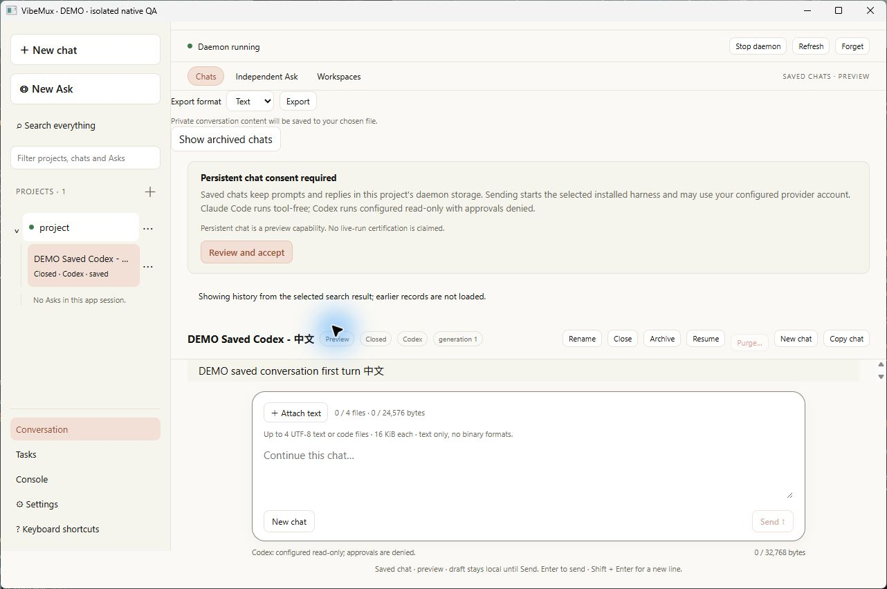

### Transcript-local reveal

Both deep history navigation in `app.svelte` and transcript Find used
`scrollIntoView` with centered positioning. That call moved an outer
overflow-hidden container along with the transcript. The new
`reveal_transcript_element` helper walks to the nearest marked HTML transcript
container and calls only its `scrollTo`. It accounts for the border, current
scroll, viewport height and target rectangle and stays inside the container's
range. Missing targets/containers produce no global fallback.

The actual Ask wrapper, Saved transcript and Workspace transcript are marked.
The inner NativeTranscript section is content rather than a scroller and stays
unmarked. Both consumers share the helper. Six focused tests cover container
ownership, outer/horizontal preservation, missing/non-HTML ancestors, geometry
and range bounds.

The real-browser fixture in `ui/tests/transcript_scroll_browser.html` reproduces
the old primitive against the same DOM as the replacement:

| Path | Header top before/after | Outer scroll | Transcript scroll | Document scroll |
| --- | --- | --- | --- | --- |
| Old centered scrollIntoView | 1 / -75 | 76 | 872 | 0 |
| Transcript-local helper | 1 / 1 | 0 | 872 | 0 |

Browser measurements are engineering evidence, separate from a native retest.
The repaired native path remains unverified. Final UI tests passed 159, including
the six new cases; typecheck reported zero errors/warnings; the production build
passed with the existing 526.36 kB chunk advisory. Both independent source gates
passed. The fixture server was explicitly stopped after recording its results.

### Generated Windows icon

Source and PE inspection traced the actual startup icon warning to the fallback
ICO encoder. It declared a 40-byte BITMAPINFOHEADER but emitted 36 bytes, putting
16896 in the compression field instead of BI_RGB. The QA executable did contain
the expected group resource 32512 and its image payload exactly matched the bad
ICO. The [Microsoft header contract](https://learn.microsoft.com/windows/win32/api/wingdi/ns-wingdi-bitmapinfoheader)
places compression before the image-size field.

The encoder now writes the missing DWORD. The existing `write_icons` entry point
creates missing PNG/ICO assets independently with create_new and preserves
existing siblings. A bounded whole-byte comparison repairs only the exact old
fallback encoding; a one-pixel custom lookalike remains unchanged. The observed
bad image is retained as the consumed golden test fixture.

The first header test failed with compression 16896 rather than 0. Windows file
and raw PE-resource decoding also failed before repair, with error 0 matching
the misleading startup warning. Five final public-I/O regressions passed.
Windows subsequently decoded the corrected ICO and the icon resources in both
normal and QA executables. Executables were mapped as resource/data only; no
application entry point or window was run by that check. An intermediate Clippy
failure exposed an unused duplicate writer API, which was removed by folding
the behavior into the existing entry point. No lint suppression was added.

### Final checks and remaining native acceptance

Executed with the pinned Rust and explicit Node 22.22.2 runtimes:

~~~text
node --experimental-strip-types --test tests/transcript_scroll_test.ts
node node_modules/svelte-check/bin/svelte-check --tsconfig ./tsconfig.json
node node_modules/vite/bin/vite.js build --config vite_config.ts
node --experimental-strip-types --test tests/*_test.ts
cargo test -p vibemux_desktop --test icon_generation --locked --offline
cargo clippy -p vibemux_desktop --all-targets --all-features --locked --offline -- -D warnings
cargo build -p vibemux_desktop -p vibemux_cli -p vibemuxd --locked --offline
cargo build -p vibemux_desktop --features native_qa --bin vibemux_desktop_qa --locked --offline
~~~

Final Clippy and both builds passed. Normal and QA PE files still have exactly
one activation manifest with Common Controls v6. A fresh repaired namespace was
prepared/checked after the final builds: 4/2/2 records, no process claim, owned
daemon joined. That preparation alone established no GUI result. The renewed
interaction and subsequent user interruption are recorded below; JSON file save
remains incomplete. No external Pro verdict is claimed. Control v14, store 13,
export 1 and the 31-command boundary are unchanged; broader parity and writable
qualification remain open.


### Renewed native retest and interrupted final export

The renewed ten-minute batch ran from 08:38:22.377Z to its input deadline at
08:48:22.377Z on Windows 11 build 26300. Search with archived history included
scanned three conversations, eight records and 324 bytes. Saved deep navigation
loaded four records, archived navigation loaded two, and Workspace navigation
loaded two retained records with its execution session Closed. The application
header and Search control stayed visible after each deep open. The repaired
application icon rendered in the title bar. No Send, Start, Resume, provider
setup or installed-vendor inference was requested.

JSON was selected with the native keyboard and the operating-system Save dialog
showed `JSON conversation (*.json)`. Save was not confirmed before the input
deadline; the exact approved destination remained absent. No post-deadline
desktop input was sent. The owned nonce stop returned runner exit 0 with
`gui_ready_observed=true`, `event_loop_returned=true`, `daemon_joined=true`,
`monitor_joined=true` and zero unresolved Asks. The nonfatal WebView unregister
diagnostic 1412 remains recorded separately from that successful lifecycle.

A separately approved final five-minute export attempt launched at 08:53:02.676Z
in a fresh synthetic namespace. The first Computer Use observation reported
that the user pressed physical Escape and stopped Computer Use. No further
Computer Use call or export interaction was made. The owner requested the
root/run-bound stop. The runner exited with code 2 and retained an explicit
`cleanup_unconfirmed` outcome: Ready and event-loop-returned true, daemon joined
true, monitor joined false, unresolved Asks zero. This last attempt is not a
successful cleanup acceptance result and does not replace the preceding batch's
clean shutdown. The JSON destination is still absent. No automatic retry is
authorized by this interrupted attempt.

At this retest cutoff, TaskWindow remained design-only; its later implementation is recorded separately. Control v14, store schema 13,
export schema 1, the 31-command boundary and production profiles are unchanged.
The repaired native scroll and icon observations establish their bounded GUI
result; JSON save, the interrupted monitor-join failure and broader parity and
release acceptance remain open.


| Renewed native observation | Result |
| --- | --- |
| Saved deep record, four canonical records | PASS; header and Search remain visible |
| Archived deep record, two canonical records | PASS; archive selection retained |
| Workspace deep record, two retained records | PASS; Closed session viewed without Resume |
| Generated application icon | PASS; corrected icon visible in native title bar |
| JSON format and native Save dialog | PASS through dialog opening; file save incomplete |
| Renewed batch owned shutdown | PASS; runner exit 0, daemon and monitor joined, Asks 0 |
| Final export attempt | INTERRUPTED by physical Escape before UI observation |
| Final attempt owned shutdown | FAILED acceptance; runner exit 2, monitor joined false |

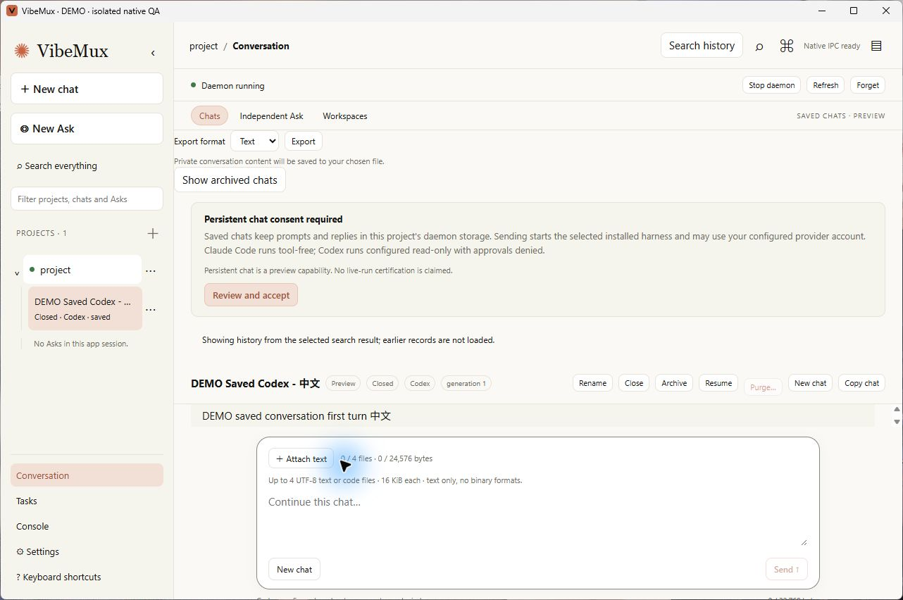

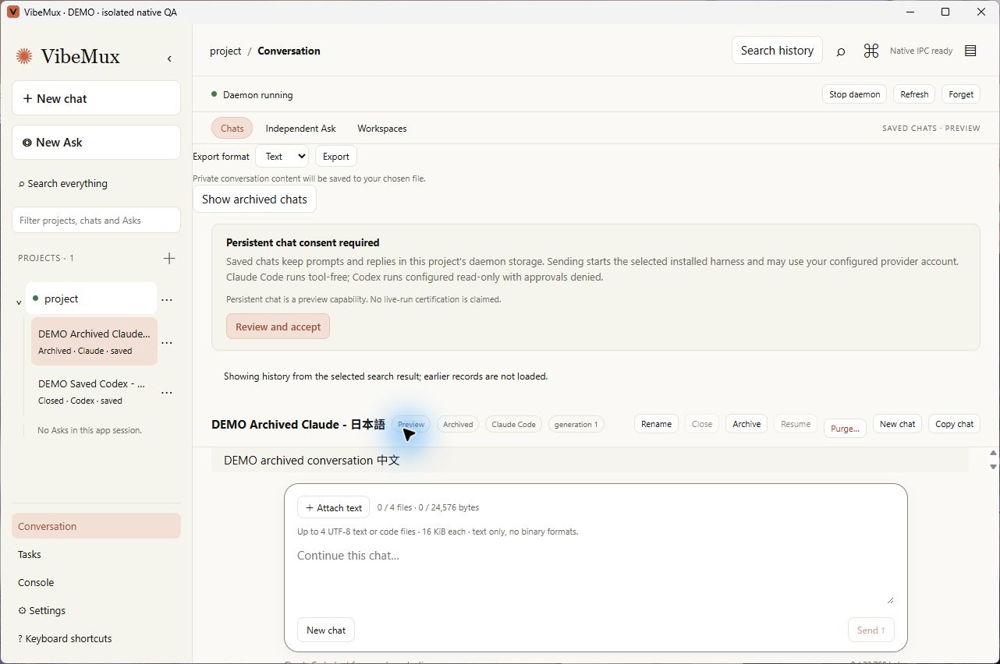

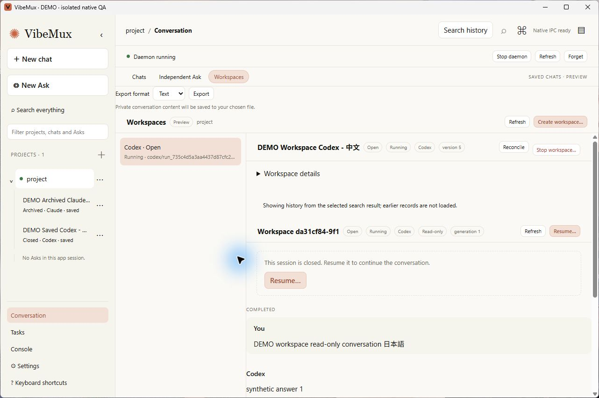

Private Save-dialog directory inventory and unrelated desktop content are excluded.

## Bound read-only task windows

Source remains on `codex/native_harness_conversations`, based at `617bb1f`,
with the existing task-owned changes retained. The implementation activates the
existing native command; it adds no command name, Control operation, store/export
schema, dependency, listener or installed-vendor qualification input.

The original regression checks failed as expected: the main capability still
matched `task_*`, and an unbound auxiliary invoke reached project resolution
instead of being denied by native window binding. The final capability removes
that overlap and limits the child to `tasks_snapshot` and public `settings_get`.
Strict native arguments accept only `{project_key, task_id}` from main. A
bounded generation-aware registry binds native labels to the authenticated
registration and canonical task/project identities. Child reads are Detail-only.

The shared frontend presenter has two consumers, docked and independent. The
entry point dynamically loads the appropriate surface before initialization;
invalid bootstrap fails closed. Polling is single-flight, and disposal suppresses
late results and future reads. Current delivered sections contain task, run,
activity and artifact metadata, without terminal control or artifact contents.

| Executed check | Result |
| --- | --- |
| Node 22.22.2 parser/controller cases | 19 passed |
| Full UI suite after production build | 178 passed, no skips |
| Svelte typecheck | 0 errors, 0 warnings |
| Production UI build | Passed; separate main/task entry chunks |
| Rust registry behavior and MockRuntime URL/reuse | 5 passed |
| Actual generated-capability deny and closed arguments | Passed |
| Existing native invoke and lockdown suites | 2 and 9 passed |
| Authenticated task-window binding fixture, normal Windows host token | Passed; canonical task/run and descriptor unchanged |
| Desktop library with all features | 38 passed, 2 explicit ignores |
| Affected all-target/all-feature Clippy, warnings denied | Passed |
| Normal desktop/CLI/daemon build | Passed |

The authenticated fixture first failed the existing private-runtime ACL check
under the shell sandbox token. The unchanged test passed under the normal host
token; no validation was weakened. Compilation emitted the existing incremental
cache hard-link fallback warning. No native window or installed vendor/provider
was launched by these tests.

The Claude worker's five-file candidate was frozen and integrated behind the
unchanged parent baseline. Parent checks, entry wiring and final source review
are separate from its report. The worker disclosed ten extra frontend reference
reads; writes stayed within its five assigned paths. The configured OpenCode
MiniMax session hit its plan limit before any assigned write; it was stopped,
and Codex completed the canonical documentation without provider substitution.

Scoped Rust and frontend source reviews passed. MockRuntime behavior does not
verify native WebView2 rendering, focus, destruction or close/reopen behavior.
Those interactions remain unverified. The original GUI/export pause is retained
until a concrete renewed desktop sequence is authorized; the user's later PC
availability message has not caused new desktop input. The third QA outcome is
preserved unchanged and is being investigated separately from this feature.

## QA stop publication and monitor diagnostics

The historical third native run remains unchanged. Its log contained the outer
`native_qa_cleanup_unconfirmed` only. `monitor_joined=false` is set for either a
failed join or an error returned by a normally joined monitor, so the artifact
does not prove a thread leak or identify that run's failure branch.

Before integrating the publisher repair, one Windows characterization test held
the old final-name writer open exclusively after writing a complete matching
nonce. The monitor returned `OwnershipChanged`; after writer close, the record
read back as the matching request. This reproduces a real publication window
without proving that it caused the historical GUI failure.

The new stop-specific publisher closes a synced bounded stage, then creates the
final name atomically without replacing it. A deterministic competing-stage
test uses distinct encodings of the same nonce, establishes both absent checks
before publication, orders a winner before the competing caller, and verifies
both succeed, the winner's bytes remain unchanged and stages are accounted for.
Foreign, malformed and mismatched destinations remain unchanged and refused.
The caller reports a generated owned stage basename if cleanup is denied.

The first integrated runtime suite had 40 passes, four failures and two ignores:
hard-link creation failed with Windows OS32 while root/ancestor directory pins
allowed read sharing only. A plain temporary-directory link probe succeeded.
Permitting read/write sharing for those read-access directory handles, while
continuing to deny delete sharing, made the exact atomic-monitor test pass.
A new functional regression confirms link publication succeeds while namespace
rename is denied with OS32, and rename succeeds only after owned pins drop.
JSON readers and immutable file pins remain at read sharing only.

The next suite had 44 passes, one failure and two ignores: a reader on the final
link did not prevent deleting the separate staging link on this Windows host.
That disproved the cleanup test's precondition. The corrected test holds the
actual stage link and retains the strict `Some(stage_basename)` assertion while
it is held, then requires cleanup success after release and preserves the final
nonce throughout. No assertion was weakened or sharing validation disabled.

The final full desktop library suite passed **45 tests, with two explicit
fixture-preparation ignores**. All seven new publication/pin checks passed,
including the old-path characterization, atomic observation, competing stages,
foreign binding/destination refusal, held-stage cleanup and namespace pinning.
The scoped source review passed after the runtime corrections. The primitive
requires local filesystem hard-link support and has no replacement fallback.

The native runner now prints the stable inner monitor error code before the
existing outer cleanup error. No report schema, production profile, command
count, reader permission or installed-vendor input changed. Exact native
task-window and JSON-export acceptance still require the renewed bounded
desktop sequence; no such input is inferred from these non-GUI checks.

## Native Task-window and Workspace JSON acceptance

The user approved one desktop-input batch of up to fifteen minutes, limited to
the DEMO main window, its DEMO Task child and their Save dialog. The unchanged
final QA binary used a fresh prepared/checked namespace. Its baseline was four
Saved, two archived and two Workspace records, with no process claims and the
preparation daemon joined. Native control began at `10:24:52.621Z`; the deadline
was `10:39:52.621Z`. The terminal outcome was written at `10:34:03.324Z`, within
the grant. No input outside the named windows or after completion was needed.

The main Tasks view listed four canonical tasks. The selected Workspace task
was `c83336f6-a0f2-4dee-bb32-b33c26114fa6`, project
`5b770c59-3b1b-4ad8-950b-22e021a904bd`, run
`83562ecb-5d29-4637-b506-b536a6dabbc3`, detail revision 42.

| Native scenario | Observed result |
| --- | --- |
| Open Task child | PASS; native window 7151572 displayed the exact bound metadata |
| Overview | PASS; task, project, run, harness and owner-role metadata rendered |
| Activity | PASS; recorded event metadata rendered |
| Artifacts | PASS; explicit empty metadata state rendered |
| Repeated Open in window | PASS; reused window 7151572, without a second child |
| Close and reopen | PASS; old child disappeared and new window 7282644 loaded the same binding/revision |
| Main closes before child | PASS; main 2760272 disappeared while child 7282644 remained |
| Child Refresh after main closure | PASS; observations advanced through 10:34:01Z and detail revision remained 42 |
| Final child close | PASS; runner exit 0, all owned native windows absent |
| Workspace JSON native Save | PASS; exact selected destination, schema 1, 2 records, 2,065 bytes |

The run/outcome pair matches root `e77fef9b-e5f4-404f-a92e-3660353a1db1`, run
`78908442-f92b-46e0-8671-b6f41b2ce39a` and runner PID 96036. The report is
`gui_exited`, with Ready/event-loop return/daemon join/monitor join true, zero
unresolved Asks and no error. It retains fixture-only true and production-profile
qualification false. Normal window close was exercised; nonce-stop publication
retains its separate filesystem/concurrency test evidence.

The native Save dialog selected JSON and wrote the exact approved new file.
The success receipt reported two records and 2,065 bytes. A read-only independent
artifact check then confirmed `kind=workspace`, schema 1, the plan's Workspace
chat `372ee2b7-24ff-43f9-8c3b-a165a46fe970`, the canonical project/run/task, and
a closed generation-1 session at version 13. Session version 13 is separate
from task-detail revision 42.

The artifact has one completed turn, correlated terminal/complete output and
no error. Its two unique records have increasing sequences ending at the declared
cutoff, matching the session count and last sequence. One user and one assistant
record have available text, no content errors or truncation, and retained UTF-8
byte counts equal to the actual and original byte counts. Title reading succeeded
and `partial=false`; capture time falls within the approved batch. This supports
Workspace JSON save, not Saved/chat JSON save or arbitrary current database state.

No Send, Start, Resume, provider setup or installed-vendor inference was used.
The earlier failures, timeboxed incomplete saves and physical-Escape interruption
remain unchanged. Full desktop parity, active Ask cancellation, broader light/dark
and IME coverage, Linux/WSL, Windows 10 and production qualification remain open.
Private Save-dialog directory inventory is excluded from these artifacts.

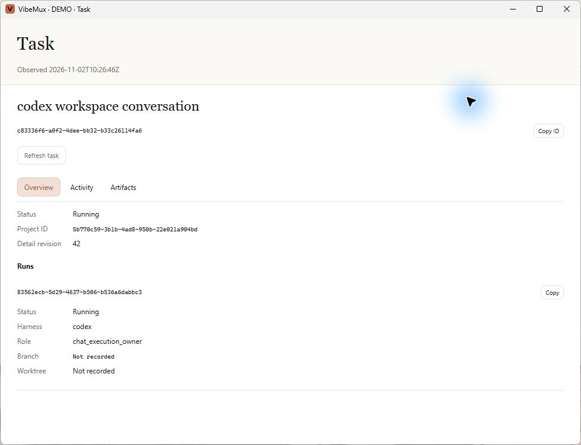

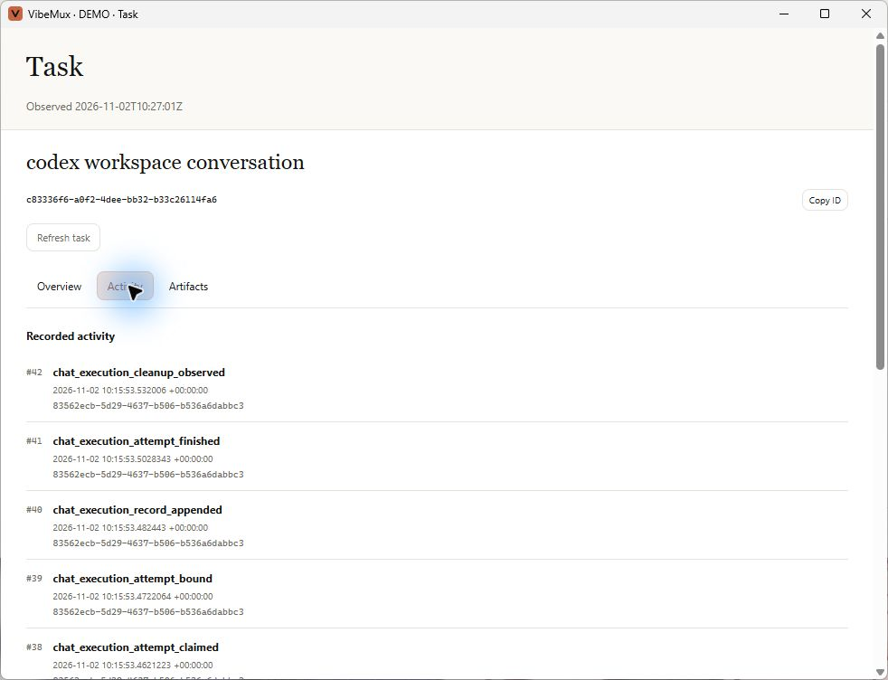

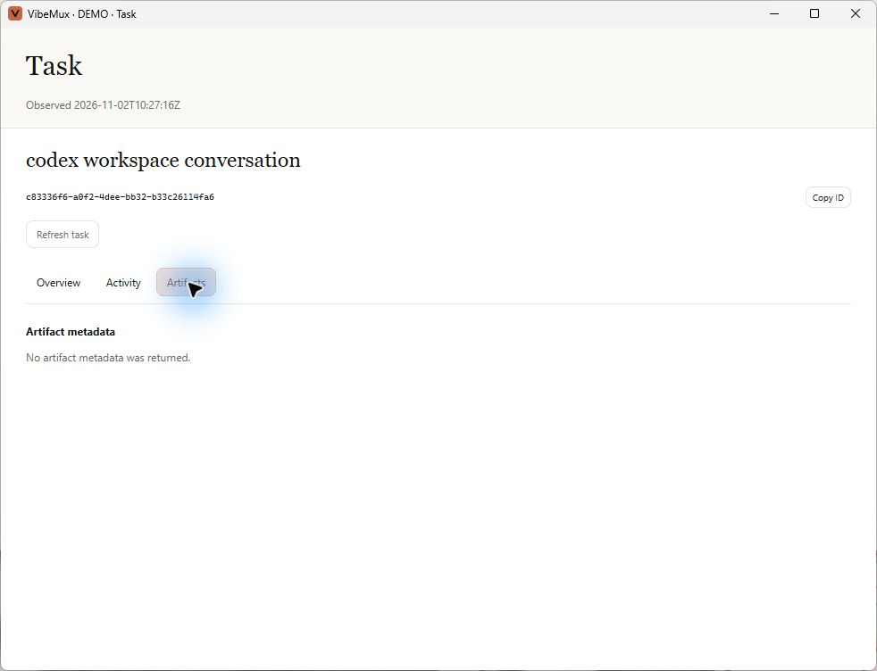

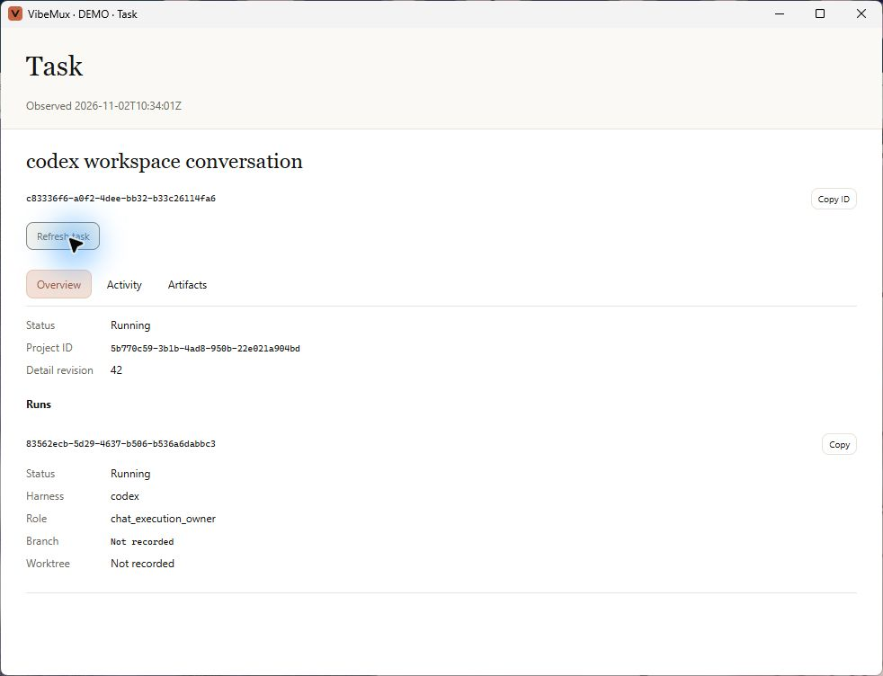

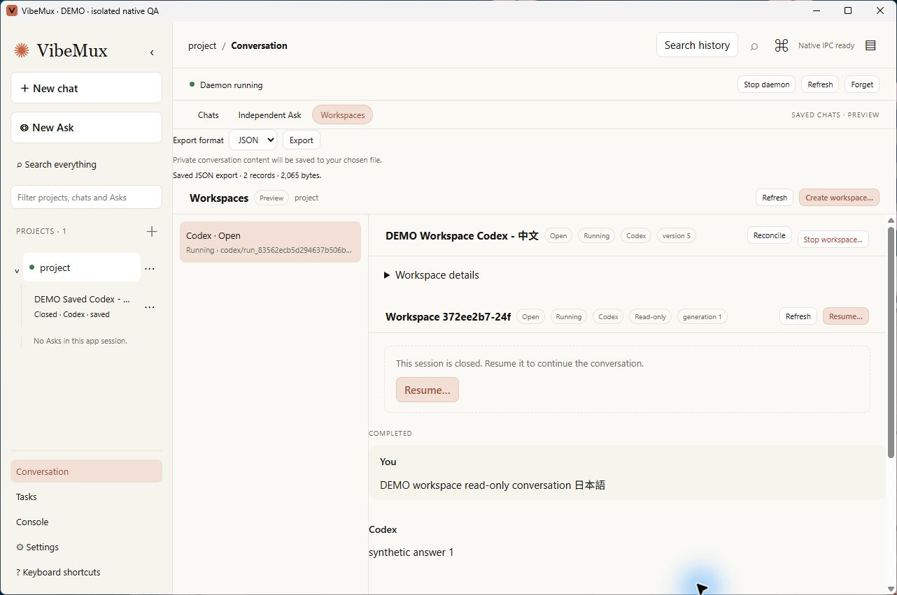

## Task terminal observation

The 2026-11-02 source adds the shared Task Terminal tab and activates the existing
`supervisor_action` for Inspect/Link/Focus/Unlink. Main and Task children use the
same native caller, registration, canonical Task/Run and observation-token checks.
The existing terminal projection excludes cwd, terminal text and titles. The
child capability contains its two reads and this closed terminal command.

Native provenance retains one current observation and one cleanup receipt per
view, bounded to main plus 16 children. Tests cover L1/L2 isolation across views,
lost successful Focus and repeated Find replies, successor acknowledgement,
unknown/foreign acknowledgements, failed effects during plugin outage, lost
replacement results and explicit idempotent Unlink of the exact reviewed lease.
Link/Focus authority is retired before effects; closing or revoking the view
clears cached authority and suppresses late publication without terminal effects.

Workspace owner resolution uses the indexed Run lookup through the authoritative
writer and the complete owner validator. Physical tests cover foreign receipts,
branch/resource/phase mismatch, dirty and advanced owned worktrees, reparse `.git`
refusal, and missing managed directories remaining absent. The execution-wrapper
regression retains empty-grant and base-HEAD refusal. A corrupt owner cannot fall
through to A2A authority.

### Executed local checks

Rust commands used the pinned Rust 1.92 toolchain with `--locked --offline` on
native Windows 11 build 26300. Service/process fixtures ran under the normal host
token so the existing runtime ACL checks remained active. UI commands used
Node 22.22.2 and the existing locked dependencies.

| Check | Command and result |
| --- | --- |
| Format | `cargo fmt --all -- --check`: exit 0 |
| Clippy | `cargo clippy -p vibemux_desktop -p vibemuxd -p vibemux_client -p vibemux_store -p vibemux_workspace --all-targets --all-features --locked --offline -- -D warnings`: exit 0 |
| Desktop library | `cargo test -p vibemux_desktop --lib --all-features --locked --offline`: 57 passed, two explicit preparation cases ignored; includes 12 bridge cases |
| Native API | `cargo test -p vibemux_desktop --all-features --locked --offline --test lockdown --test native_invoke --test native_reads --test task_windows`: 21 passed |
| Actual service path | Final `--test task_windows` rerun: three passed. The amended case compares direct Control Inspect with actual-capability Tauri Invoke, both returning `terminal_plugin_unavailable`; optional ACK decoding reaches that same service, foreign Runs are refused, private paths are absent from errors and Task/Run/descriptor remain unchanged. This unavailable result supplies no lease or genuine acknowledgement proof. |
| Daemon library | `cargo test -p vibemuxd --lib --all-features --locked --offline`: 265 passed, two explicit native cases ignored |
| Store | `cargo test -p vibemux_store --all-features --locked --offline`: 212 passed across 13 reported suites, including owner lookup and frontend metadata |
| Terminal protocol | `cargo test -p vibemuxd --all-features --locked --offline --test terminal_observer`: three passed |
| Workspace | `cargo test -p vibemux_workspace --all-features --locked --offline`: nine passed; reused after unchanged production source |
| UI | Svelte check: zero errors/warnings; Vite production build: exit 0; Node test runner over `tests/*_test.ts`: 203 passed, including 25 controller cases |
| Native bundles | `cargo build -p vibemux_desktop -p vibemux_cli -p vibemuxd --locked --offline` and `cargo build -p vibemux_desktop --features native_qa --bin vibemux_desktop_qa --locked --offline`: exit 0 |

Clippy initially reported a collapsible conditional in test teardown; the scoped
fix passed the rerun. The QA build's first feature selector used a hyphen and was
rejected; the manifest's `native_qa` selector built successfully. Incremental-cache
hard-link warnings fell back to copying and did not change these exit results.
Earlier red evidence for lost cleanup, namespace creation and Inspect unknown-field
decoding is retained separately from the final passing logs. Independent Core,
native bridge and UI source reviews returned scoped PASS. OpenCode's configured
MiniMax plan remains quota-blocked; Codex completed canonical documentation.

### Acceptance boundary

The fresh synthetic root for this Terminal check prepared and checked with the
baseline four Saved, two archived and two Workspace records, no process claims,
owned daemon joined and production qualification false. This is non-GUI fixture
evidence. At that cutoff, native Terminal interaction awaited a fresh named
desktop-input grant; the earlier Task-window grant was spent. Real WezTerm was not discovered
on PATH or at the three checked install locations, and no live pane was inspected,
focused, linked or configured. This does not establish that WezTerm is absent
from the host.

The earlier three-tab screenshots and Workspace JSON artifact remain valid for
their recorded interactions. They do not verify the new Terminal surface.
Linux/WSL, Windows 10, real WezTerm and full desktop parity remain open. Control
v14, store schema 13, the 31-command list and production profiles are unchanged.


### Native Terminal unavailable-plugin acceptance

A separate approved ten-minute native batch launched at 2026-11-02T13:50:18.268Z
with a 14:00:18.268Z input deadline. Fresh CUA window bindings and screenshot/AX
observations verified the docked Terminal tab, its selected Workspace Run and
explicit Find returning `terminal_plugin_unavailable`. Overview remained usable.
The independent Task child rendered the same binding and returned the same
terminal error through its scoped command capability.

The first main-close action had no verified effect. Fresh inventory, binding,
Raise and screenshot-derived coordinate input closed that main window; inventory
then contained only the Task child. The child completed another Find and manual
Refresh, with an observation at 13:59:03Z and unchanged canonical task/project/run
and detail revision 42. Its final close completed within the input deadline.
The runner returned exit 0 with Ready/event-loop/daemon/monitor true, zero
unresolved Asks and no error. Final native inventory contained no QA windows.
The matched local outcome and receipt retain root/run/process identity.

This is a fixed synthetic Workspace-owner scenario with production qualification
false. It verifies native rendering, unavailable-plugin handling and child
service access after main close. It exercises no real WezTerm pane, successful
Link/Focus/Unlink, installed vendor, Send/Start/Resume, export or provider setup.
No further desktop input is authorized by this completed batch.


## Saved and Workspace command palette

The local palette now consumes loaded Saved sessions and Workspace owners from
registered projects, with cached titles, metadata search, project-qualified
action identities and the existing eight-result/256-character-query bounds.
The Workspace snapshot catalogue copies listed owner rows, tool arrays and cached
title maps without RPC. Purged Saved content and missing or forgotten projects
cannot become enabled conversation targets. An explicit history-search action
opens the existing project search; the native `quick_search` stub remains unused.

The new navigation helper uses existing selectors, rechecks project/target and
caller lifetime around awaits, and returns no successful late presentation after
disposal or supersession. App admission checks the currently offered action and
serializes navigation; fixture, modal, main-content and keyboard guards apply.
The app now disposes its Saved controller during teardown.

Review reproduced a Workspace acknowledgement defect in two public-controller
cases: removing an attachment while Send was pending, and adding a new file after
an uncertain Send, both with unchanged raw draft text. The old predicate cleared
current input in both cases. Both acknowledgement paths now require raw-text
equality and equality between the complete current formatted payload and the
immutable submitted prompt. Exact positive receipts can settle pending state;
unknown or null receipts retain uncertainty. No operation is automatically resent.

### Executed checks

On Node 22.22.2 with the existing lockfile:

- Workspace catalogue: initial undefined-catalogue regression RED, then all 22
  Workspace state tests passed. Snapshot copying and removal perform no new reads.
- Palette builder: five new cases failed against the old builder; six final
  cases passed, including the separately reproduced title-suffix-after-72 repair.
- Navigation: all 15 search/navigation tests passed, including five palette
  cases for Saved input/pending preservation, Workspace away/back with null
  receipts, unavailable targets, cross-project revalidation and disposal while
  Saved status is deferred. Positive receipt reconciliation is tested separately.
- Workspace execution: both unchanged-text attachment cases failed before the
  predicate repair; all 16 execution tests passed afterward.
- Full `node --experimental-strip-types --test tests/*_test.ts`: 217 passed,
  zero failed or skipped. The host invocation expands the test file list.
- Svelte check: zero errors and zero warnings. Vite production build: exit 0.
- `cargo build -p vibemux_desktop -p vibemux_cli -p vibemuxd --locked --offline`:
  exit 0 with the new bundled assets.
- `cargo build -p vibemux_desktop --features native_qa --bin vibemux_desktop_qa --locked --offline`:
  exit 0. Neither build launched its GUI.

Independent source reviews passed after the title-index, disposal and attachment
corrections. A prepared Local CLI candidate did not match the assigned scope and
was not integrated; Codex completed the implementation and executed these checks.
OpenCode's configured plan remains unavailable, so Codex closed documentation.

No daemon command, wire/store schema, dependency or production-profile grant
changed. The preceding Terminal native batch verifies its recorded unavailable-
plugin scenario. It does not establish native palette interaction, keyboard/IME
acceptance for this change or full desktop parity. No further desktop input
occurred after that approved batch closed.

## Native worktree and HTTPS presentation

The 2026-11-03 local implementation of
[ADR 065](../adr/065_native_links_and_worktree_access.md) adds the Core v15
workspace read and activates the existing `open_link` command. Task Overview
and Workspace views mount the shared folder/path/branch controls. Native Ask,
Saved and Workspace Markdown uses the native HTTPS wrapper. Store schema 13,
export schema 1 and 31 command names remain unchanged. No installed-provider
input or real clipboard/browser/file-manager action occurred in these checks.

Executed on native Windows 11 with pinned Rust 1.92 and Node 22.22.2:

- `cargo test -p vibemuxd --all-features --lib workspace_access`: eight passed.
  Covers canonical metadata/directory reads, foreign/unplanned/unknown Runs,
  finalized retention, dirty/advanced owned branches, missing namespaces and
  receipts, current session recovery and managed/legacy A2A physical slots.
- `cargo test -p vibemuxd --all-features --lib control_workspace`: two passed,
  including a real authenticated server/client roundtrip, old-descriptor
  capability refusal, unchanged older reads and unchanged canonical state.
- `cargo test -p vibemux_desktop --all-features --test native_invoke native_link_requests_reject_unknown_authority_and_unsafe_urls_before_effects`:
  one passed through the actual Tauri handler/capability context. Unknown
  authority fields, no-argument calls and unsafe URLs are refused before effects.
- `cargo test -p vibemux_desktop --all-features --test task_windows`: three
  passed under the normal Windows token. The authenticated fixture verifies
  main/child branch copying, independent child binding after main selection,
  unmanaged-directory refusal, child HTTPS refusal, foreign Task/Run refusal,
  registration revocation and normalized main HTTPS. OS effects are recorded
  in memory; replies omit copied values and canonical state is unchanged.
- `cargo test -p vibemux_desktop --all-features --test native_owners -- --ignored`:
  the explicitly selected synthetic acceptance passed. Real managed Git
  workspaces and authenticated IPC reached fake native folder/path/branch
  effects before Start and after Finalized, with dirty retained files intact.
  It used the existing fixed fixture/trampoline, with no installed vendor.
- `cargo test -p vibemuxd -p vibemux_desktop -p vibemux_client -p vibemux_workspace --all-features --lib --locked --offline`:
  482 passed, five ignored. This includes four native pin checks (case aliases,
  ordinary writes, no-delete sharing and in-root reparse ancestry), HTTPS caller
  closure before/during handoff, error sanitization and existing terminal and
  execution policy regressions.
- `cargo test -p vibemux_desktop --all-features --locked --offline`: 125 passed,
  four ignored; this includes native capabilities, project identity, read
  services and the strict invoke tests. The explicit owner acceptance above is
  reported separately from this default ignored count.
- `node --experimental-strip-types --test tests/*_test.ts`: 234 passed.
  New controllers cover explicit requests, strict acknowledgements, refused URLs,
  fixture inertness, single-flight actions, queued disposal and late replies.
  Svelte check reported zero errors/warnings; Vite built production assets.
- `cargo fmt --all -- --check`: exit 0.
- Affected-package `cargo clippy ... --all-targets --all-features --locked --offline -- -D warnings`:
  exit 0 under the normal Windows token after three collapsible-if corrections.
  The affected packages are the same four listed in the library command above.
- Dependency feature inspection found only `open`'s
  `shellexecute-on-windows` feature and text-only Arboard without default features.
  `cargo deny` and `cargo audit` are not installed; neither check ran.

Original failures remain in local evidence. The restricted token failed the
existing private-runtime ACL preflight and could not create the reparse test
fixture. Its cached `protoc.exe` also reproducibly failed to launch with Windows
DLL-relocation error 623, while the same executable reported `libprotoc 31.1`
under the normal token. No ACL, tool version or permission policy was weakened.
The first junction helper used a verbatim path unsupported by Windows PowerShell
5.1; the fixture now uses its ordinary absolute temporary path. The UI's first
controller test exposed Node strip-only syntax incompatibility, corrected by
declaring fields explicitly. These were test/runtime repairs, not acceptance
retries against an installed provider.

Independent Core/native/UI source gates passed. The fixed test-only
`native_links` mode adds one literal HTTPS reference for a future approved native
click and has its own passing fixture unit check. Real native OS effects,
Windows 10, Linux/WSL, full desktop parity and owner-facing worktree removal
remain unverified or unfinished. Codex completed canonical documentation using
the disclosed fallback for unavailable OpenCode; no publication occurred.

### Native worktree and link acceptance

The separately approved fifteen-minute Windows 11 batch used a fresh synthetic
root at `target/native_workspace_links_gui_qa`. Launch was
2026-11-02 19:04:03.186Z, with a desktop-input deadline of 19:19:03.186Z.
Prepare/check had reported 4 Saved, 2 archived and 2 Workspace records, no process
claims, fixture-only true and production-profile-qualified false.

Verified through native screenshots/accessibility state and matching QA records:

- Workspace Open Folder, Copy Path and Copy Branch controls rendered. Copy
  acknowledgements completed; explicit paste into the QA app's filter showed
  the full expected synthetic branch and managed worktree path.
- Open Folder acknowledged and produced a File Explorer window whose breadcrumb
  reached the exact synthetic Run directory. It contained the three expected
  Git/base files. No file was opened, modified or removed through Explorer.
- Clicking the fixed transcript reference returned `Link open requested.` and
  created a new Chrome tab at exactly `https://example.org/`, titled
  `Example Domain`, opened at 19:08:19.729Z. The WebView stayed on the app origin.
- Docked Task Overview rendered the same canonical branch and three controls.
  Its independent Task child returned both Branch copied and Worktree path
  copied, retained the original project/task/run binding and revision 42, and
  was observed at 19:10:48Z. No Send, Start, Resume, removal, export or setup ran.

Browser page-content inspection remains unverified. The first browser binding
timed out/reset the tool session; subsequent DOM access reported an unattached
debugger, and native Chrome inspection timed out awaiting app approval. Tool
waits exhausted the input window. No desktop input occurred after its deadline.
The ordinary manual close sequence was not completed in this batch. The
root-bound QA `stop` command then requested owned shutdown: runner exit 0,
Ready/event-loop/daemon/monitor true, zero unresolved Asks, no error and an empty
owned-window inventory. The synthetic worktree and external browser/folder
windows were preserved; no external process was terminated. A post-exit WebView
class-unregistration diagnostic is retained in the log and did not change the
successful owned shutdown report.

This is partial native acceptance: worktree clipboard/folder and HTTPS handoff
are verified for this synthetic scope. It does not prove remote page content,
the manual close sequence, Finalized native interaction, Windows 10 or Linux.
The consent is spent. The local receipt is
`target/workspace_links_gui_acceptance_receipt.json`; screenshots were displayed
by Computer Use, with no native PNG files saved for this batch. Original output
and tool failures remain preserved.

## Complete terminal-subtree observation

The 2026-11-03 read-only foundation in
[ADR 067](../adr/067_terminal_cleanup_inventory.md) is implemented in the
observer, negotiated plugin method and daemon request gate. Removal in
[ADR 066](../adr/066_explicit_worktree_removal.md) remains Proposed. No migration,
Control/native command, dependency, live configuration, terminal instance or
user worktree was changed by this foundation.

The new parser was built in an isolated worktree/branch and integrated after
parent verification and independent source review. It preserves the existing
exact-directory parser/focus behavior. Limits apply to the complete source
(512 KiB/256 panes) and matched reply (four panes), with errors instead of
truncation. Windows fixtures exercised child directories, case aliases,
symlinks/junctions and prefix traps. Unknown/remote/unresolved cwd, malformed
data and duplicate IDs refuse a clear result.

Executed with Rust 1.92 on native Windows 11:

- Worker `cargo test -p vibemux_terminal_observer --locked --offline`: 18 passed,
  no skips, before parent method/config/lifecycle integration. Worker Clippy,
  format and diff checks passed. Restricted-token protoc error 623 and symlink
  privilege error 1314 remained failures; the unchanged checks passed under the
  normal host token without weakening tests.
- Parent `cargo test -p vibemux_plugin_protocol -p vibemux_plugin_supervisor -p vibemux_terminal_observer --all-features --locked --offline`:
  final 55 passed, no failures or skips. This includes 20 observer library and
  two binary cases after the ownership repair.
- `cargo test -p vibemuxd --all-features --test terminal_observer --locked --offline`:
  four passed. A real framed mock-plugin session refuses missing capability or
  permissions, distinguishes cleanup's reply from legacy exact inventory, and
  joins owned processes. This verifies transport/gating, not a live backend.
- `cargo clippy -p vibemuxd -p vibemux_plugin_protocol -p vibemux_plugin_supervisor -p vibemux_terminal_observer --all-targets --all-features --locked --offline -- -D warnings`:
  exit 0 after the final ownership repair.
- `cargo fmt --all -- --check`: exit 0.
- `cargo build -p vibemuxd --bin vibemuxd -p vibemux_terminal_observer --bin vibemux_terminal_observer --locked --offline`:
  exit 0; neither binary was launched against a live terminal.

The original RED checks remain recorded: missing new dispatch reached the wrong
error boundary; the initial plugin-version change rejected a legacy manifest;
and the cleanup-capable registry fixture initially lacked its negotiated method.
The corrected version keeps the default two-capability Hello at version 1.0.0,
requires explicit config/manifest/policy opt-in, and never falls back. Config
tests reject non-booleans and unknown fields. Actual protocol negotiation tests
exercise both legacy and updated declarations.

Final review found that dropping a request's `spawn_blocking` handle could leave
filesystem work alive and admit more jobs. The injected ownership regression
failed with a second job accepted. Moving the permit into the actual closure
made timeout and abort cases pass: a second closure never runs, busy shutdown
cannot claim quiescence, and release follows actual completion. One owned worker
now covers before/after instance verification, the bounded CLI call and all
filesystem observation. Main refuses new work while it remains busy and waits
for idleness before acknowledging shutdown; a drain error uses the existing
non-graceful owned-process cleanup path. Independent source review closed the
P2 finding without executing or claiming these tests itself.

Live WezTerm, Linux/WSL, destructive worktree lifecycle, restart recovery from
every crash window and native removal UI remain unverified or unfinished.
No desktop input, installed-provider input or real worktree removal occurred.
Codex synchronized the protocol/architecture/status/changelog/evidence docs
using the recorded fallback for the ended OpenCode session; README was checked
and already states that removal is separate unfinished work.

## Held native-process release boundary

The 2026-11-03 additive private process API reuses ADR 029 containment and the
same first-party trampoline. `spawn_held` returns only after containment and pipe
setup, without sending go. Consuming `release_after` awaits a trusted caller's
authorization callback while retaining the exact owner. It writes go only after
`Ok`. A failed authorization records no release attempt; a write/flush failure
records an attempt that may have started the program. The opaque failure keeps
the owner for explicit cleanup and exposes no pipes or retry path. Debug output
omits the callback error and private command data.

Normal `spawn` delegates through immediate authorization success and preserves
its auto-go/error behavior. On failed release it now obtains the stronger root/
tree/stderr completion and bounded stdout EOF before returning. This adds up to
two extra two-second windows in the reviewed worst case; legacy spawn discards
the receipt and receives no new durable recovery authority. The existing later
finish/Drop implementation remains unchanged. A cancelled authorization future
uses Drop containment and supplies no joined receipt.

Executed with Rust 1.92 on Windows 11, using only fixed synthetic executables:

```powershell
cargo build -p vibemuxd --features test_helpers --bin vibemux_native_fixture --bin vibemux_launch_trampoline --locked --offline
cargo test -p vibemuxd --all-features --lib harness_dispatch::native_process::held_tests --locked --offline -- --ignored
cargo test -p vibemuxd --all-features --test launch_trampoline --test harness_dispatch --locked --offline
cargo test -p vibemuxd --all-features --lib --locked --offline
cargo test -p vibemux_desktop --all-features --test native_owners --locked --offline -- --ignored
cargo clippy -p vibemuxd --all-targets --all-features --locked --offline -- -D warnings
cargo fmt --all -- --check
cargo build -p vibemuxd --bin vibemuxd --locked --offline
```

Results:

- Six explicitly selected held acceptance cases passed, with no skips in that
  invocation. The default library run keeps these cases ignored until its fixed
  binaries have been built; they are not counted as default passes.
- Authorization denial closed held stdin, observed trampoline exit 121, positive
  Windows cleanup and no program/descendant marker. The known held state and
  absent launch marker matter; numeric exit 121 alone is not authority.
- Held Drop and abort during a pending authorization ended the exact captured
  synthetic root and produced no launch marker. Neither test promotes that
  observation into a joined or durable quiescence receipt.
- Held and legacy release preserved the exact stdin/stdout bytes, including an
  embedded go byte. An accidental second release byte would change the echo.
- A released early descendant stayed inside the owned Job, then ended with
  root-reaped/tree-empty cleanup and separately verified stdout EOF.
- An injected missing release pipe still reported `release_attempted=true` and
  retained its owner until explicit joined cleanup.
- Existing harness dispatch integration passed 23 cases; trampoline integration
  passed six. Daemon library tests passed 275 with eight ignored, including the
  six separately executed new cases. The explicit synthetic desktop-owner
  acceptance passed and retained its files through reopen/Stop.
- Clippy, formatting, fixed-binary build and normal daemon build completed with
  exit 0. Independent source review passed the additive API and identified the
  bounded legacy failure-latency change explicitly.

The initial contract RED lacked `spawn_held` and release types. A test helper's
process-stamp closure typing was corrected, then the RED was rerun with only
missing-contract/collateral inference errors before implementation. All original
outputs remain in local logs; no tests were weakened or installed-provider input
retried to obtain the result.

The callback receives a live owned PID, not a durable creation/executable stamp.
Actual identity capture, a durable release-arm transaction, quiescence persistence,
cross-restart recovery and worktree removal remain
[proposed ADR 066](../adr/066_explicit_worktree_removal.md). No new schema,
Control/native command, dependency, permission, live configuration or deployment
was introduced. No installed provider, browser/desktop action or real user
worktree removal ran. Linux/WSL remains unverified; its existing lack of positive
group-empty evidence is preserved. Codex synchronized the affected canonical docs
using the recorded fallback for the ended OpenCode session; README's unfinished
removal statement remains accurate.

## Private cleanup store foundation

The 2026-11-03 increment implements the private accepted scope of
[ADR 066](../adr/066_explicit_worktree_removal.md) and the read-only Windows
handle query in [ADR 068](../adr/068_windows_file_identity.md), on Windows 11 Pro
Education build 26300 with pinned Rust 1.92. It introduces store schema 14 while
keeping Control v15 and 31 native commands. It exposes no production removal
executor or renderer confirmation action.

The store records five-minute inert previews and exact canonical bindings. Fresh
Confirm atomically reserves the resource/path/branch and returns one linear
execution claim. Replay/read/reopen return no live authority. Completion is
created before any spawn/registration, survives uncertain registration/Arm
acknowledgements and retires pending release deliveries before a write attempt.
Definite persistence failures return the same retired completion/no-spawn proof
for safe retry. An absent executor row is never a never-spawned witness.
Unknown retains its reservation. Positive durable quiescence supports explicit
read-only-effect reconciliation to `RemovedObserved`/`Refused`, with no new
execution or unobserved-success attribution. Private records are bounded at
64 KiB before SQL retrieval/decoding; events omit paths, receipt tokens and
object identities. Historical owner/session/Task/Run records remain unchanged.

Executed checks:

```text
cargo test -p vibemux_types --locked --offline
cargo test -p vibemux_platform --all-features --locked --offline
cargo test -p vibemux_store --test workspace_cleanup --test workspace_cleanup_reservations --locked --offline
cargo test -p vibemuxd --lib --all-features workspace_access --locked --offline
cargo test -p vibemuxd -p vibemux_client -p vibemux_desktop -p vibemux_workspace --lib --all-features --locked --offline
```

Results were 41 types cases, 30 platform cases, 20 focused store cases, nine
workspace-presentation cases, and 483 related-library cases with 11 ignored.
Normal Windows token execution was required by the existing native ACL/protoc
path; no tests or host policy were weakened. Incremental-cache hard-link warnings
caused file-copy fallback and did not change source diagnostics.

Independent source review found and closed four recovery/reservation gaps:
completion authority had to precede registration; durable-positive Unknown needed
an explicit reconciliation path; idle read-only process claims needed a cleanup
conflict check; failed evidence writes needed to retain retired proof. A further
sealed never-spawned case now accepts a retained unused claim after Unknown and
clears its error before Quiescent. Regressions retain the original RED outputs
and demonstrate current GREEN results. Source review passed the final store and
Directory consumer; it did not execute tests or approve future destructive work.

The adapter tests preserve upper identity bits and high volume bits, compare
aliases and renamed handles, distinguish a replacement object, query directories,
reject unsupported handles and verify redaction. This does not qualify Windows 10
or additional filesystems. The presentation fixture deliberately supplies a
synthetic Removed verdict while its owned directory remains present: it verifies
that the historical tombstone blocks directory actions while branch metadata is
still readable. It does not exercise a removal executor or prove postconditions.

The service must still retain immutable executable pins, consume actual native
process/terminal/physical evidence, own accepted writer continuations and hold its
resource gate beyond client/window lifetime. Crash windows without durable
positive quiescence remain Unknown. No installed provider, browser/desktop action
or real user-workspace removal ran; Linux/WSL remains unverified. Codex updated
the owning canonical docs because the task's OpenCode session ended unavailable.

Final combined regression also passed 303 types/platform/store cases, with no
ignored cases (232 store, 41 types, 30 platform). Clippy passed with warnings
denied for all targets/features of types, platform, store, daemon, client and
desktop. Workspace formatting and `git diff --check` passed. The required
`cargo nextest` runner is not installed (`no such command: nextest`); it was not
installed or represented as executed. The earlier unavailable `cargo deny` and
`cargo audit` tools remain separate unexecuted gates.

The final daemon binary build completed with exit 0. Additional exact commands:

```text
cargo test -p vibemux_types -p vibemux_platform -p vibemux_store --all-features --locked --offline
cargo clippy -p vibemux_types -p vibemux_platform -p vibemux_store -p vibemuxd -p vibemux_client -p vibemux_desktop --all-targets --all-features --locked --offline -- -D warnings
cargo fmt --all -- --check
cargo build -p vibemuxd --bin vibemuxd --locked --offline
```

## Supervised Windows cleanup service

The later 2026-11-03 increment implements the bounded Windows service in
[ADR 066](../adr/066_explicit_worktree_removal.md), after the private-store
foundation cutoff above. Control v16 adds closed Plan/Confirm/Status/Reconcile
requests; schema 14 is unchanged from that foundation. Main-only native command
32 derives the Core project identity from the registered Task/Run. Its renderer
input contains no path, plugin choice, process proof or force flag. Task-child
capabilities keep their four existing actions.

The executor retains strict Windows image/ancestry handles, captures the live
held trampoline's actual executable identity, and commits registration/Arm
before the consuming release permit. Fixed Git argv removes only the recorded
managed worktree and preserves its branch. Fresh canonical, physical, HEAD,
cleanliness and complete configured-terminal checks run under the exclusive
resource gate. Accepted jobs outlive their RPC waiters. Shared workspace and
terminal reads use that same resource gate. Process settlement requires actual
termination, root reap, tree emptiness and stdout/stderr EOF. Read failures do
not count as successful drains. No PID absence or restart recreates authority.

Source review found and reproduced two persistence gaps: queue rejection could
lose the sole completion proof, and an accepted blocked writer response could
outwait the evidence-flush deadline. A reserved custodian now retires the proof
before any read/enqueue, retains it through failure, and hands it to an actually
executing writer closure. Explicit reconciliation can flush this retired proof;
Status never writes. Absolute timeout bounds response waits and retry sleeps,
while owned writer shutdown/join remains separate. Concurrent confirmation also
rechecks the original operation receipt after waiting on the resource gate.
UI review reproduced stale Status replies replacing a newer reviewed plan or
restoring uncertainty after settlement; generation and accepted-revision checks
now preserve the newer canonical result and its review consent. Original RED
outputs remain in the task's local logs.

Executed on Windows 11 Pro Education build 26300, pinned Rust 1.92:

```text
cargo test -p vibemuxd -p vibemux_desktop -p vibemux_store -p vibemux_types -p vibemux_workspace -p vibemux_client --all-features --lib --locked --offline
cargo test -p vibemuxd --lib --all-features workspace_cleanup::tests --locked --offline -- --ignored --test-threads=1
cargo test -p vibemuxd --all-features --test terminal_observer --locked --offline
cargo test -p vibemux_desktop --all-features --test native_owners --locked --offline -- --ignored
cargo test -p vibemux_store -p vibemux_workspace -p vibemux_desktop --all-features --locked --offline
cargo clippy -p vibemuxd -p vibemux_store -p vibemux_workspace -p vibemux_client -p vibemux_desktop --all-targets --all-features --locked --offline -- -D warnings
cargo fmt --all -- --check
cargo build -p vibemux_desktop -p vibemux_cli -p vibemuxd --locked --offline
cargo build -p vibemux_desktop --features native_qa --bin vibemux_desktop_qa --locked --offline
```

Results: 595 related library cases passed with 27 explicitly ignored; the ten
selected cleanup-service cases passed separately with no failures or ignores.
They exercise real removal and branch/main-repository integrity, committed HEAD
advance before review, changed HEAD after review, tracked/ignored byte
preservation, one execution after concurrent or dropped waiters, failed final
SQL settlement followed by restart `RemovedObserved`, full writer queues,
accepted-response deadlines and writer-commit monotonic expiry. The actual
registered Tauri Main-to-Control Status fixture passed in both Open and
Finalized owner states within its one lifecycle test. Closed invoke and Task
capability rejection checks passed separately. Neither fixture uses installed
vendor inference or desktop input.

The full affected store/workspace/desktop package run passed 378 with five
explicit ignores, including all 21 cleanup-store/reservation cases. These counts
include library checks also present in the separate six-package command; they
are not additive unique-test totals. The five-crate all-target/all-feature
Clippy run passed with warnings denied. Workspace formatting and
`git diff --check` passed.
All four synthetic terminal-plugin integration cases passed with the shared
workspace gate, negotiated cleanup method, permission and response correlation
checks. No live terminal instance participated.
The matching normal desktop/CLI/daemon and developer-QA binaries built with
exit 0. Eighteen canonical docs resolved 400 local targets; the scoped
87-file secret-pattern scan found no matches. These checks do not certify
release dependencies or native interaction.

All 250 UI tests passed with Node 22.22.2; `svelte-check` reported zero errors and
warnings, and Vite production assets built. The focused controller cases include
explicit reconciliation availability for Claimed/Armed, lost confirmation
replies and stale reads. Independent Core and native/UI source gates passed;
reviewers did not execute the parent-owned checks or certify native interaction.

Normal Windows-token execution preserves the existing native ACL/protoc/temp
ownership requirements. An unrelated incremental-cache hard-link warning used
the compiler's file-copy fallback. During development, sharing one Cargo target
between different source worktrees produced a stale test binary with zero
selected new tests; that observation was discarded. Exact owned-cache cleanup
and Root-only rebuilding restored a reproducing RED and qualified GREEN.
Subsequent worker work used separate targets or source-only candidates.

No real user worktree deletion, live WezTerm, installed-provider input, desktop
action, deployment or publication ran. Linux/WSL, Windows 10, additional
filesystems and native cleanup-panel interaction remain unverified. Required
`cargo nextest`, `cargo deny` and `cargo audit` tools remain unavailable, without
automatic installation. Codex synchronizes the canonical documentation using
the recorded fallback for the ended OpenCode session.

## Cleanup review QA scenario

The later developer-only `prepare_cleanup` increment supplies a fresh synthetic
Finalized Workspace for native removal review. It retains the ordinary 4/2/2
history, closes execution and uses one file-retaining owner Stop through Control.
The ordinary History scenario still requires Open and loads no terminal plugin.
New private plan schema 2 requires an explicit scenario. Legacy plan schema 1
without a selection remains History; root/run/stop/report schema 1 is unchanged.

The cleanup layout retains the built/copied registry mock, fixed TOML manifest
and startup JSON with immutable file pins. Reopening compares all bounded source
and copied image bytes. Normal `start_for_paths_with_plugins` starts exactly one
`mock.harness` peer in fixed `terminal_cleanup_normal` mode. Its complete Hello is
declared, while policy grants only cleanup inventory and observe/process, with
zero restarts. Prepare/check/run wait for Active; readiness failure or timeout
joins the created server before returning, with layout ownership retained. Stop
remains independent of plan and sidecar parsing. No preparation path creates a
cleanup Plan, Confirm or Arm.

The original RED rejected the missing subcommand as `InvalidArguments`. The
first candidate then returned `OwnershipChanged`: source tracing showed that
`PluginManifest::from_path` reads TOML, while that candidate emitted JSON. The
fixed static manifest uses the existing TOML format. Both failure outputs remain
in local logs. The exact case then passed preparation/check and a fresh actual
Control v16 Plan with `can_confirm=true`, after first requiring Status to show
no seeded cleanup record. The test joins its daemon/observer before checking
the result and never confirms or removes the worktree.

Commands executed on Windows 11 Pro Education build 26300, Rust 1.92:

```text
cargo build -p vibemuxd --features test_helpers --bin vibemux_chat_fixture --bin vibemux_registry_mock --bin vibemux_launch_trampoline --locked --offline
cargo test -p vibemux_desktop --all-features --lib native_qa:: --locked --offline
cargo test -p vibemux_desktop --all-features --lib native_qa::tests:: --locked --offline -- --ignored --test-threads=1
cargo test -p vibemux_desktop --all-features --lib --locked --offline
cargo clippy -p vibemux_desktop --all-targets --all-features --locked --offline -- -D warnings
cargo fmt --all -- --check
```

Results: 25 focused cases passed with three explicit ignores; the selected three
non-GUI native cases passed separately with no failures/skips. They cover the
cleanup scenario/Plan, definitive and timed-out readiness teardown with writer/
endpoint reacquisition, and original History preparation/reopening/failure/panic
cleanup. Version cases preserve legacy History and reject missing v2 selections,
unknown versions and values. Baseline cases distinguish Open from Finalized;
image comparison rejects changed same-length and empty copies. The full desktop
library passed 72 with four explicit ignores. Clippy and formatting passed.

The empty terminal response is a deterministic fixture, not live WezTerm or
host-wide absence evidence. No desktop input, installed-provider input, cleanup
confirmation or worktree removal ran in these checks. Production Control v16,
store schema 14, command count 32 and Task-child permissions are unchanged.
Native panel interaction remains a separate consent-bound acceptance step.

The final scoped Sol source gate passed this scenario and its ownership/dispatch
path. The feature-enabled QA binary built with exit 0. After all builds, the
fresh `target/native_cleanup_review_gui_qa` namespace passed the actual CLI
`prepare_cleanup` and `check` commands: root ID
`92fc947c-f401-4939-be50-3d3f50197a25`, 4/2/2 records, no process claim,
production qualification false and joined daemons/plugins. No Run record or
window was created. Desktop review/Keep/review and Task-child inspection await
their new bounded approval; it excludes Remove. This preparation does not
extend earlier spent desktop or installed-provider grants.

## Local probe loopback health boundary

While the cleanup desktop approval remained pending, native Console source
tracing found a network boundary defect in the shared probe: the loopback health
client disabled proxies but retained the HTTP client's redirect default. A local
302 could choose another network destination, and any status below 400 counted
as healthy. The native `probe_rerun` command itself remains unimplemented.

The regression exercises public `run_probe` with a temporary home, empty launcher
path, disabled A2A self-test and two owned loopback listeners. The first returns
302 to the second; the second returns 200 if contacted. The RED contacted that
target. With redirects disabled, the same test observes no target connection and
retains 302/Failed. Separate 200, 204 and 403 responses protect successful health
checks and original failure reporting. Peer tasks have bounded waits and join
before assertions; authentication/inference remain NotRun.

Executed with Rust 1.92 on Windows 11 Pro Education build 26300:

```text
cargo test -p vibemux_probe --lib network_tests::loopback_health_redirect_never_contacts_its_target_or_verifies_gateway --locked --offline -- --exact
cargo test -p vibemux_probe --lib network_tests:: --locked --offline
cargo test -p vibemux_probe --all-features --locked --offline
cargo clippy -p vibemux_probe --all-targets --all-features --locked --offline -- -D warnings
```

The original RED failed on target contact. Both focused cases then passed;
the complete probe package passed 26 with no failures or ignored cases. Clippy
passed with warnings denied. Scoped Sol source review passed the HTTP boundary
and tests; the reviewer ran no checks. Original failure output remains in the
local evidence log. No installed CLI, provider, external endpoint or desktop
input participated. Probe schema 1 and existing saved reports are unchanged.

The pending cleanup QA executable and its chat-fixture, registry-mock and
trampoline images were not rebuilt or replaced. The prepared root has not run.
Its native review permission remains pending and excludes Remove.

Console Refresh remains a fixed recorded-data read. Its explicit rerun needs a
separate owned operation. Source review identified the existing daemon-library
`NativeProcess` trampoline/tree wrapper as the narrow reuse path for containing
the bundled probe CLI and all version-check descendants. Default CLI arguments
print JSON and do not write a cache. The standalone library still has root-only
Drop/timeout cleanup gaps; this HTTP repair supplies no new process-tree proof.
The contained runner, native action, UI status/cancellation and application
shutdown integration remain implementation work. No shared-process extraction,
new crate, installed-provider retry or weaker execution mode is justified by
this groundwork. Codex closes docs through the recorded OpenCode-unavailable
fallback.

## Fixed contained local diagnostic runner

The later Windows I/O increment of
[ADR 069](../adr/069_native_console_diagnostics.md) supplies a specific public
Rust `local_probe::run(cancel)` boundary inside the daemon library. Production
derives fixed sibling names and bundle cwd, supplies no argv/cache flag, forwards
only set allowlisted environment variables, and retains ordinary-file/ancestor
pins with full 128-bit identities. It reuses `NativeProcess`'s held launch and
Windows Job owner without exposing generic pipes or executable choices.

Capture is bounded to 256 KiB stdout, 64 KiB stderr observations and 20 seconds
after release. Root exit is checked independently of stdout EOF, including a
descendant retaining the pipe. Root/tree termination, reap and both EOF results
precede report publication. Spawn uncertainty does not fabricate quiescence.
Parsing requires complete known-Agent coverage and authentication/inference
NotRun, then calls the pure validated metadata projection. Debug/errors omit raw
report data, paths, endpoints and arbitrary CLI text. No canonical/cache write
is performed by this boundary.

The initial missing API was reproduced. A later dependent build could not see
the new pure projection although its source, check build and focused test agreed.
Cargo metadata still named Root and no target override was set. Exact Root
Probe-package cache cleanup followed cache-tag/path/reparse and dry-run checks:
the dry run estimated 19.8 GiB; Cargo actually removed 4.9 GiB. The unchanged
source then compiled and all six initial native cases passed. Sources, runtime
data and all four pending QA images were preserved; original failure logs remain.

Source review then found the final-verification blocking/cancellation gap.
The new held-check RED sent cancellation during verification and observed exit 1
instead of unreleased exit 121. The corrected production path holds an Arc of the
bundle, awaits its blocking verification task without dropping the Held owner,
and rechecks cancellation before Go. The regression now requires Cancelled,
unreleased exit 121, no start marker and positive joined receipt.

Commands executed with Rust 1.92 on Windows 11 Pro Education build 26300:

```text
cargo test -p vibemux_probe --lib snapshot::tests::owned_report_projection_validates_and_withholds_private_metadata_without_file_io --locked --offline -- --exact
cargo build -p vibemuxd --features test_helpers --bin vibemux_native_fixture --locked --offline
cargo test -p vibemuxd --all-features --lib local_probe:: --locked --offline
cargo test -p vibemuxd --all-features --lib local_probe::tests:: --locked --offline -- --ignored --test-threads=1
cargo test -p vibemuxd -p vibemux_probe --all-features --lib --locked --offline
cargo test -p vibemuxd --all-features --lib harness_dispatch::native_process::held_tests --locked --offline -- --ignored --test-threads=1
cargo clippy -p vibemuxd -p vibemux_probe --all-targets --all-features --locked --offline -- -D warnings
```

Results: all eight explicitly selected native diagnostic cases passed; four
ordinary bundle/read-error cases passed; related libraries passed 327 with 32
explicit ignores; the existing held boundary passed six separately. Counts
overlap. Clippy passed with warnings denied. Independent source gates passed the
I/O boundary and the added test-host composition; reviewers ran no checks.

The native cases cover sanitized valid data, malformed/empty/nonzero output,
false inference claims, stdout/stderr overflow, active cancellation, execution
deadline, root exit with held descendant stdout, final artifact refusal and
cancellation during final verification. The final case starts a contained
first-party host beside byte-checked fixture/probe aliases and a copied qualified
trampoline. That host calls the actual public runner, so fixed sibling lookup,
empty production argv, pins, nested containment and result publication are
exercised together. It performs no installed-launcher discovery or model call.

The pending desktop QA executable, chat fixture, registry mock and trampoline
were not rebuilt or replaced. No GUI run has begun and its approval remains
pending. This I/O result supplies no host-level global admission, Tauri/UI,
application-shutdown or installed-tool qualification. The native Console command
still requires that integration. Linux/WSL, Windows 10 and additional filesystem
runtime coverage remain unverified; no weaker execution fallback is enabled.

## Native Console local checks integration

The later host/UI increment completes the native wiring described by
[ADR 069](../adr/069_native_console_diagnostics.md). AppState owns the registry,
one global active job, 64 retained operation bindings and cancellation/join
handles. Exact registration binding survives dropped invoke waiters; replay
returns the original receipt. Unconfirmed cleanup keeps admission fenced.
The Main-only closed command accepts start/status/cancel and returns metadata
snapshot schema 1. Task-child capabilities, native count 32, Control v16 and
store schema 14 remain unchanged. Ordinary Refresh starts no probe.

The Harnesses panel mounts an app-owned controller, retains previous completed
results and the original project for uncertain replies, and performs bounded
status-only polling. Start and Cancel acknowledgement races cannot regress a
newer Unconfirmed phase. The original stale-ack RED failed with Running in place
of Unconfirmed; the added regression now passes for both acknowledgements.
The nonrenewing shutdown RED also failed before the stored absolute-deadline
repair. Original failure logs remain separate from passing reruns.

QA now captures the actual managed AppState in setup before window creation.
The cleanup classifier gives unresolved probes priority over panic, missing
Ready/owner, ownership and monitor errors. It keeps unresolved Ask counts
separate and persists CleanupUnconfirmed. The fault-matrix RED observed
RuntimeUnavailable in place of Cleanup; the repaired matrix passes. These
are source/unit checks, not an actual Wry panic or Console GUI acceptance.

Executed on Windows 11 Pro Education build 26300, Rust 1.92 and Node 22.22.2:

```text
cargo test -p vibemux_desktop --all-features --lib probe_ --locked --offline
cargo test -p vibemux_desktop --all-features --lib --locked --offline
cargo clippy -p vibemux_desktop --all-targets --all-features --locked --offline -- -D warnings
node --experimental-strip-types --test tests/*_test.ts
node node_modules/svelte-check/bin/svelte-check --tsconfig ./tsconfig.json
node node_modules/vite/bin/vite.js build --config vite_config.ts
cargo build -p vibemux_probe --bin vibemux_probe --locked --offline
cargo build -p vibemux_desktop --bin vibemux_desktop --locked --offline
```

Focused host checks passed 10; the desktop library passed 83 with four explicit
ignores. The renderer passed 267 with no skips, including 17 probe-controller
cases. Svelte reported zero errors/warnings; Clippy and builds exited 0. Vite
reported a 504.08 kB app chunk, 155.60 kB gzip, and its existing 500 kB warning.
The normal desktop executable was rebuilt after the final assets. The probe
helper was built, not run against installed tools. No provider/model input was
used. Independent Sol host/QA and native UI source gates passed; reviewers ran
no tests. OpenCode's earlier quota failure remained terminal; Codex completed
the canonical documentation through the disclosed native fallback.

The preserved cleanup QA image was not replaced by these builds. Its separate
review-only observation below supplies no new Console acceptance. Native Console
interaction, installed tools, Windows 10, Linux/WSL, broader filesystems and full
workspace/release gates remain unverified. The broader desktop-parity goal stays
open; this result does not qualify writable installed profiles or retire egui.

## Native cleanup-review observation

The explicit user approval covered one batch of at most 15 minutes on the
prepared DEMO Main and Task child, with review/Keep/review and no Remove action.
The exact root was `target/native_cleanup_review_gui_qa`, root ID
`92fc947c-f401-4939-be50-3d3f50197a25`; the preserved QA image was 79,677,440 bytes,
written locally at 2026-11-03 08:13:24. A fresh pre-run check exited 0 with
4/2/2 records, no process claim and joined daemon ownership. The subsequent
run ID was `752c9657-8bd9-495a-9be1-1d8bf5c5e490`.

Computer Use observed Finalized/Stopped Workspace
`60d5b23d-f779-42bd-9159-54572e036d45`. Review removal displayed branch
`codex/run_2d0cd5bf06384a9389329c8715d1fe7f`, the retention explanation and separate
Keep/Remove controls. Keep returned to Review removal/Refresh status. Reopening
displayed the same branch and controls. The matching Task child showed stopped
Run `2d0cd5bf-0638-4a93-8932-9c8715d1fe7f`, Overview metadata and folder/copy
controls, with no removal controls. No Remove, Send, Start, Resume, export,
clipboard, browser, provider-setup or installed-inference action was performed.

The child closed normally. The first Main close reported unavailable coordinate
geometry; fresh window selection, activation and screenshot preceded one
successful retry. Runner exit was 0 with `gui_exited`, Ready/event-loop return
true, daemon/monitor joined, unresolved Asks zero and no error. A subsequent
`stop --root ...` returned AlreadyStopped for the same IDs; Computer Use listed
no remaining QA windows. The batch completed within its bound and its consent
is spent. The task-owned receipt/logs remain under target; no screenshot artifact
was saved. This is synthetic native review/Keep and child-presentation evidence.
It does not exercise removal, live WezTerm, the newer Console UI or production
profile qualification.

## Private command tool records and cards

This later increment implements [ADR 070](../adr/070_private_command_tool_records.md)
through the actual correlated Codex producer, runtime actor, Saved/Workspace
private sinks and both transcript renderers. The source inputs were the current
worktree and official pinned Codex 0.166.0 ThreadItem/command-status schemas.
The private version-1 envelope stays under existing Tool content, outside
ordinary DTOs/events/Debug. Control v16, store 14, native commands 32 and
permission/profile behavior remain unchanged.

The initial API RED failed on the missing command record and runtime variant.
The isolated protocol worktree first encountered a locked manifest mismatch;
reseeding matching current crate manifests resolved source identity, then the
actual missing-API RED was reproduced. Its final default-feature suite passed
220 harness and 45 types tests. Parent integration initially called a nonexistent
Saved writer method; using the existing `append` fixed compilation. The focused
Root run passed four new sink/receipt cases plus one existing command case.
These checks cover private once-only storage, exact acknowledged turn/attempt
binding, immutable pending UUID/body, failed writes and capacity refusal.

Source review required nonfatal sticky display loss for overflow, malformed
projection and conflicting tool replay. Protocol regressions preserve a valid
Completed terminal while marking capture incomplete, and reset loss on the
next turn. The internal full-tail fingerprint detects conflicting discarded
output; no digest sidecar or public digest was added.

The runtime review then found that a tool callback timeout became a fatal writer
error before a correlated terminal in the same transition. The new in-memory
RED failed after explicit fixture joins because that terminal was missing.
The repair shares one absolute batch deadline and retires further tool capture
for that turn after timeout/unavailability. Its GREEN completes in 0.11 seconds:
a 64-tool batch invokes one held callback, still reports Completed with
incomplete display within one second, then a second turn captures all 64 tools
completely. Transport cleanup joins exactly once. Fatal binding errors remain
fatal; optional display uncertainty never authorizes another append or input.

The card parser's missing-module RED became eight passing cases. Parent Svelte
server-render checks compile the actual component and verify collapsed native
details, escaped dangerous text, absence of active controls/links, literal
partial/legacy fallback and distinct null/empty/truncated output. An initial
test expected unnecessary escaping of `>`; the corrected expectation preserves
the active-tag/attribute assertions and all three cases pass. UI review also
reproduced hidden Find hits in closed cards: six old scroll checks passed and
the new case failed. The repaired helper opens only selected disclosures below
the nearest transcript root before geometry; all seven scroll checks pass.

Executed with Rust 1.92 and Node 22.22.2 on Windows 11 Pro Education build 26300:

```text
cargo test -p vibemux_types -p vibemux_harness -p vibemuxd -p vibemux_desktop --all-features --lib --locked --offline
cargo test -p vibemuxd --all-features --lib chat_session::tests::a_tool_callback_timeout --locked --offline
cargo build -p vibemuxd --features test_helpers --bin vibemux_chat_fixture --locked --offline
cargo test -p vibemuxd --features test_helpers --test persistent_chat_service native_command_tools_reach_private_paged_history_without_changing_vendor_outcomes --locked --offline -- --exact --test-threads=1
cargo clippy -p vibemux_types -p vibemux_harness -p vibemuxd -p vibemux_desktop --all-targets --all-features --locked --offline -- -D warnings
node --experimental-strip-types --test tests/*_test.ts
node node_modules/svelte-check/bin/svelte-check --tsconfig ./tsconfig.json
node node_modules/vite/bin/vite.js build --config vite_config.ts
cargo build -p vibemux_desktop --bin vibemux_desktop --locked --offline
```

Related libraries passed 660: desktop 83, harness 227, types 45 and daemon 305,
with 36 explicit ignores. The native service case passed in 5.29 seconds and
covers three modes: ordinary capture, 65-item overflow and intentional output
truncation. It starts only exact owned first-party fixture copies, writes no
model command, reads private bodies in at most 8 KiB chunks, checks one record
per command despite terminal replay, and reopens the retained history after
owned shutdown/restart. Vendor outcomes stay Completed while overflow/truncation
sets incomplete capture. All assertions remain intact.

Clippy initially rejected one test's default-then-reassignment style; the
initializer was corrected without changing behavior, and the affected-package
all-target/all-feature check passed with warnings denied. UI tests passed 279
with no skips; Svelte reported zero errors/warnings and production assets built.
The app chunk is 510.71 kB, 157.54 kB gzip, with the existing 500 kB warning.
The normal desktop executable built successfully after those final assets.
Independent backend and UI source gates passed; reviewers ran no tests.

No installed vendor/provider, model input, desktop control, profile widening,
permission change or schema migration occurred. The first-party chat fixture
was rebuilt for the new fixed modes after the earlier cleanup-review batch was
complete; that once-used namespace retains its original vendor copies. Earlier
GUI acceptance remains bound to its original image and supplies no tool-card
interaction proof. Native card interaction, live tool progress, file-edit/diff
cards, Windows 10, Linux/WSL, installed writable qualification and full
workspace/release gates remain open. OpenCode's earlier quota failure stayed
terminal; Codex completed documentation through the disclosed native fallback.

## Private file-change records and cards

The next increment implements [ADR 071](../adr/071_private_file_change_records.md)
through the correlated Codex producer, generic private tool observation, both
writer sinks and the existing transcript card. Official pinned 0.166.0
FileUpdateChange, PatchChangeKind and PatchApplyStatus schemas supplied the
input shape. Paths and diff strings remain reported data and confer no
filesystem or approval authority. Control v16, store 14, native commands 32,
profiles and approval denials are unchanged.

The missing generic/file API RED was reproduced in both the isolated producer
and Root private-sink tests. The protocol worktree's final suite passed 227
harness and 49 types tests, with zero ignores; its scoped Clippy passed. A
byte-exact command-body golden test preserves v1 compatibility. File checks
cover mandatory nullable fields, Unicode boundaries, encoded-body and combined
diff/list budgets, invalid omitted tails, repeated paths, hidden-tail replay
conflicts, mixed-kind count/byte limits and sticky loss/reset. Source selection
validates every bounded entry before retaining a deterministic prefix.

Parent integration passed five focused cases: both prior command sinks, new
Saved/Workspace file history and the mixed-kind receipt budget/ID namespace.
The same actor callback deadline/retirement block remains in use. Generic
truncation feeds output completeness; failed or declined tool reports do not
replace the separately correlated turn outcome.

The file decoder's RED had 11 passing and three failing cases; its final run
passed 14, including all eight unchanged command cases. Six actual-component
Svelte server-render cases verify escaping, repeated paths/order, no active
controls/links, empty versus omitted details, truncated diffs and the absence
of a second clipped vertical viewport.

A new Find regression failed while seven existing scroll cases passed: a long
diff's whole `<pre>` center differs from the matching text range. The helper
now opens disclosures before measuring the optional Range, and the Find
component supplies its selected range. All eight scroll cases pass; element-only
callers retain their behavior.

The browser fixture at `ui/tests/tool_record_browser.html` mounts the actual
Svelte card and imports the production search/range/reveal helpers. The first
restricted-token Vite owner logged readiness, but Chrome and a normal-token
HTTP read timed out; a restricted HTTP read reported a socket access denial.
That owner stopped and joined before a fresh normal-token owner started. No
proxy, firewall or global setting was changed. Chrome then loaded the fixture
through the supported native browser API with DOM-scoped actions only.

The block-reveal control opened the card but left the match offscreen. The
selected-range control made it visible, with the header preserved, outer/page
scroll zero and no inner clipping. The observed selected glyph bounds were
219.84–232.07 within a viewport at 85.10–365.10. Both results are retained in the
task-owned geometry receipt. A viewport screenshot was saved; a later optional
cropped capture timed out, so the original image is retained. Only the created
test tab was closed; both preview owners returned exit 0 with their close
receipt. No desktop mouse/keyboard input or device/network-policy changes were
used. This proves the bounded Chrome component geometry, not Wry/WebView2
native app acceptance.

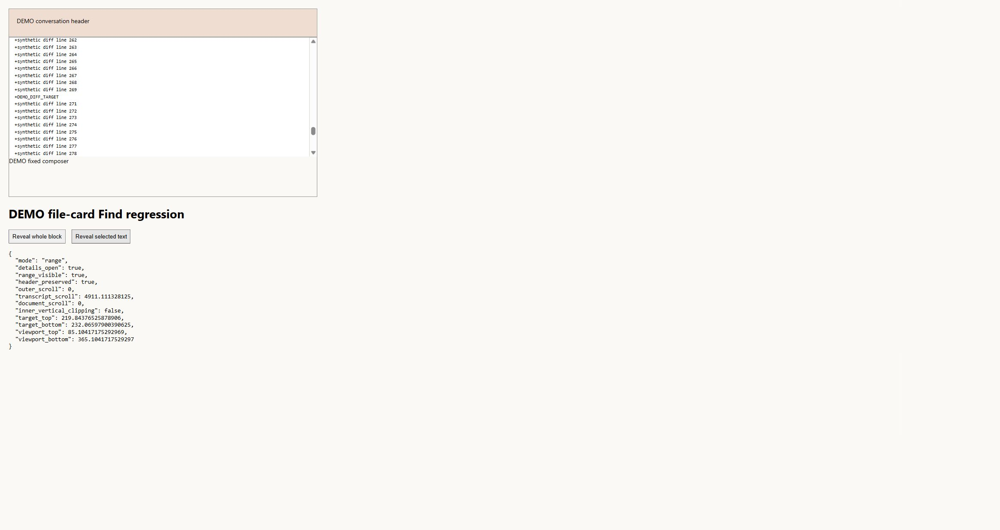

Executed with Rust 1.92 and Node 22.22.2 on Windows 11 Pro Education build 26300:

```text
cargo test -p vibemuxd --all-features --lib tool_records_ --locked --offline
cargo test -p vibemux_types -p vibemux_harness -p vibemuxd -p vibemux_desktop --all-features --lib --locked --offline
cargo build -p vibemuxd --all-features --bin vibemux_chat_fixture --locked --offline
cargo test -p vibemuxd --all-features --test persistent_chat_service native_ --locked --offline -- --test-threads=1
cargo clippy -p vibemux_types -p vibemux_harness -p vibemuxd -p vibemux_desktop --all-targets --all-features --locked --offline -- -D warnings
node --experimental-strip-types --test tests/*_test.ts
node node_modules/svelte-check/bin/svelte-check --tsconfig ./tsconfig.json
node node_modules/vite/bin/vite.js build --config vite_config.ts
cargo build -p vibemux_desktop --bin vibemux_desktop --locked --offline
cargo fmt --all -- --check
git diff --check
```

Related libraries passed 674: desktop 83, harness 234, types 49 and daemon 308,
with 36 explicit ignores. The three selected native service cases passed in
10.86 seconds, preserving the prior command and repeated-turn/resume scenarios
alongside the new file case. Its fixed modes cover ordinary mixed capture,
combined 65-item overflow and 17 long diffs retaining two entries with explicit
omission. Private reads remain at most 8 KiB, terminal replay appends no second
record, reopened bodies match exactly, and guarded file/HEAD bytes remain
unchanged. Reported moves/additions/deletions are never applied.

UI tests passed 289 with zero skips; Svelte reported zero errors and warnings.
Production assets and the final normal desktop binary built. Vite's app chunk
is 515.03 kB, 158.69 kB gzip, with its existing 500 kB warning. Four-package
all-target/all-feature Clippy passed with warnings denied. Independent bounded
backend and UI source reviews passed; reviewers ran no execution checks.

The command private codec is unchanged. The in-process observation is now
`ToolObservation` over Command/FileChange variants; the superseded command-only
module was removed only after comparison with its retained task-owned preimage.
No manifest, dependency or lockfile change was needed. Canonical documentation
was completed by Codex after the earlier OpenCode quota failure remained
terminal. Native VibeMux card interaction, live tool progress, installed
writable qualification, image/PDF input, Windows 10, Linux/WSL and full
workspace/release gates remain open. No installed vendor or model input was used.

## Native Surfaces QA preparation

On 2026-11-03, the closed developer QA CLI gained `prepare_surfaces`. Private
plan schema 2 carries the distinct Surfaces scenario; legacy schema 1 remains
History-only. History/CleanupReview retain their existing exact `native_links`
configuration. Surfaces pins `native_surfaces`, retains 8 Saved, 2 archived and
4 Workspace records, and starts no terminal plugin or cleanup sidecar.

The seed/check path reads actual authenticated Saved and Workspace private
content through the existing bounded collector and snapshot verifier. It
requires canonical turn/attempt grouping, one User/Assistant/Command/File record
per Codex group, complete correlated outcomes and exact private bodies.
Repeated vendor call IDs across turns remain separate. The fixed command
reports failure with exit 7. The file record reports ordered Update/Move, Add
and Delete entries, including a complete 300-line diff with the retained
`DEMO_SURFACE_FIND_TARGET` marker. Reported operations have no filesystem effect.

NativeQa startup now supplies a Rust-only fixed in-process `ProbeRunner` before
managed-state capture and window construction. The same factory is used by
non-GUI startup observations. Its bounded job returns all launcher,
authentication, inference, gateway and A2A checks as NotRun. It performs no
process, file, environment or network access. Completion, cancellation,
prior-result retention and shutdown are verified through the actual AppState
facade. Standard startup retains the ordinary runner; no renderer selector or
production privilege was added.

The CLI regression first failed because `prepare_surfaces` was unrecognized.
The initial focused run then passed 36 cases and failed a preflight assumption
that no sibling probe executable existed. That guard stopped before AppState
construction or Start, so no installed probe ran. The corrected test verifies
the concrete fixed runner before Start through a test-only TypeId helper, then
checks completion, cancellation and retained results. The existing sibling
helper was preserved. The focused run passed 37 cases with four explicit
ignores, including the integrated worker's nine source cases.

Executed with Rust 1.92 on Windows 11 Pro Education build 26300:

```text
cargo test -p vibemux_types -p vibemux_harness -p vibemuxd -p vibemux_desktop --all-features --lib --locked --offline
cargo test -p vibemuxd --all-features --bin vibemux_chat_fixture --locked --offline
cargo build -p vibemuxd -p vibemux_desktop --all-features --bin vibemux_chat_fixture --bin vibemux_registry_mock --bin vibemux_launch_trampoline --bin vibemux_desktop_qa --locked --offline
cargo test -p vibemux_types -p vibemux_harness -p vibemuxd -p vibemux_desktop --all-features --lib native_qa::tests:: --locked --offline -- --ignored --test-threads=1
cargo clippy -p vibemux_types -p vibemux_harness -p vibemuxd -p vibemux_desktop --all-targets --all-features --locked --offline -- -D warnings
cargo build -p vibemux_desktop --bin vibemux_desktop --locked --offline
cargo fmt --all -- --check
git diff --check
target/debug/vibemux_desktop_qa.exe prepare_surfaces --root <absolute fresh owned root>
target/debug/vibemux_desktop_qa.exe check --root <same absolute root>
```

The four related libraries passed 685: desktop 94, harness 234, types 49 and
daemon 308, with 37 explicit ignores. Two fixture binary cases passed. The four
explicitly selected native QA cases passed in 22.33 seconds: retained history,
cleanup review, failed/timed-out readiness and Surfaces prepare/reopen. They
exercise injected startup observations without opening a GUI. Clippy passed
with warnings denied; both desktop builds, formatting and whitespace checks
passed. The prior frontend evidence remains applicable because frontend source
and assets were unchanged. Independent source review found no P1/P2 issue.

After the current helper builds, a fresh namespace at
`target/native_surfaces_gui_qa` prepared and checked successfully. Its root ID
is `babf92af-e2ac-45f9-af10-76168f041531`. Both reports show the exact 8/2/4
baseline, no process claim, joined daemon shutdown, `fixture_only=true` and
`production_profile_qualified=false`. The run ID and GUI observations are null;
no GUI run has started. The task-owned image metadata receipt records the
current QA, chat fixture, trampoline and registry mock images. Rebuilding a
fixture requires renewed matching-image validation before reusing that root.

Build headroom was recovered from measured inactive generated cache only. An
exact private worker Cargo target clean removed 2,420 generated files reported
as 929.8 MiB. A separate plan selected five literal desktop incremental-cache
directories, totaling 13,433,803,422 logical bytes and 2,604 generated files.
The parent rechecked ordinary ancestors, file kinds/counts and compiler
idleness, held the existing Cargo lock exclusively, then removed those five
directories. Free space rose from 4,681,650,176 to 15,305,232,384 bytes; physical
recovery differs from logical size. Root binaries retained their recorded size
and write time. Sources, registered worktrees, QA data, executable/dependency
directories and prior evidence were preserved. The outer target was not cleaned.

Codex completed canonical documentation after the earlier OpenCode quota failure
remained terminal. No installed tool/model input or desktop control was used.
Native cards, long-diff Find, palette and Console interaction await a fresh
bounded desktop grant. Installed writable qualification, live tool progress,
image/PDF input, Windows 10, Linux/WSL and full workspace/release gates remain
open; the full desktop-parity goal remains active.

## Native Surfaces interaction and observed gaps

The user approved one 15-minute batch on the prepared Surfaces main window.
It launched at 2026-11-03T04:44:47.1072025Z with an input deadline of
04:59:47.1072025Z. Root `babf92af-e2ac-45f9-af10-76168f041531` acquired run
`385fec62-4083-4925-8291-9f66c17da8a5`. Only the named DEMO window was controlled.
No consent/settings change, Send, Workspace Start, Resume, removal, export,
clipboard action, browser link or installed-provider input was performed.

Ctrl+K opened the palette. Its Saved and Workspace results opened the exact
synthetic histories. Saved showed both reported failed command cards with exit
7 and both completed three-change file cards. Find selected the retained late
diff marker, reported 1 of 2 matches, opened the matching disclosure and kept
the app header visible. Searching the fixed command output also revealed its
retained text and duration. The default 1282 by 852 window left very little
transcript space because the consent panel and composer occupied fixed space;
this observation is a layout defect, not a full layout acceptance pass.

Workspace command and file disclosures expanded. The command showed its fixed
output, duration and owned worktree path. The file card showed the literal
update/move path and long diff; accessibility text also exposed the ordered
add/delete entries. Workspace Find remained disabled despite readable retained
records. Source tracing found explicit Workspace rejection in both the header
and common handler, plus missing Find props/component through the Workspace
wrapper. The Workspace detail currently scrolls the entire execution section;
its marked inner transcript does not have a bounded viewport. Those gaps need
repair and a separate retest.

Console Harnesses completed the first eight-second in-process mock check. The
UI displayed Local checks completed and last checked
`2026-11-03T04:50:09.000Z`, with launcher/authentication/model rows and gateway/A2A
marked Not checked. The second mock job exposed Cancel; cancellation requested
then Check status showed Local checks cancelled. The original completed report
and timestamp remained visible. This is native UI/lifecycle evidence for the
fixed mock, with no installed diagnostic or model qualification.

The Computer Use helper briefly returned stale bounds after maximize and one
input was refused over a non-target window. The parent refreshed/raised only
the QA binding before continuing. One attempted outward resize was refused by
the helper's coordinate bounds. Offscreen accessibility clicks also had stale
geometry after scrolling; refreshed screenshot-backed coordinates completed
the visible disclosure actions. No alternate input helper was used.

Normal window close returned runner exit 0 before the input deadline. The
matching outcome is gui_exited with Ready and event-loop return observed,
daemon and monitor joined, zero unresolved Asks and no error. The subsequent
window inventory contained no DEMO window. The root remains fixture-only and
production qualification false. This batch is complete and its desktop grant
is spent.

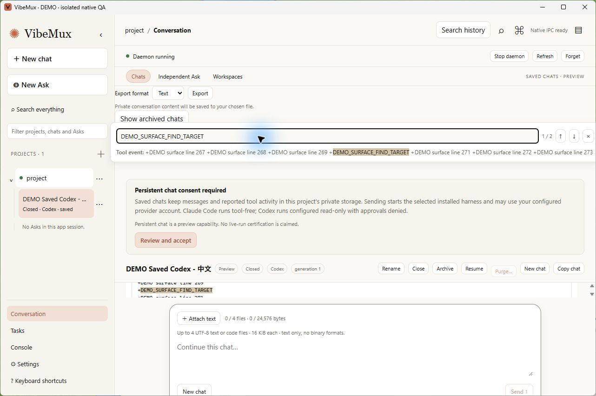

The raw native Workspace-command screenshot is retained locally because its
working-directory field contains a machine-specific checkout path. The public
record keeps the observation and validation results above.

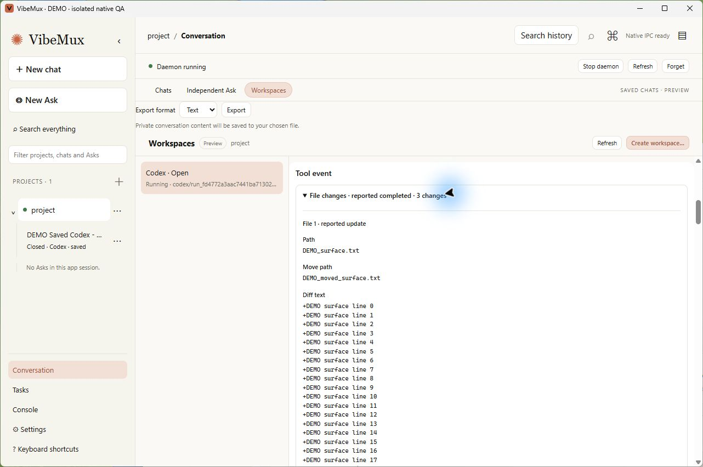

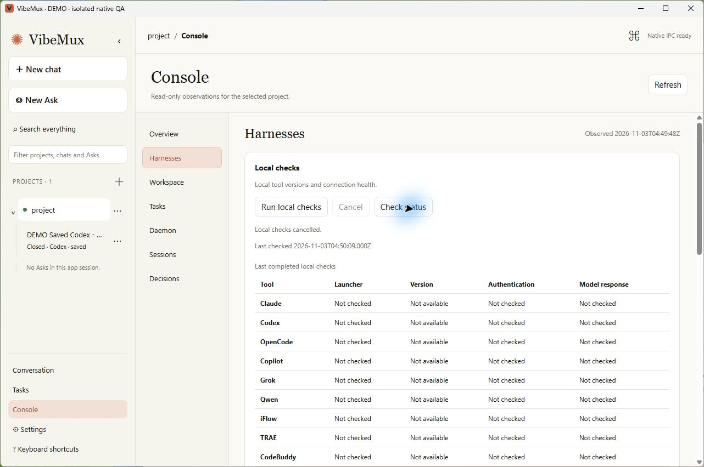

## Retained Find and history layout repair

The native gaps above were reproduced with actual `PersistentChat` and
`WorkspaceChats → WorkspaceExecution`, production styles, real ToolRecord/Find
components and the export controls. The fixture runs only in Vite fixture mode,
uses fixed synthetic closed sessions and has no backend mutation capability.
Its header is synthetic; App's header/shortcut/palette wiring has shared-selector
unit coverage and source review, with repaired native interaction still pending.

At CSS 1280×850, Saved's unaccepted-consent/Find layout produced a padding-only
32px transcript. Workspace mounted no Find input. The original reports remain
separate from later success. The parent repaired the existing UI chain:

- `selected_transcript_target` checks current registration/chat/session and purge
  state for Saved/Workspace. Header, shortcut and palette use it. Closed or
  finalized Workspace history requires no live process. Workspace selection
  closes Find; keyed teardown handles target replacement and old highlights.
- The bounded Workspace transcript now contains its owner header, keyed
  Task/Run access and metadata. A context-only fallback retains its own scroller.
  Existing action disable predicates and consent dialogs are preserved.
- Saved consent copy moved into its transcript. Closed/archived Saved and
  inactive Workspace drafts sit behind Draft message, preserving controller
  text/files. Context entry initializes expansion from retained input; subsequent
  editing uses the user's expansion state. Active/new composers keep their flow.
- Saved/Workspace Find bars fit their parent width and reserve compact fixed
  space; the preview uses an ellipsis. Literal tool content keeps its complete
  transcript-owned vertical scrolling. The reveal helper was unchanged.

The source reviewer found a residual palette-only Workspace exclusion and an
initial live-derived disclosure `open` prop. The latter was reproduced in both
components: clearing text or removing the last attachment closed an editor that
the user had opened. All four observations were false before correction and
true after context-bound user state replaced the live-derived prop. Both P2
findings were closed; the final bounded source review found no residual P1/P2.

The initial 900×600 check exposed another real size failure, with usable Saved
and Workspace heights of 88/73px. After the scoped Find-bar correction, final
results were:

| CSS viewport | Saved usable transcript | Workspace usable transcript |
|---|---:|---:|
| 1280×850 | 408px | 440px |
| 900×600 | 126px | 129px |

Usable height excludes transcript padding. Every final surface check found the
unique line-270 marker through the real Find input, opened the matching file
disclosure, kept the selected range inside the viewport, preserved the app
header, left page/all outer scrolling at zero, and made zero mutation callbacks.
The other surface's marker was absent. Local synthetic drafts survived switching
between surfaces; Find inputs were gone on return. Browser sizing accounted for
the existing Chrome zoom to reach the measured CSS sizes without changing that
setting. Its temporary viewport was reset and the created tab closed.

Executed with Node 22.22.2, Svelte 5.57.2 and Rust 1.92 on Windows 11 build 26300:

```text
node --experimental-strip-types --test tests/*_test.ts
node node_modules/svelte-check/bin/svelte-check --tsconfig ./tsconfig.json
node node_modules/vite/bin/vite.js build --config vite_config.ts
cargo build -p vibemux_desktop --bin vibemux_desktop --locked --offline
cargo build -p vibemux_desktop --all-features --bin vibemux_desktop_qa --locked --offline
target/debug/vibemux_desktop_qa.exe prepare_surfaces --root <fresh repaired absolute root>
target/debug/vibemux_desktop_qa.exe check --root <same repaired absolute root>
```

All 291 frontend tests passed with zero skips, including two new selection-gate
cases. Typecheck reported zero errors/warnings. Vite built a 517.59 kB app chunk,
160.08 kB gzip, retaining the 500 kB warning. Both desktop builds exited 0 with
incremental hard-link/copy-fallback warnings. Rust runtime source was unchanged
by this UI repair; the preceding 685-library/four-native-QA/two-fixture results
retain that scope and were not rerun as new UI evidence.

The preview owner's first launch failed before serving because a file URL's
pathname was used as a Windows path. The parent used `fileURLToPath`, retained
the failed log, and launched a fresh owner only after the first was terminal.
The successful loopback fixture owner later closed/joined with exit 0. Its
temporary helper and stop marker were removed after shutdown. No proxy,
firewall, provider, profile or global setting changed.

The newly built QA image prepared and checked `target/native_surfaces_repaired_gui_qa`,
root `d0b33cbc-e5cf-42e9-a46e-a54953bf3e31`: exact 8 Saved/2 archived/4 Workspace,
no process claim, daemon joined, fixture-only true, qualification false and null
run/GUI observations at preparation. The prior approved
batch remains spent; native retest requires a fresh named bounded grant.
Canonical docs were completed by Codex after the earlier OpenCode quota failure
remained terminal. The full desktop-parity goal remains active.

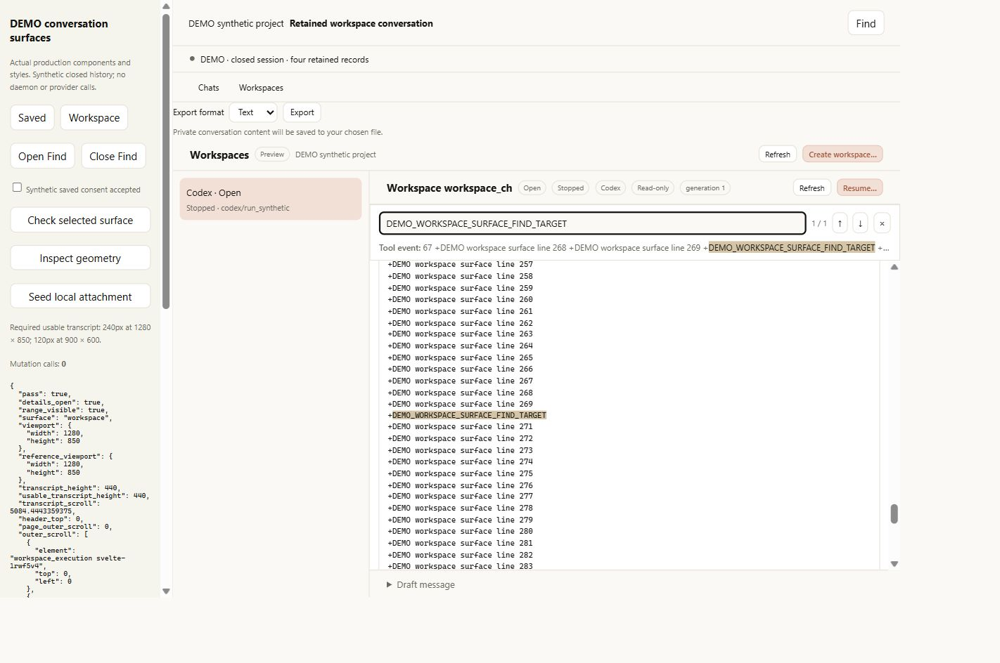

### Repaired native attempt stopped by the user

The user approved a new ten-minute repaired-history batch. It launched at
2026-11-03T05:16:15.9255014Z with deadline05:26:15.9255014Z, acquiring run
`d52592dc-bbd3-47b8-8c2c-bfe9f26f2130` in the repaired namespace above. The first
Computer Use window-inventory call was stopped by the user's physical Escape.
No repaired window was bound or controlled, and no scenario interaction was
performed. The parent stopped desktop input and issued only the exact root/run
nonce Stop through the existing CLI.

Stop requested successfully; the owned runner returned exit0. Its matching
outcome is gui_exited, Ready/event-loop return observed, daemon/monitor joined,
zero unresolved Asks and no error. This verifies owned shutdown after interruption,
not repaired native Find/layout/draft acceptance. The namespace is now used and
its desktop grant spent. Another desktop attempt requires a fresh namespace
and renewed user direction; it does not restart automatically.

## Live assistant handoff repair

This non-desktop continuation addressed an observed source defect in
`WorkspaceExecutionState.read_history`: any complete record for the live
attempt cleared the assistant snapshot. A completed command/file Tool could
therefore erase a good stream before the assistant finished. When the next
private Live read failed, the UI's promise to retain its last observation was
violated. Saved had the complementary issue: a successfully loaded assistant
never retired its matching tail, so a failed subsequent Live read could leave
both visible. Both readers could also restore a stale successful same-ID Live
snapshot after a history handoff.

The fix is confined to the two renderer controllers. History hands over only
for `kind=assistant`, a complete error-free private body and the matching
canonical turn/attempt ID. Each Live reader keeps its existing scope, request,
generation, revision and cursor checks, then consults the existing bounded
records list before assigning a snapshot. A successful loaded assistant for
that ID suppresses the stale duplicate. No cache, API, retry, permission, wire
field, persistence write or canonical outcome was added.

The regressions use each controller's public interface and fake read backend;
they call no daemon or provider. All cases keep status Busy and the same active
request, preventing a metadata transition from masking history behavior. Each
captures every publication after its record arrives. Per controller, the matrix
covers four ordinary non-assistant kinds, partial read failure, unavailable
assistant content, another canonical ID, matching assistant with failed Live,
and matching assistant with successful stale Live. Successful handoff traverses
two UTF-8 chunks: the first retains the good tail and only the complete body
replaces it. All requests are asserted read-only and consent calls remain zero.

The initial 18-case run passed 10 and failed 8. Strengthening the success cases
to isolate UTF-8 partial/final publication retained the same failure matrix.
After repair all 18 passed. Original Saved tests and the prior Workspace
UTF-8/revision test were retained unchanged. The latter's finished-state branch
clears the active request before history, so it was not evidence for this new
predicate by itself.

The reviewer checked the exact purge variant against current store rules:
supported Workspace purge is rejected for execution-owned chats; legacy purge
requires Archived state without a fence or active request. Saved's error-body
retention was already its behavior. Existing observed session-purge and
generation/request reset paths were preserved. No additional purge behavior was
introduced. Independent bounded source/test review found no remaining P1/P2;
the reviewer ran no execution checks.

Executed with Node 22.22.2, Svelte 5.57.2 and Rust 1.92 on Windows 11 build 26300:

```text
node --experimental-strip-types --test --test-name-pattern='live assistant handoff' tests/chat_state_test.ts tests/workspace_execution_state_test.ts
node --experimental-strip-types --test tests/*_test.ts
node node_modules/svelte-check/bin/svelte-check --tsconfig ./tsconfig.json
node node_modules/vite/bin/vite.js build --config vite_config.ts
cargo build -p vibemux_desktop --bin vibemux_desktop --locked --offline
```

The focused matrix passed 18 with no skips, the full frontend suite passed 309
with no skips, and typecheck reported zero errors/warnings. Vite built a
518.01 kB app chunk, 160.18 kB gzip, retaining the 500 kB warning. The normal
desktop build exited 0 in 12.57 seconds with incremental hard-link/copy-fallback
warnings. Runtime Rust and the private/wire schemas were unchanged; earlier
Rust suites remain their own scope, not fresh execution for this UI change.

All four owned source/test files were untracked goal work. The parent preserved
their exact preimages and consumed them in a 209-line scoped comparison; no
unrelated file or old test was replaced. Canonical docs were updated by Codex
after the earlier Local CLI failures remained terminal. No desktop, browser,
native app, installed harness or model input was used. No desktop grant was
renewed and no QA namespace was launched. The earlier user-interrupted retest
remains unexecuted. Live tool-progress capture, image/PDF input, installed
writable qualification and full platform/release acceptance remain open.
