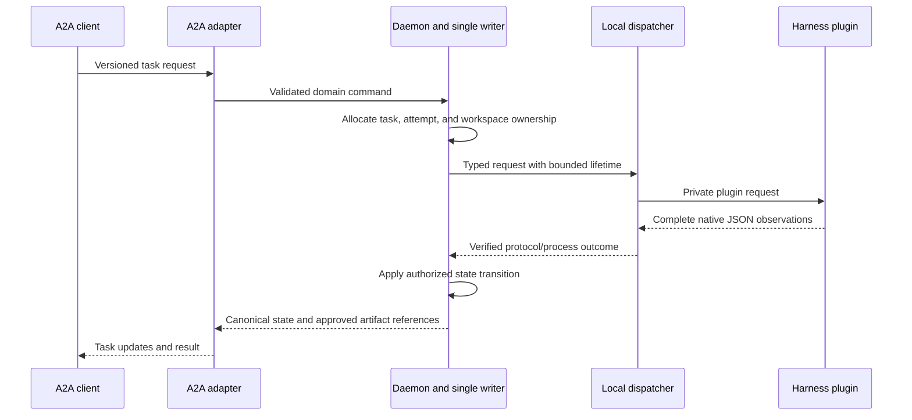

# A2A Implementation and Learning Path

## Recommended Next Slice

Keep Rust as the core and implement one **loopback A2A task through the existing
single writer and the new harness dispatcher**. Use the synthetic harness first.
Do not begin with remote autonomous delegation, automatic retries, or a second
shared database.

The existing `vibemux_a2a` information-share server is useful transport evidence.
It does not yet own executable tasks, attempt recovery, approval continuations,
or durable result streaming. The new harness crate supplies bounded local I/O,
but does not fill those domain gaps by itself.

## Four Boundaries to Understand

**Model versus harness.** A model generates content. A harness owns a session,
tools, permission behavior, and its provider configuration. VibeMux routes a
request to a harness; it does not implement a model runtime or recover a hidden
provider request from terminal text.

**ACP versus A2A.** ACP controls a local agent session from a client. A2A exposes
agent capabilities and task/message exchange between agents. Neither replaces
OS process ownership. Codex app-server and Claude stream-json are additional
local integration contracts, not ACP messages with renamed fields.

**Observation versus authority.** A text delta or successful vendor turn is an
observation. It does not authorize shell execution, approve a tool, prove a code
change correct, complete a canonical task, or permit a Git push. Those decisions
belong to explicit policy and the state owner.

**Duplicate suppression versus recovery.** The current dispatcher's UUID set and
workspace lease apply to one process. A request can be duplicated after restart
or in another process. A durable attempt record and owner fencing must exist
before an A2A retry is allowed to cause work.

## Version Contracts Before Implementation

The current official A2A specification uses major/minor protocol versions such
as `1.0`, explicit version negotiation, and wrapper-based parts. This differs
from older `kind`-discriminated examples. Pin a supported wire version and
fixture before writing the gateway; do not infer protocol compatibility from
Cargo package version numbers. Unsupported versions must fail explicitly.
[A2A versioning and migration specification](https://a2a-protocol.org/latest/specification/)

The existing repository already pins `A2A_SPEC_VERSION` to `1.0` and tests it
against the selected SDK. Reuse that boundary; the next task is domain binding,
not an unrequested library or protocol upgrade.

Keep these independent: A2A protocol version, ACP integer `protocolVersion`,
VibeMux plugin Protobuf version, and VibeMux request JSON `schema_version`.
An upgrade in one does not imply an upgrade in the others. Use the installed
SDK's types at the adapter boundary and repository-owned domain types inside.

## Implementation Steps

### 1. Establish the Daemon Binding

Make `vibemuxd` the sole owner of executable task state, attempt allocation,
request history, workspace ownership, and dispatcher lifetime. Add a narrow
versioned local control command rather than exposing arbitrary vendor methods.
The A2A module must submit that command; it must not write SQLite directly.

Define explicit mappings for `task_id`, `attempt_id`, `request_id`, and the
vendor session/turn IDs. Vendor IDs remain scoped to the owning adapter session.
Persist only the metadata needed to reconcile an attempt, not raw vendor text
or configuration. Use the existing writer worker for atomic admission and
state/event updates.

Acceptance: one loopback request produces exactly one admitted attempt and a
traceable event sequence. A second request cannot acquire the same writable
workspace. No database migration happens implicitly.

### 2. Add Streaming and Cancellation

Translate canonical state changes and approved artifacts into the selected A2A
send/stream/cancel operations. Keep a bounded subscriber queue and explicit
slow-consumer behavior. A reconnect cursor belongs to a durable event stream;
the current in-memory `Record.sequence` is not a cross-restart cursor.

A cancel request first targets the exact active attempt. Continue consuming
tail events until the native protocol confirms cancellation or the grace bound
expires. Return whether cancellation was confirmed, forced, or still uncertain.
Do not fabricate `cancelled` from a disconnected HTTP client.

Acceptance: inject cancellation between two chunks and prove that the final
chunk is neither lost nor attributed to a different attempt. Closing one
subscriber must not cancel another user's task without policy authorization.

### 3. Implement Approval Continuations

Current native client capabilities deny tool approval. Preserve that default.
A future interactive approval flow needs a pending, immutable request tied to
the task, attempt, tool, requested scope, expiration, and owner generation.
An A2A input-required exchange may transport a user's answer; the answer is
still validated by the local policy owner before a native decision is sent.

Acceptance: stale, duplicate, cross-task, and broadened approvals are rejected.
An agent cannot grant itself permissions by emitting an approval-shaped event.
Do not add a generic "allow all" switch as the first implementation.

### 4. Add Restart-Safe Admission

Choose an idempotency key that includes request identity and a payload digest.
Atomically store its admitted attempt with a writer-owned generation or fencing
token. An identical request can return the existing task; a different payload
under the same key is a conflict.

Record `unknown` when a crash leaves insufficient evidence. Automatic retry
of filesystem or network effects is unsafe until the previous attempt is known
to have stopped or its effects are explicitly reconciled. A retry budget is
not an ownership mechanism.

Acceptance: crash after admission, after native launch, and after completion
but before acknowledgement. Each recovery must either resume the same known
state or refuse another execution. Never use a process-name search to kill an
unidentified workload.

### 5. Graduate Native Integrations Individually

Codex is the first candidate for a complete live roundtrip because its
app-server carries correlated turns, streamed events, and explicit approvals.
Claude follows through its control stream. ACP provides a reusable path for
OpenCode, Copilot, and Grok, but launcher versions and lifecycle behavior must
be qualified separately. Resolve Grok's observed shutdown behavior before
calling that live route ready.

Ask for separate authorization before real model generation, account usage,
network exposure, or tool execution. Keep these separate qualification levels:
installed launcher, clean initialization, model roundtrip, permitted tool action,
canonical task binding, and remote A2A interoperability.

Only after the loopback task contract is stable should the gateway add remote
authentication, per-peer authorization, TLS, replay defense, public Agent Card
allowlists, and destination controls. Do not publish topology, raw prompts,
credentials, internal paths, stderr, or provider configuration in the card.

## Practical Learning Exercises

1. Read `contract.rs` and `normalize.rs`. Explain why an OpenCode step ending,
   a nested Claude result, and an ACP cancellation request do not all mean that
   the root task completed.
2. Replay a synthetic fixture using the CLI. Add an unknown field to a local
   copy and verify it remains in `raw_json` while the public summary is unchanged.
3. Run the process tests. Explain the difference between a clean EOF without
   a terminal record, a vendor refusal, and a forced timeout cleanup.
4. Add the loopback mock A2A task binding. Draw which component may mutate each
   piece of state before writing the adapter. Give every writable resource one
   owner and every externally visible outcome an evidence source.
5. Design the crash-after-admission test before implementing retries. Demonstrate
   what prevents a second attempt from repeating an unobserved side effect.

These are implementation exercises, not recurring jobs or deployment requests.
For local commands and current verification gaps, see the
[harness core guide](harness_core_guide.md).
