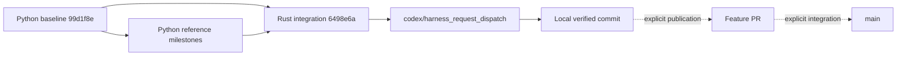

# Branch and Worktree Workflow

## Current Lineage

The Rust integration baseline is `6498e6a`. All existing `rust_*`, `daemon_*`,
`plugin_*`, `a2a_basic_share`, `probe_unified_frontend`, and `integration_core`
milestone refs are reachable from that baseline. They do not require another
merge to build the current feature.



The current roles are:

- `main`: integration branch. The local primary checkout remains at the Python
  baseline until a separate approved fast-forward/integration action.
- `codex/harness_request_dispatch`: active, local delivery branch containing
  the structured harness core and common CLI/UI.
- `python_source_reference` and `python_reference_p0`: frozen migration and
  behavior references; no new orchestration features.
- Existing Rust/daemon/plugin feature names: retained milestone refs. Reachable
  does not mean safe to delete, deployed, or fully qualified.
- Future development: `codex/<topic_name>` with a concise snake_case topic.
  Prefer one cohesive change per branch and one owner per write scope.

The active branch intentionally has no remote upstream before publication.
`origin/main` is its comparison baseline, not its push destination. When
publication is explicitly approved, the feature should track a same-name
remote branch; do not configure a topic branch to track `origin/main`.

## Physical Layout

```text
<repo>/                                      primary checkout
<repo>/.vibemux/worktrees/harness_request_dispatch/
                                             existing active development checkout
<repo>/.vibemux/developer_worktrees/<topic_name>/
                                             future isolated development/review checkouts
<repo>/.vibemux/worktrees/<run_id>/            runtime-owned run worktrees
<repo>/.vibemux/workspace_backups/              private source safety copies
<repo>/target/                               ignored build output
```

The existing development location is retained so private configuration and
compiled paths do not break. It is not a runtime Run and must not be inferred
to belong to an agent cleanup operation. Unknown resources remain untouched.

Parallel agents use separate worktrees. A read-only reviewer uses a dedicated
review context and immutable source/diff inputs; the main implementation
worktree has one writer. Temporary review resources are removed only after
their branch, base, ownership, and clean status are checked.

## Inspect Before Changing Git State

```powershell
git status --short --branch
git worktree list --porcelain
git log --graph --decorate --oneline --all
.\target\debug\vibemuxctl.exe --format text workspace status
```

The CLI only reads local refs. Its `integrated` flag means ancestry relative to
the recorded baseline. It does not query a remote or grant cleanup permission.
Use a separate read-only remote ref query when current synchronization matters.

The public `origin/main` and secondary `linux/main` differed in the
[2026-08-27 branch inventory](../reports/branch_inventory_20260827.md). A fresh
2026-08-28 query confirmed `origin/main` at `6498e6a`; the secondary query failed,
so its current SHA and synchronization state are unknown. The historical SHA
is not current proof. Private addresses and SSH configuration are omitted.
Publication to one remote does not prove synchronization of another.

## Commit and Publication Boundaries

Before a local commit, run the relevant tests, formatting, privacy scan, and
`git diff --cached --check`. Review the exact staged file list; do not stage
runtime directories, logs, private config, caches, databases, or virtualenvs.
Use a public no-reply author address when privacy requires it, without changing
global Git identity settings.

A local commit, remote push, PR, merge, deployment, and release are distinct
actions. None implies the next. Do not automatically stash, reset, clean,
merge, force-push, or delete historical branches to simplify the graph.

Source safety archives are ignored local artifacts, not a substitute for Git
history. Do not commit them or copy another project's runtime database.
